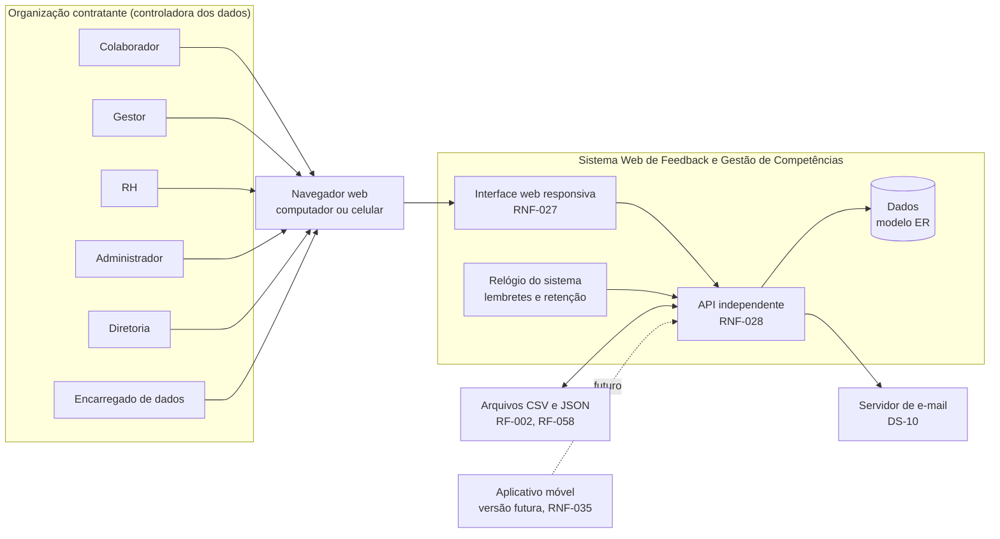

# Especificação de Requisitos de Software

**Projeto:** Sistema Web de Feedback e Gestão de Competências
**Disciplina:** Domínios de Software (INF0296, 2026/2) · 1ª Etapa: Levantamento de Requisitos
**Issue:** #54 · **Versão:** 1.0 · **Data:** 17/11/2026
**Responsáveis:** Júlia de Souza Nascimento e Verônica Ribeiro Oliveira Palmeira
**Padrão:** IEEE Std 830-1998, *Recommended Practice for Software Requirements Specifications*
**Base:** [Lista Geral de Requisitos](Lista_Geral_Requisitos.md) (#45), versão 1.0, e [Documento Visão](Documento_Visao.md) (#46), versão 1.0

## Histórico de revisões

| Versão | Data | Autoras | Descrição |
|---|---|---|---|
| 1.0 | 17/11/2026 | Júlia de Souza Nascimento e Verônica Ribeiro Oliveira Palmeira | Primeira versão, consolidando a lista geral, o Documento Visão, os casos de uso, a especificação suplementar, o modelo ER e o dicionário de dados |

---

## Sumário

1. [Introdução](#1-introdução)
   - 1.1 [Propósito](#11-propósito) · 1.2 [Escopo](#12-escopo) · 1.3 [Definições, acrônimos e abreviações](#13-definições-acrônimos-e-abreviações) · 1.4 [Referências](#14-referências) · 1.5 [Visão geral do documento](#15-visão-geral-do-documento)
2. [Descrição geral](#2-descrição-geral)
   - 2.1 [Perspectiva do produto](#21-perspectiva-do-produto) · 2.2 [Funções do produto](#22-funções-do-produto) · 2.3 [Características dos usuários](#23-características-dos-usuários) · 2.4 [Restrições](#24-restrições) · 2.5 [Suposições e dependências](#25-suposições-e-dependências) · 2.6 [Distribuição dos requisitos entre versões](#26-distribuição-dos-requisitos-entre-versões)
3. [Requisitos específicos](#3-requisitos-específicos)
   - 3.1 [Interfaces externas](#31-interfaces-externas) · 3.2 [Requisitos funcionais](#32-requisitos-funcionais) · 3.3 [Requisitos de desempenho](#33-requisitos-de-desempenho) · 3.4 [Requisitos lógicos de dados](#34-requisitos-lógicos-de-dados) · 3.5 [Restrições de projeto](#35-restrições-de-projeto) · 3.6 [Atributos do sistema de software](#36-atributos-do-sistema-de-software) · 3.7 [Regras de negócio](#37-regras-de-negócio)
4. [Apêndices](#4-apêndices)
   - A. [Necessidades, dores e escopo atendidos](#apêndice-a--necessidades-dores-e-escopo-atendidos) · B. [Verificação de consistência](#apêndice-b--verificação-de-consistência) · C. [Decisões desta especificação](#apêndice-c--decisões-desta-especificação) · D. [Fora do escopo](#apêndice-d--fora-do-escopo) · E. [Artefatos do projeto](#apêndice-e--artefatos-do-projeto)

---

## 1. Introdução

### 1.1 Propósito

Este documento especifica, de forma completa e verificável, os requisitos do **Sistema Web de Feedback e Gestão de Competências**. Ele é o artefato final da etapa de especificação do [processo de requisitos](Processo_Requisitos.md) (seção 2.3) e reúne em um só lugar o que os outros artefatos detalham por partes: as funções, as qualidades, as interfaces, os dados, as restrições e as regras de negócio.

O documento se destina a:

| Leitor | Uso |
|---|---|
| Product Owner e professora da disciplina | Conferir se o sistema especificado atende ao enunciado e ao processo descrito nas entrevistas |
| Equipe de projeto e desenvolvimento | Base para a arquitetura, o projeto de dados, a implementação e a estimativa |
| Equipe de testes | Base para os casos de teste e para os critérios de aceitação |
| Organização contratante e encarregado de dados | Conferir as obrigações da LGPD e de acessibilidade que o sistema apoia |

### 1.2 Escopo

**Produto.** Sistema Web de Feedback e Gestão de Competências, uma aplicação web usada por uma única organização em cada instalação (RNF-030, RN-010).

**O que o sistema faz.** Cobre o ciclo completo do feedback dentro de uma organização: registrar fatos e feedbacks formais, informais, positivos e construtivos; coletar avaliações de gestor, pares, equipe, avaliação ascendente, autoavaliação e 360°; proteger a identidade de quem avalia; acompanhar planos de ação e metas de desenvolvimento; guardar o histórico; e analisar os resultados com números, tendências e gráficos (Documento Visão, seção 1.2).

**O que o sistema não faz.** Não é canal de denúncia (RN-009), não decide promoção, salário ou desligamento (RN-007) e não inclui, nesta versão, aplicativo móvel nativo nem integração com sistemas externos (RF-004, RNF-025, RNF-035). A lista completa está no [Apêndice D](#apêndice-d--fora-do-escopo).

**Objetivos e benefícios.** Os objetivos do produto estão no Documento Visão (seção 4.1):

1. Fazer com que o feedback aconteça e fique registrado, e não dependa da memória nem do tempo do gestor.
2. Basear todo feedback em fatos e comportamentos observados, e não em opinião (RN-001).
3. Permitir saber se uma pessoa melhorou depois de um feedback, por meio de plano de ação com prazo e acompanhamento.
4. Proteger quem avalia, para que as pessoas sejam sinceras, sem expor a identidade do emissor por descuido ou por exclusão (RN-004, RN-005).
5. Dar ao colaborador, ao gestor e ao RH uma visão da evolução por competência, com números e gráficos.
6. Servir como apoio ao desenvolvimento das pessoas, e não como instrumento de punição (RN-007, RN-008).
7. Estar em conformidade com a LGPD e com as normas de acessibilidade desde a primeira versão.

O [Apêndice A](#apêndice-a--necessidades-dores-e-escopo-atendidos) mostra quais requisitos atendem a cada necessidade, a cada dor do processo atual e a cada item do enunciado.

### 1.3 Definições, acrônimos e abreviações

#### 1.3.1 Definições

As definições abaixo são as do [Dicionário de Dados e Glossário](Dicionario_de_Dados.md) (seção 2), transcritas sem alteração. O glossário é a referência completa, com sinônimos, termos a evitar e a ligação com o modelo ER. Os ajustes de uso de termos adotados nesta especificação estão na decisão [ERS-D09](#apêndice-c--decisões-desta-especificação).

| Termo | Definição |
|---|---|
| **Anonimização** | Tratamento que impede associar um dado ao titular por meios técnicos razoáveis. O dado anonimizado deixa de ser dado pessoal (LGPD, art. 5º, III e XI, e art. 12) |
| **Anônimo (modo)** | Modo de identificação em que ninguém, nem RH nem administrador, consegue ligar a resposta ao emissor |
| **Avaliado** | Colaborador que é objeto de avaliação em um ciclo, individualmente ou como membro de uma equipe |
| **Avaliador convidado** | Papel de quem é convidado a responder uma avaliação de um ciclo: par, membro da equipe, liderado na avaliação ascendente ou o próprio avaliado na autoavaliação. É um papel, não um perfil |
| **Avaliação** | Julgamento do desempenho feito com parâmetros definidos antes, em geral por questionário dentro de um ciclo. O feedback é a comunicação desse julgamento (E01 §14) |
| **Avaliação 360°** | Modalidade em que o gestor abre o ciclo e convida membros do próprio time, e todos avaliam todos |
| **Avaliação ascendente** | Modalidade em que o colaborador avalia o seu gestor. O modo padrão é confidencial, e o ciclo pode ser configurado como anônimo |
| **Avaliação de equipe** | Modalidade em que todos os membros da equipe avaliam todos |
| **Check-in** | Encontro de verificação entre gestor e colaborador. No ciclo formal, registra os valores observados dos indicadores. No check-in periódico, acompanha metas e planos em andamento |
| **Ciclo de avaliação** | Período planejado de feedback formal, com avaliados, objetivos, competências, modalidades, questionários, participantes e datas dos check-ins |
| **Colaborador** | Pessoa da organização cadastrada no sistema. É também o perfil básico de todo usuário e o ator principal dos casos de uso |
| **Competência** | Conjunto de comportamentos observáveis esperado pela organização. Pode ser fixa (do cargo) ou específica (atribuída pelo gestor a um colaborador ou grupo) |
| **Confidencial (modo)** | Modo de identificação em que a identidade do emissor fica oculta para o receptor e guardada à parte. Só o RH consulta, com registro na trilha de auditoria, e nunca nas avaliações em que ele próprio é o avaliado. É o modo padrão entre pares, na equipe e na avaliação ascendente |
| **Emissor** | Quem dá o feedback ou responde a uma avaliação. A identidade dele segue o modo de identificação |
| **Encarregado** | Pessoa indicada pelo controlador para ser o canal de comunicação com os titulares e com a ANPD (LGPD, art. 5º, VIII, e art. 41). A identidade e o contato dele ficam no aviso de privacidade |
| **Fato** | Comportamento ou resultado observado, com data e descrição, que fundamenta um feedback. Até ser vinculado a um feedback, é visível só para quem o registrou |
| **Feedback** | Comunicação ao receptor sobre um comportamento ou resultado observado, baseada em fatos. Tem tipo (positivo ou construtivo) e é formal ou informal. Não pode ser excluído; cada edição gera uma versão |
| **Feedback construtivo** | Feedback que aponta um comportamento ou resultado a corrigir. Estrutura: aspecto positivo, fatos, problema, repercussão, reflexão e plano de ação |
| **Feedback formal** | Feedback planejado dentro de um ciclo, com objetivos, indicadores e check-ins |
| **Feedback informal** | Feedback dado a qualquer momento, sem planejamento, inclusive para colaborador de outra área |
| **Feedback positivo** | Feedback que reconhece uma ação ou comportamento com bons resultados. Estrutura: ação ou comportamento, resultados e repercussão para o gestor, o time e a organização |
| **Gestor** | Perfil de quem tem uma equipe sob sua responsabilidade. Planeja ciclos, atribui competências específicas e configura check-ins. Também é avaliado, por isso acumula o perfil colaborador |
| **Identificado (modo)** | Modo de identificação em que o receptor vê quem emitiu. É obrigatório no feedback do gestor para o colaborador |
| **Indicador** | Medida que permite verificar se um objetivo do ciclo ou uma meta foi atingido, com fonte de evidência e valor esperado |
| **Meta de desenvolvimento** | Resultado que o colaborador ou a equipe deve alcançar em um prazo, com competência, indicador e valor esperado. Definida em conjunto pelo colaborador e pelo gestor |
| **Modalidade** | Quem avalia quem: gestor → colaborador, ascendente, pares, equipe, autoavaliação ou 360° (lista geral, seção 2.4) |
| **Modo de identificação** | Como a identidade do emissor é tratada: identificado, confidencial ou anônimo. Configurado pelo RH ou pelo administrador, por ciclo e por modalidade |
| **Mínimo de respondentes** | Número mínimo de respostas de uma fonte confidencial ou anônima para que o resultado seja exibido. Padrão: 3 |
| **Plano de ação** | Conjunto de ações, responsáveis, metas, pontos de monitoramento e data final, criado a partir de um feedback construtivo, em conjunto pelo emissor e pelo receptor. Na data final, registra se houve melhora ou se é preciso novo feedback |
| **Ponto de monitoramento** | Data prevista do plano de ação em que se registra o resultado das ações |
| **Pseudonimização** | Tratamento após o qual o dado só pode ser associado ao titular com uma informação adicional guardada à parte (LGPD, art. 13, §4º). Continua sendo dado pessoal |
| **Receptor** | Quem recebe o feedback: um colaborador ou uma equipe |
| **Relato** | Fato registrado pelo gestor a partir do que outro colaborador contou. Quem relatou fica oculto ao receptor. Só embasa um feedback depois de confirmado pela observação do próprio gestor |
| **Resultado consolidado** | Valor calculado ao encerrar o ciclo para cada avaliado, por competência, indicador e modalidade. Fica guardado e não muda depois de liberado (decisão M-08 do ER) |
| **Réplica** | Manifestação do receptor sobre um feedback recebido, sem alterar o texto do emissor |
| **Sessão de feedback** | Encontro agendado entre emissor, receptor e outros participantes para conversar sobre um feedback. O sistema agenda e registra, mas não conduz a conversa |
| **Solicitação de titular** | Pedido do titular para exercer um direito da LGPD, acompanhado em fila com prazo e responsável |
| **Titular** | Pessoa natural a quem se referem os dados (LGPD, art. 5º, V). Aqui, colaboradores, gestores e demais avaliados ou avaliadores |
| **Trilha de auditoria** | Registro inalterável dos acessos e das alterações a dados pessoais e feedbacks: quem, quando, o quê e de onde. Inclui toda consulta à identidade de emissor confidencial |

#### 1.3.2 Acrônimos e abreviações

| Sigla | Significado |
|---|---|
| ABNT | Associação Brasileira de Normas Técnicas |
| ANPD | Autoridade Nacional de Proteção de Dados |
| API | *Application Programming Interface*, interface de programação de aplicações |
| AS-IS | Processo atual, modelado em BPMN antes do sistema |
| BPMN | *Business Process Model and Notation* |
| CSV | *Comma-Separated Values*, arquivo de texto com valores separados por vírgula (RFC 4180) |
| DPO | *Data Protection Officer*, o encarregado de dados |
| DS-xx | Decisão da [Especificação Suplementar](Especificacao_Suplementar.md) (seção 15) |
| E01, E02 | Entrevista 01 (PO) e Entrevista 02 (Secretaria Municipal de Educação) |
| ER | Modelo entidade-relacionamento |
| ERS | Especificação de Requisitos de Software (em inglês, SRS) |
| ERS-Dxx | Decisão desta especificação ([Apêndice C](#apêndice-c--decisões-desta-especificação)) |
| ES | [Especificação Suplementar](Especificacao_Suplementar.md) |
| JSON | *JavaScript Object Notation* (RFC 8259) |
| LGPD | Lei Geral de Proteção de Dados Pessoais, Lei nº 13.709/2018 |
| M-xx | Decisão de modelagem do [modelo ER](modelagem/modelo-dados/Modelo_Dominio_ER.md) (seção 13) |
| MoSCoW | Escala de prioridade: *Must*, *Should*, *Could*, *Won't* |
| P-xx | Decisão adotada na consolidação da [lista geral](Lista_Geral_Requisitos.md) (seção 9) |
| PO | *Product Owner*, a representante do cliente (Profa. Adriana) |
| Q01, Q02 | Questionários 01 e 02 |
| RF, RNF, RN | Requisito funcional, requisito não funcional e regra de negócio |
| RH | Recursos humanos |
| RIPD | Relatório de Impacto à Proteção de Dados Pessoais |
| SaaS | *Software as a Service*, software operado como serviço pelo fornecedor |
| SSO | *Single Sign-On*, login único |
| TLS | *Transport Layer Security*, protocolo de criptografia em trânsito |
| UC | Caso de uso (*use case*) |
| UCxx-Dnn | Decisão de especificação de um caso de uso completo |
| WCAG | *Web Content Accessibility Guidelines*, diretrizes de acessibilidade do W3C |

### 1.4 Referências

**Normas, leis e livros**

| Referência | Uso nesta especificação |
|---|---|
| IEEE. *IEEE Std 830-1998 – Recommended Practice for Software Requirements Specifications*. 1998 | Estrutura do documento e características de uma boa especificação. A norma foi substituída pela ISO/IEC/IEEE 29148, mas é a pedida no enunciado e continua sendo a referência clássica de estrutura de uma ERS |
| ISO/IEC/IEEE 29148:2018 – *Systems and software engineering – Life cycle processes – Requirements engineering* | Sucessora da IEEE 830. Consultada para as características de requisitos bem escritos |
| ISO/IEC 25010:2023 – *Product quality model* | Classificação dos requisitos não funcionais (ES, seção 2) |
| LARMAN, C. *Utilizando UML e Padrões*. 3. ed. Porto Alegre: Bookman, 2007. Caps. 6 e 7 | Casos de uso, Documento Visão, Especificação Suplementar e glossário |
| Lei nº 13.709/2018 (LGPD) e resoluções da ANPD | Requisitos legais (seção 3.5 e ES, seção 12.2) |
| Lei nº 13.146/2015 (Lei Brasileira de Inclusão), ABNT NBR 17225:2025 e WCAG 2.2 | Acessibilidade |
| NIST SP 800-63B-4 – *Digital Identity Guidelines: Authentication and Authenticator Management* | Limites de sessão e de tentativas de login (DS-05, DS-06) |

**Artefatos do projeto.** A lista com links e issues está no [Apêndice E](#apêndice-e--artefatos-do-projeto). As fontes de elicitação (entrevistas, questionários, pesquisa documental, sistema análogo e BPMN) são citadas pela coluna Origem das tabelas da seção 3.

### 1.5 Visão geral do documento

A seção 2 descreve o produto e o seu contexto, sem detalhar requisitos. A seção 3 traz todos os requisitos, organizados como o IEEE 830 recomenda. Os requisitos funcionais seguem a organização **por funcionalidade** do anexo A.4 da norma, com as mesmas oito áreas da lista geral e do Documento Visão. Os apêndices mostram a cobertura, a consistência entre os artefatos e as decisões tomadas nesta especificação.

**Fonte única dos requisitos.** Os 117 requisitos desta especificação são os da [lista geral](Lista_Geral_Requisitos.md), com os mesmos identificadores, textos, origens e prioridades. As tabelas da seção 3 foram geradas a partir do [CSV da lista](Lista_Geral_Requisitos.csv), sem redigitação. Os detalhes que pertencem a outros artefatos são referenciados, e não copiados, para que cada informação tenha um só lugar de manutenção (IEEE 830, seção 4.3.7):

| Detalhe | Onde está |
|---|---|
| Evidência e justificativa de cada requisito | Coluna Observações da lista geral |
| Critério de aceitação de cada RNF | Especificação Suplementar, seções 3 a 12 |
| Comportamento passo a passo | Casos de uso completos (#48) |
| Atributos, tipos e regras de validação dos dados | Modelo ER (#52) e dicionário de dados (#53) |
| Telas | Protótipo no Figma (#50) |

**Convenções.**

| Item | Convenção |
|---|---|
| Identificadores | `RF-nnn` requisito funcional, `RNF-nnn` não funcional, `RN-nnn` regra de negócio, `UC-nn` caso de uso. Um identificador nunca é reutilizado ([processo](Processo_Requisitos.md), seção 5) |
| Verbo | "Deve" indica obrigação. Todo requisito é atendido de acordo com a sua prioridade |
| Prioridade (importância) | MoSCoW, com os critérios da lista geral (seção 2.3): **Must** essencial para a primeira versão; **Should** importante, mas não essencial; **Could** desejável; **Won't** registrado para versão futura |
| Estabilidade | **Alta**: requisito sustentado diretamente pelas fontes. **Média**: requisito escrito conforme uma decisão adotada na consolidação, indicada entre parênteses (P-xx); se essa decisão mudar, o requisito muda pela gestão de mudanças do processo (seção 9) |
| Verificação | **T** teste, **I** inspeção, **A** análise, **D** demonstração (ES, seção 1.4). Os requisitos funcionais são verificados por teste dos cenários dos casos de uso |
| Origem | Candidatos de cada fonte: `RE` entrevista, `RQ` questionário, `RD` pesquisa documental, `RA` sistema análogo, `RP` BPMN AS-IS, `ESC` enunciado; `E01 §n` é trecho de transcrição (lista geral, seção 2.4) |
| Casos de uso | O link leva à descrição completa, quando ela existe. Os demais estão em formato resumido no [diagrama](modelagem/casos-de-uso/Diagrama_Casos_de_Uso.md#4-casos-de-uso) |

---

## 2. Descrição geral

### 2.1 Perspectiva do produto

O sistema é um **produto novo e independente**. Ele substitui o registro em papel, planilha, caderno e mensagens de aplicativo descrito nos dois processos atuais (BPMN AS-IS 1 e 2), e não faz parte de um sistema maior. Cada instalação atende a uma única organização (RN-010).

| Aspecto (IEEE 830, 5.2.1) | Situação neste produto |
|---|---|
| Interfaces de sistema | Nenhum sistema externo nesta versão. SSO e integração com RH e folha são Won't (RF-004, RNF-025). O cadastro entra manualmente ou por planilha (RF-001, RF-002) |
| Interfaces com o usuário | Web, responsiva, em português do Brasil e acessível (seção 3.1.1) |
| Interfaces de hardware | Nenhuma específica. Basta um dispositivo com navegador suportado (seção 3.1.2) |
| Interfaces de software | API própria, navegadores, arquivos CSV e JSON e e-mail (seção 3.1.3) |
| Interfaces de comunicação | HTTPS com TLS 1.2 ou superior e e-mail (seção 3.1.4) |
| Restrições de memória | As fontes não definem. O dimensionamento segue o cenário de referência de 500 colaboradores (ES, seção 4.1) |
| Operações | Backups diários com teste de restauração antes de cada ciclo (RNF-011, DS-08); janelas de manutenção fora dos prazos dos ciclos (RNF-010); rotinas automáticas de lembrete e de retenção, disparadas pelo relógio do sistema (UC-30, UC-31) |
| Adaptação ao local de instalação | Cada organização parametriza, sem alterar código: competências, questionários, modalidades, ciclos (RNF-026), modos de identificação (RF-030), mínimo de respondentes (RN-005), finalidades e bases legais (RF-054), prazos de retenção (RF-062) e a lista de termos ofensivos (DS-13) |

### 2.2 Funções do produto

As funções estão agrupadas nas oito áreas do Documento Visão (seção 6), que são as mesmas da lista geral (seção 4). O detalhe está na seção 3.2.

| Funcionalidade | O que o sistema faz | Requisitos | Casos de uso |
|---|---|---|---|
| [3.2.1 Organização, usuários e acesso](#321-organização-usuários-e-acesso) | Cadastra colaboradores, cargos, equipes e hierarquia; importa por planilha; autentica e controla o acesso por perfil | RF-001 a RF-004 | UC-01, UC-02 |
| [3.2.2 Competências e questionários](#322-competências-e-questionários) | Cadastra competências por cargo; cria questionários reutilizáveis; escolhe o tipo de resposta; permite questionário padrão e perguntas específicas | RF-005 a RF-010 | UC-03, UC-04, UC-05, UC-13, UC-16 |
| [3.2.3 Registro de fatos e feedbacks](#323-registro-de-fatos-e-feedbacks) | Registra fatos observados e feedbacks formais e informais, positivos e construtivos, com estrutura guiada, orientações e réplica do receptor | RF-011 a RF-021 | UC-06, UC-07, UC-08, UC-10, UC-14 |
| [3.2.4 Ciclos formais e modalidades](#324-ciclos-formais-e-modalidades) | Planeja ciclos com objetivos, indicadores e check-ins; suporta gestor, pares, equipe, ascendente, autoavaliação e 360°; define o modo de identificação; consolida os resultados | RF-022 a RF-036 | UC-09, UC-12, UC-13, UC-14, UC-15, UC-16, UC-17, UC-18, UC-31 |
| [3.2.5 Sessão e notificações](#325-sessão-e-notificações) | Agenda a sessão de feedback com lembrete; envia lembretes de pendências e prazos; registra check-ins periódicos | RF-037 a RF-041 | UC-11, UC-18, UC-31 |
| [3.2.6 Plano de ação e metas](#326-plano-de-ação-e-metas) | Cria e acompanha planos de ação a partir de feedbacks construtivos; cadastra metas individuais e de equipe | RF-042 a RF-047 | UC-19, UC-20, UC-21, UC-23 |
| [3.2.7 Histórico, painéis e análise](#327-histórico-painéis-e-análise) | Mantém o histórico de cada colaborador; oferece painéis com tendências e gráficos para o colaborador, o gestor e o RH; exporta relatórios | RF-048 a RF-052 | UC-22, UC-23, UC-24 |
| [3.2.8 Conformidade legal](#328-conformidade-legal) | Aviso de privacidade, direitos do titular, consentimento, retenção, incidentes, canal de denúncias e acessibilidade | RF-053 a RF-065 | UC-25, UC-26, UC-27, UC-28, UC-29, UC-30 |

Além das funções, o produto se distingue por qualidades que valem para todas elas: segurança e privacidade (RNF-001 a RNF-006), acessibilidade (RNF-017 a RNF-023), desempenho e disponibilidade (RNF-008 a RNF-011), português do Brasil (RNF-016) e parametrização sem alterar código (RNF-026).

### 2.3 Características dos usuários

Os usuários vêm do Documento Visão (seção 3.3) e os atores, do [diagrama de casos de uso](modelagem/casos-de-uso/Diagrama_Casos_de_Uso.md) (seção 2). Uma mesma pessoa pode ter mais de um perfil, como o gestor que também é avaliado pelo seu superior (RF-003).

| Classe de usuário | Quem é | O que faz no sistema | Características relevantes para os requisitos |
|---|---|---|---|
| **Colaborador** | Qualquer pessoa da organização com acesso ao sistema | Recebe e pede feedback, responde avaliações, registra réplica, define metas, acompanha sua evolução e exerce seus direitos de titular | Inclui pessoas com deficiência (RNF-017 a RNF-023) e pode incluir menores de 18 anos, como aprendizes (RN-016). Acessa por computador ou celular (RNF-027). A disposição a ser sincero com o gestor identificado é baixa, de 1,5 em 5 nos questionários, o que motiva os modos de identificação (RN-004) |
| **Gestor** | Colaborador com uma equipe sob sua responsabilidade | Registra fatos, dá feedback, planeja ciclos e check-ins, agenda sessões, cria e acompanha planos de ação | Tem pouco tempo para planejar e acompanhar cada pessoa (dor D2 do AS-IS 1). "Gestores não sabem dar feedback" foi o problema citado nos dois questionários, por isso o sistema orienta durante o registro (RF-016, RF-017) |
| **RH** | Área de recursos humanos da organização | Mantém cadastros e questionários padrão, configura modos de identificação, acompanha ciclos, consulta o histórico e os painéis da organização | Único perfil que pode consultar a identidade de emissores confidenciais, com auditoria (RN-004, RNF-003). Em organização sem RH próprio, como a secretaria da E02, um usuário recebe o perfil RH junto com o seu (RF-003) |
| **Administrador** | Responsável pela configuração do sistema na organização | Mantém cadastros, parametriza o sistema e configura finalidades, bases legais e retenção | Não vê o conteúdo de feedbacks (ES, seção 8.1). Usa autenticação em dois fatores (RNF-006) |
| **Diretoria** | Cúpula da organização | Consulta indicadores agregados | Não vê resultados individuais (RNF-001; decisão P-02) |
| **Encarregado de dados** | Pessoa indicada pela organização para atender os titulares e a ANPD (LGPD, art. 41) | Trata as solicitações de titulares e registra incidentes de segurança | Agentes de pequeno porte podem ser dispensados de indicar encarregado, mas mantêm um canal com o titular (pesquisa documental, seção 3.7). Nesse caso, o RH trata a fila (RF-061) |

O tempo, representado pelo ator **Relógio do sistema**, dispara os lembretes e a política de retenção (UC-30, UC-31). Não é um usuário.

O acesso de cada classe aos dados está na seção 3.6.5. A forma de dar acesso à diretoria e ao encarregado, que não estão na lista de perfis do RF-003, está na decisão [ERS-D02](#apêndice-c--decisões-desta-especificação).

### 2.4 Restrições

| Restrição | O que significa para o produto | Requisitos |
|---|---|---|
| **Plataforma web** | Aplicação web acessada por navegador, sem instalação | RNF-030 |
| **LGPD** | Conformidade com a Lei nº 13.709/2018. O consentimento não é a base legal padrão. Coletar só o necessário. Nenhum campo para dados sensíveis. Direitos do titular atendidos pelo sistema | RNF-031, RN-012, RN-013, RF-053 a RF-063 |
| **Perspectiva móvel** | A primeira versão é web responsiva. A API independente prepara o aplicativo iOS e Android da versão futura | RNF-027, RNF-028, RNF-035, RNF-036 |
| **Acessibilidade** | ABNT NBR 17225:2025 e WCAG 2.2, níveis A e AA, por exigência da Lei Brasileira de Inclusão | RNF-017 a RNF-023, RF-065 |
| **Idioma** | Interface e conteúdos em português do Brasil | RNF-016 |
| **Uma organização por instalação** | Cada instalação atende a uma única organização | RN-010 |
| **Operação como serviço e dados no exterior** | Registros de acesso por no mínimo 6 meses; transferência internacional só com mecanismo da LGPD | RNF-032, RNF-033 |
| **Limites do produto** | Não é canal de denúncia e não decide promoção, salário ou desligamento | RN-009, RN-007 |
| **Integrações** | Sem SSO nem API de RH nesta versão | RF-004, RNF-025 |
| **Não discriminação** | Competências e perguntas não podem usar critérios discriminatórios | RN-014 |

### 2.5 Suposições e dependências

| # | Suposição ou dependência | Efeito se não se confirmar | Fonte |
|---|---|---|---|
| SD-01 | A organização cadastra colaboradores, cargos, equipes e hierarquia. O sistema não obtém esses dados sozinho | Sem a hierarquia, as regras de visibilidade (RNF-001) e de convite do 360° (RF-025) não funcionam | Documento Visão, seção 5.3; RF-001, RF-002 |
| SD-02 | A organização é a controladora dos dados pessoais e o fornecedor é o operador. O sistema apoia as obrigações da controladora | A divisão de responsabilidades da LGPD muda, e os requisitos "dever do controlador que o sistema apoia" precisam ser revistos | Pesquisa documental, seção 3.1; RF-054, RF-061, RF-063 |
| SD-03 | A organização define finalidades, bases legais, prazos de retenção e prazos de resposta aos titulares, dentro do que a lei permite | O sistema não tem como aplicar a retenção (UC-30) nem montar o aviso de privacidade (RF-053) | RF-054, RF-062; decisão ERS-D10 |
| SD-04 | Há um servidor de e-mail disponível para as notificações | As notificações ficam só dentro do sistema | DS-10 |
| SD-05 | A antecedência do aviso de manutenção é definida no contrato entre fornecedor e organização | O RNF-010 fica sem prazo de aviso verificável | DS-11 |
| SD-06 | A regulamentação da ANPD sobre direitos do titular ainda não foi publicada. Os requisitos de direitos do titular são configuráveis para se adaptar a ela | Formatos e prazos podem mudar quando o regulamento sair | Pesquisa documental, FD-08 e seção 8 |
| SD-07 | O dimensionamento parte de 500 colaboradores, limite superior do porte informado nos questionários | Organizações maiores exigem novo dimensionamento, previsto pela escalabilidade (RNF-029) | DS-01, DS-04 |
| SD-08 | Se o sistema for operado como serviço, valem os registros de acesso; se for hospedado fora do Brasil, vale a regra de transferência internacional | RNF-032 e RNF-033 deixam de se aplicar | Documento Visão, seção 5.3 |

### 2.6 Distribuição dos requisitos entre versões

A prioridade MoSCoW define o que entra na primeira versão.

| Tipo | Must | Should | Could | Won't | Total |
|---|---|---|---|---|---|
| Requisitos funcionais | 30 | 27 | 7 | 1 | 65 |
| Requisitos não funcionais | 18 | 14 | 1 | 3 | 36 |
| Regras de negócio | 13 | 3 | 0 | 0 | 16 |
| **Total** | **61** | **44** | **8** | **4** | **117** |

Dos 117 requisitos, 101 têm estabilidade alta e 16 têm estabilidade média, por dependerem de uma decisão adotada na consolidação (P-01 a P-10): RF-012, RF-030, RF-035, RF-041, RF-052, RF-062, RN-003, RN-004, RN-005, RN-011, RNF-001, RNF-008, RNF-009, RNF-010, RNF-011, RNF-013.

| Versão | Conteúdo |
|---|---|
| **Primeira versão** | Todos os requisitos Must. Os Should e os Could entram conforme a capacidade de desenvolvimento, nessa ordem |
| **Versões futuras** | Os 4 requisitos Won't: login único (RF-004), integração com sistemas de RH e folha (RNF-025), aplicativo móvel em iOS e Android (RNF-035) e sua acessibilidade (RNF-036). A API independente (RNF-028) e a interface responsiva (RNF-027) já preparam o aplicativo |

A PO admitiu reduzir o escopo da arquitetura, por exemplo só a gestor e colaborador (E01 §24), sem reduzir os requisitos (lista geral, seção 3).

---

## 3. Requisitos específicos

### 3.1 Interfaces externas

#### 3.1.1 Interfaces com o usuário

| Característica | Requisito |
|---|---|
| Interface web acessada por navegador, sem instalação | RNF-030 |
| Interface responsiva: sem rolagem horizontal a 320 px de largura, em retrato e paisagem, com alvos de toque de no mínimo 24 × 24 px CSS | RNF-027 |
| Interface, mensagens, orientações e modelos de perguntas em português do Brasil | RNF-016 |
| Acessibilidade conforme ABNT NBR 17225:2025 e WCAG 2.2 A e AA: teclado, contraste, alternativa textual dos gráficos, formulários acessíveis, login sem teste cognitivo, HTML semântico | RNF-017 a RNF-023 |
| Registro do feedback informal em uma única tela | RNF-013 |
| Validação com mensagens claras e confirmação antes de ações irreversíveis | RNF-015, RNF-021 |
| Aviso, antes do envio, de quem verá o conteúdo e a identidade do emissor | RF-019 |
| Aviso de privacidade acessível de qualquer tela | RF-053 |
| Atalho fixo para o canal de denúncias da organização | RF-064 |
| Símbolo de acessibilidade e declaração de acessibilidade | RF-065 |

As telas estão no [protótipo do Figma](prototipacao/Prototipo.md) (#50): login e consentimento, painel do colaborador, emissão de feedback, resposta a questionários, relatório consolidado com proteção do anonimato, plano de ação, metas, histórico, administração de ciclos e questionários e ao menos uma tela em versão para celular.

#### 3.1.2 Interfaces de hardware

Não há interface de hardware específica. O sistema é usado em computador ou celular com um dos navegadores suportados (RNF-030, DS-07). A futura versão móvel usará a mesma API (RNF-028, RNF-035).

#### 3.1.3 Interfaces de software

| Interface | Direção | Formato | Requisito |
|---|---|---|---|
| API do sistema | Entrada e saída | Documentação publicada em formato padronizado, como a especificação OpenAPI; comunicação protegida pelo RNF-004 | RNF-028 |
| Navegadores | Saída | Google Chrome, Microsoft Edge, Mozilla Firefox e Apple Safari, na versão estável atual e na anterior, em computador e celular | RNF-030, DS-07 |
| Importação de colaboradores, cargos, equipes e hierarquia | Entrada | CSV no padrão RFC 4180, codificação UTF-8, com cabeçalho na primeira linha. Os erros são mostrados antes de gravar | RF-002 |
| Exportação dos dados do titular | Saída | JSON (RFC 8259) ou CSV (RFC 4180), em UTF-8 | RF-058 |
| Relatório do histórico de um colaborador | Saída | Relatório exportado pelo RH | RF-051 |
| Inventário de finalidades e bases legais | Saída | Exportação do inventário cadastrado | RF-054 |
| Notificações e lembretes | Saída | Notificação dentro do sistema e e-mail para o endereço cadastrado | RF-026, RF-037, RF-040, DS-10 |
| Login único e sistemas de RH e folha | — | Fora desta versão | RF-004, RNF-025 (Won't) |

#### 3.1.4 Interfaces de comunicação

| Comunicação | Requisito |
|---|---|
| Toda comunicação com o sistema usa HTTPS com TLS 1.2 ou superior. Conexões sem TLS ou com versão anterior são recusadas | RNF-004 |
| Envio de e-mail para notificações e lembretes | DS-10 |

### 3.2 Requisitos funcionais

Os requisitos funcionais estão organizados por funcionalidade (IEEE 830, anexo A.4). Cada funcionalidade traz a descrição e a prioridade, as sequências de estímulo e resposta, que são os casos de uso, e os requisitos.

#### 3.2.1 Organização, usuários e acesso

**Descrição e prioridade.** Cadastra colaboradores, cargos, equipes e hierarquia; importa por planilha; autentica e controla o acesso por perfil. São 4 requisitos: 2 Must, 1 Should, 1 Won't. Na lista geral, seção 4.1.

**Sequências de estímulo e resposta.**

| Caso de uso | Ator principal | Resumo |
|---|---|---|
| UC-01 Manter colaboradores e estrutura | RH, Administrador | Cadastra, altera e desativa colaboradores, cargos e equipes, define quem é gestor de quem e atribui os perfis de acesso |
| UC-02 Importar cadastro por planilha | RH, Administrador (pelo UC-01) | Estende UC-01: carrega colaboradores, cargos, equipes e hierarquia de um arquivo CSV, mostrando os erros encontrados antes de gravar |

**Requisitos funcionais.**

| ID | Requisito | Prior. | Estab. | Origem | Casos de uso |
|---|---|---|---|---|---|
| RF-001 | O sistema deve permitir que o RH ou o administrador cadastre colaboradores, cargos, equipes e a hierarquia da organização (quem é gestor de quem), com quantos níveis hierárquicos forem necessários. | Must | Alta | RE-28 | UC-01 |
| RF-002 | O sistema deve permitir importar colaboradores, cargos, equipes e hierarquia a partir de planilha (CSV), como alternativa ao cadastro manual. | Should | Alta | RE-28; RD-39 | UC-02 |
| RF-003 | O sistema deve autenticar cada usuário e liberar as funções de acordo com o seu perfil: colaborador, gestor, RH ou administrador. Um mesmo usuário pode acumular perfis, como o gestor que também é avaliado pelo seu superior. | Must | Alta | RE-27; RD-14; RP-17 | UC-01 |
| RF-004 | O sistema deve permitir login único (SSO) com o provedor de identidade da organização. | Won't | Alta | RA-23 | — (Won't) |

Sem caso de uso, conforme o diagrama (seção 8): **RF-004**: Won't nesta versão: integração externa não pedida pela PO.

#### 3.2.2 Competências e questionários

**Descrição e prioridade.** Cadastra competências por cargo; cria questionários reutilizáveis; escolhe o tipo de resposta; permite questionário padrão e perguntas específicas. São 6 requisitos: 3 Must, 2 Should, 1 Could. Na lista geral, seção 4.2.

**Sequências de estímulo e resposta.**

| Caso de uso | Ator principal | Resumo |
|---|---|---|
| UC-03 Manter competências dos cargos | RH, Administrador | Cadastra competências e as associa aos cargos, formando o conjunto fixo de cada cargo |
| UC-04 Atribuir competências específicas | Gestor | Escolhe um colaborador ou grupo da sua equipe e acrescenta competências além das fixas do cargo |
| UC-05 Manter questionários de avaliação | RH, Gestor | O RH cria questionários e o padrão da organização, com perguntas ligadas a competências e o tipo de resposta de cada uma; o gestor acrescenta perguntas para um colaborador |
| [UC-13 Planejar ciclo de avaliação](modelagem/casos-de-uso/UC-13_Planejar_Ciclo_de_Avaliacao.md) (completo) | Gestor, RH | Define período, avaliados, objetivos, competências, indicadores, questionário, modalidades, participantes, modo de identificação e datas dos check-ins. Ao abrir o ciclo, o sistema notifica os avaliados e os avaliadores |
| UC-16 Consolidar resultados do ciclo | (incluído em UC-15) | Calcula os resultados por competência, indicador e modalidade, compara autoavaliação e avaliação dos outros e aplica o mínimo de respondentes |

**Requisitos funcionais.**

| ID | Requisito | Prior. | Estab. | Origem | Casos de uso |
|---|---|---|---|---|---|
| RF-005 | O RH ou o administrador deve poder cadastrar competências e associá-las aos cargos, formando o conjunto de competências fixas de cada cargo. | Must | Alta | RE-11; RA-17; RQ-02 | UC-03 |
| RF-006 | O gestor deve poder atribuir a um colaborador ou a um grupo competências específicas, além das competências fixas do cargo. | Must | Alta | RE-11; RA-17; ESC | UC-04 |
| RF-007 | O sistema deve permitir criar questionários de avaliação, com perguntas vinculadas às competências e aos cargos, e salvá-los como modelos reutilizáveis em outros ciclos. | Must | Alta | RE-12; RA-14; RQ-02; RP-02; RP-16; ESC | UC-05 |
| RF-008 | O RH deve poder definir um questionário padrão da organização, e o gestor deve poder acrescentar a ele perguntas específicas para um colaborador. | Should | Alta | RE-12; RP-02 | UC-05 |
| RF-009 | Para cada pergunta ou indicador, o sistema deve permitir escolher o tipo de resposta: escala ordinal, valor numérico, atingido/não atingido ou texto livre. | Should | Alta | RE-13 | UC-05 |
| RF-010 | O sistema deve permitir atribuir pesos diferentes aos feedbacks de um período e aos indicadores de um mesmo feedback no cálculo dos resultados consolidados. | Could | Alta | RE-14 | [UC-13](modelagem/casos-de-uso/UC-13_Planejar_Ciclo_de_Avaliacao.md), UC-16 |

#### 3.2.3 Registro de fatos e feedbacks

**Descrição e prioridade.** Registra fatos observados e feedbacks formais e informais, positivos e construtivos, com estrutura guiada, orientações e réplica do receptor. São 11 requisitos: 5 Must, 5 Should, 1 Could. Na lista geral, seção 4.3.

**Sequências de estímulo e resposta.**

| Caso de uso | Ator principal | Resumo |
|---|---|---|
| UC-06 Registrar fato observado | Colaborador (emissor) | Registra um fato ou comportamento observado, com data e descrição. O fato fica visível só para quem registrou até ser vinculado a um feedback |
| UC-07 Registrar relato de colega | Gestor | Estende UC-06: o fato vem do relato de outro colaborador, fica marcado como "relato" e só embasa um feedback depois de confirmado pelo gestor |
| [UC-08 Registrar feedback](modelagem/casos-de-uso/UC-08_Registrar_Feedback.md) (completo) | Colaborador (emissor) | Escolhe o receptor, o tipo e a modalidade, preenche a estrutura do tipo escolhido, vincula fatos e competências, vê quem poderá ler o conteúdo e envia. Inclui o formulário curto de reconhecimento e a edição com versões |
| UC-10 Registrar réplica | Colaborador (receptor) | Registra uma manifestação sobre um feedback recebido, sem alterar o texto do emissor |
| [UC-14 Responder avaliação](modelagem/casos-de-uso/UC-14_Responder_Avaliacao.md) (completo) | Avaliador convidado | Responde ao questionário da sua modalidade dentro do prazo, podendo consultar os fatos e feedbacks do período, e vê antes do envio quem poderá ver suas respostas |

**Requisitos funcionais.**

| ID | Requisito | Prior. | Estab. | Origem | Casos de uso |
|---|---|---|---|---|---|
| RF-011 | O emissor deve poder registrar fatos e comportamentos observados de um colaborador ao longo do período, com data e descrição, e vinculá-los depois a um ou mais feedbacks. Até o vínculo, o fato registrado é visível apenas para quem o registrou. | Must | Alta | RE-02; RA-02; RP-01; RP-11 | UC-06 |
| RF-012 | O gestor deve poder registrar como fato um relato recebido de outro colaborador, marcado como "relato", sem que o receptor do feedback veja quem relatou. O relato só pode embasar um feedback depois de confirmado pela observação do próprio gestor. | Could | Média (P-06) | RE-05; RP-15 | UC-07 |
| RF-013 | O sistema deve permitir registrar um feedback com emissor, receptor (colaborador ou equipe), data, tipo (positivo ou construtivo), modalidade (formal ou informal), descrição e os fatos que o motivaram. | Must | Alta | RE-01; RA-24; RP-01; RP-11; ESC | [UC-08](modelagem/casos-de-uso/UC-08_Registrar_Feedback.md) |
| RF-014 | O sistema deve permitir registrar um feedback informal a qualquer momento, sem ciclo ou planejamento prévio, inclusive para um colaborador de outra área. | Must | Alta | RE-04; RA-03; RP-01; ESC | [UC-08](modelagem/casos-de-uso/UC-08_Registrar_Feedback.md) |
| RF-015 | O sistema deve oferecer um formulário simplificado para o feedback positivo informal (reconhecimento), que peça apenas os campos obrigatórios de RN-002. | Should | Alta | RE-04; RA-03; RP-11 | [UC-08](modelagem/casos-de-uso/UC-08_Registrar_Feedback.md) |
| RF-016 | Ao escolher o tipo do feedback, o sistema deve apresentar a estrutura correspondente. Positivo: ação ou comportamento, resultados e repercussão para o gestor, o time e a organização. Construtivo: aspecto positivo, fatos, problema, repercussão, reflexão e plano de ação. | Should | Alta | RE-03; RA-21; RP-03; RP-05 | [UC-08](modelagem/casos-de-uso/UC-08_Registrar_Feedback.md) |
| RF-017 | O sistema deve oferecer orientações sobre como dar e como receber feedback, com exemplos de feedback positivo e construtivo, disponíveis durante o registro. | Should | Alta | RE-23; RQ-03; RD-37; RA-21; RP-03; RP-05; RP-09; RP-13 | [UC-08](modelagem/casos-de-uso/UC-08_Registrar_Feedback.md) |
| RF-018 | Nos campos de texto livre, o sistema deve orientar o emissor a descrever fatos e comportamentos observáveis e a não incluir dados sensíveis, informações de saúde ou dados de terceiros. | Should | Alta | RD-06 | UC-06, [UC-08](modelagem/casos-de-uso/UC-08_Registrar_Feedback.md) |
| RF-019 | Antes do envio de um feedback ou de uma avaliação, o sistema deve informar ao emissor, em linguagem clara, quem poderá ver o conteúdo e a sua identidade, conforme o modo de identificação (RN-004). | Must | Alta | RD-16; RA-05 | [UC-08](modelagem/casos-de-uso/UC-08_Registrar_Feedback.md), [UC-14](modelagem/casos-de-uso/UC-14_Responder_Avaliacao.md) |
| RF-020 | O receptor deve poder registrar uma manifestação (réplica) sobre um feedback recebido, sem alterar o conteúdo escrito pelo emissor. | Should | Alta | RD-09; RP-13 | UC-10 |
| RF-021 | O sistema deve permitir vincular cada feedback a uma ou mais competências do receptor. | Must | Alta | RA-04; RE-11 | [UC-08](modelagem/casos-de-uso/UC-08_Registrar_Feedback.md) |

#### 3.2.4 Ciclos formais e modalidades

**Descrição e prioridade.** Planeja ciclos com objetivos, indicadores e check-ins; suporta gestor, pares, equipe, ascendente, autoavaliação e 360°; define o modo de identificação; consolida os resultados. São 15 requisitos: 6 Must, 7 Should, 2 Could. Na lista geral, seção 4.4.

**Sequências de estímulo e resposta.**

| Caso de uso | Ator principal | Resumo |
|---|---|---|
| UC-09 Solicitar feedback | Colaborador | Pede feedback a um ou mais colegas, fora do ciclo formal, com tema e prazo. Os colegas respondem por UC-08 |
| UC-12 Avaliar sessão de feedback | Colaborador | Após a sessão, o emissor avalia a postura do receptor e o receptor avalia se o feedback agregou valor |
| [UC-13 Planejar ciclo de avaliação](modelagem/casos-de-uso/UC-13_Planejar_Ciclo_de_Avaliacao.md) (completo) | Gestor, RH | Define período, avaliados, objetivos, competências, indicadores, questionário, modalidades, participantes, modo de identificação e datas dos check-ins. Ao abrir o ciclo, o sistema notifica os avaliados e os avaliadores |
| [UC-14 Responder avaliação](modelagem/casos-de-uso/UC-14_Responder_Avaliacao.md) (completo) | Avaliador convidado | Responde ao questionário da sua modalidade dentro do prazo, podendo consultar os fatos e feedbacks do período, e vê antes do envio quem poderá ver suas respostas |
| UC-15 Acompanhar e encerrar ciclo | Gestor, RH | Acompanha quem já respondeu e quem não respondeu, e encerra o ciclo, o que dispara a consolidação dos resultados (UC-16) |
| UC-16 Consolidar resultados do ciclo | (incluído em UC-15) | Calcula os resultados por competência, indicador e modalidade, compara autoavaliação e avaliação dos outros e aplica o mínimo de respondentes |
| UC-17 Moderar resposta inadequada | RH | Estende UC-15: antes de liberar os resultados, oculta do avaliado uma resposta inadequada, sem apagá-la, registrando a ação e avisando o emissor |
| UC-18 Registrar check-in | Gestor | Registra um check-in com o colaborador: valores observados dos indicadores do ciclo ou check-in periódico ligado a metas e planos |
| UC-31 Enviar lembretes e notificações | Relógio do sistema | Envia lembretes de sessões, avaliações pendentes, check-ins e prazos de planos, respeitando quem desativou os lembretes |

**Requisitos funcionais.**

| ID | Requisito | Prior. | Estab. | Origem | Casos de uso |
|---|---|---|---|---|---|
| RF-022 | O gestor ou o RH deve poder planejar um ciclo de feedback formal, informando período, receptor (indivíduo ou equipe), objetivos de comportamento ou de resultado, competências, questionário, modalidades, participantes e datas dos check-ins. | Must | Alta | RE-06; RA-09; RQ-01; ESC | [UC-13](modelagem/casos-de-uso/UC-13_Planejar_Ciclo_de_Avaliacao.md) |
| RF-023 | Para cada objetivo de um ciclo formal, o sistema deve permitir definir indicadores, com a fonte de evidência e o valor esperado, e registrar o valor observado em cada check-in. | Must | Alta | RE-07; RA-16; RP-16 | [UC-13](modelagem/casos-de-uso/UC-13_Planejar_Ciclo_de_Avaliacao.md), UC-18 |
| RF-024 | O sistema deve suportar as modalidades gestor → colaborador, colaborador → gestor (ascendente), entre pares, de equipe (todos avaliam todos), autoavaliação e 360°, e permitir combinar várias delas em um mesmo ciclo. | Must | Alta | RE-18; RA-10; RQ-15; ESC | [UC-13](modelagem/casos-de-uso/UC-13_Planejar_Ciclo_de_Avaliacao.md) |
| RF-025 | Na avaliação 360°, o gestor deve abrir o ciclo e selecionar ou convidar os participantes, que precisam ser membros do seu time. | Must | Alta | RE-19; RA-11 | [UC-13](modelagem/casos-de-uso/UC-13_Planejar_Ciclo_de_Avaliacao.md) |
| RF-026 | Ao abrir um ciclo formal, o sistema deve notificar cada avaliado sobre os objetivos, as competências e os indicadores pelos quais será avaliado e sobre as datas dos check-ins. | Should | Alta | E01 §29; E01 §19 | [UC-13](modelagem/casos-de-uso/UC-13_Planejar_Ciclo_de_Avaliacao.md), UC-31 |
| RF-027 | Cada participante convidado deve poder responder, dentro do prazo do ciclo, ao questionário da modalidade em que avalia. | Must | Alta | RE-18; RE-19; RA-10; ESC | [UC-14](modelagem/casos-de-uso/UC-14_Responder_Avaliacao.md) |
| RF-028 | Ao responder uma avaliação formal, o avaliador deve poder consultar os fatos e os feedbacks registrados sobre o avaliado no período do ciclo, respeitadas as regras de visibilidade. | Should | Alta | RA-15; ESC | [UC-14](modelagem/casos-de-uso/UC-14_Responder_Avaliacao.md) |
| RF-029 | O sistema deve registrar quem foi convidado para uma avaliação e não respondeu no prazo, e mostrar essa informação ao gestor e ao RH, sem aplicar nenhuma consequência automática. | Should | Alta | RE-20; RP-06 | UC-15 |
| RF-030 | O RH ou o administrador deve poder configurar, por ciclo e por modalidade, o modo de identificação do emissor, dentro do que RN-004 permite. | Must | Média (P-01) | RA-12; RD-15; RE-33 | [UC-13](modelagem/casos-de-uso/UC-13_Planejar_Ciclo_de_Avaliacao.md) |
| RF-031 | O colaborador deve poder solicitar feedback a um ou mais colegas a qualquer momento, fora do ciclo formal, informando o tema e o prazo de resposta. | Should | Alta | RQ-06; RA-06 | UC-09 |
| RF-032 | Ao encerrar um ciclo, o sistema deve consolidar automaticamente os resultados de cada avaliado por competência, por indicador e por modalidade. | Should | Alta | RQ-16 | UC-16 |
| RF-033 | O sistema deve comparar a autoavaliação de um colaborador com a avaliação feita pelos demais avaliadores do ciclo, mostrando onde as percepções convergem ou divergem. | Should | Alta | RE-21; RQ-18 | UC-16 |
| RF-034 | Após a sessão de feedback, o sistema deve permitir que o emissor avalie a postura do receptor (colaborativa ou reativa) e que o receptor avalie se o feedback agregou valor. | Should | Alta | RE-22; RP-08 | UC-12 |
| RF-035 | Antes da liberação dos resultados de um ciclo, o RH deve poder ocultar do avaliado uma resposta inadequada, sem apagá-la, com registro na trilha de auditoria e aviso ao emissor. | Could | Média (P-07) | RA-13 | UC-17 |
| RF-036 | O sistema deve permitir alternar as perguntas dos check-ins periódicos entre um período e outro. | Could | Alta | RA-26 | UC-18 |

#### 3.2.5 Sessão e notificações

**Descrição e prioridade.** Agenda a sessão de feedback com lembrete; envia lembretes de pendências e prazos; registra check-ins periódicos. São 5 requisitos: 3 Should, 2 Could. Na lista geral, seção 4.5.

**Sequências de estímulo e resposta.**

| Caso de uso | Ator principal | Resumo |
|---|---|---|
| UC-11 Agendar sessão de feedback | Colaborador (emissor) | Agenda a sessão com data, hora, participantes, assunto e pauta; o sistema pode sugerir horários livres e envia o comunicado |
| UC-18 Registrar check-in | Gestor | Registra um check-in com o colaborador: valores observados dos indicadores do ciclo ou check-in periódico ligado a metas e planos |
| UC-31 Enviar lembretes e notificações | Relógio do sistema | Envia lembretes de sessões, avaliações pendentes, check-ins e prazos de planos, respeitando quem desativou os lembretes |

**Requisitos funcionais.**

| ID | Requisito | Prior. | Estab. | Origem | Casos de uso |
|---|---|---|---|---|---|
| RF-037 | O emissor deve poder agendar a sessão de feedback com data, hora, participantes e assunto, e o sistema deve enviar aos participantes um comunicado da sessão e um lembrete antes dela. | Should | Alta | RE-08; RA-08; RP-12 | UC-11, UC-31 |
| RF-038 | Ao agendar uma sessão, o sistema deve sugerir horários em que emissor e receptor estejam livres. | Could | Alta | RE-09; RP-12 | UC-11 |
| RF-039 | A sessão agendada deve ter uma pauta compartilhada entre os participantes, e cada participante deve poder fazer anotações privadas, visíveis só para ele. | Could | Alta | RA-08 | UC-11 |
| RF-040 | O sistema deve enviar lembretes de avaliações pendentes, de check-ins e de prazos de planos de ação, e cada usuário deve poder desativá-los. | Should | Alta | RQ-21; RP-06; RP-14 | UC-31 |
| RF-041 | O sistema deve permitir registrar check-ins periódicos entre gestor e colaborador, com frequência configurável, vinculados às metas e aos planos de ação em andamento. O gestor define para quais colaboradores da sua equipe os check-ins periódicos valem. | Should | Média (P-09) | RA-01; RE-06; RP-07 | UC-18 |

#### 3.2.6 Plano de ação e metas

**Descrição e prioridade.** Cria e acompanha planos de ação a partir de feedbacks construtivos; cadastra metas individuais e de equipe. São 6 requisitos: 3 Must, 3 Should. Na lista geral, seção 4.6.

**Sequências de estímulo e resposta.**

| Caso de uso | Ator principal | Resumo |
|---|---|---|
| [UC-19 Criar plano de ação](modelagem/casos-de-uso/UC-19_Criar_Plano_de_Acao.md) (completo) | Gestor (emissor) | Estende UC-08 quando o feedback é construtivo: emissor e receptor definem juntos ações, responsáveis, metas, pontos de monitoramento e data final |
| UC-20 Acompanhar plano de ação | Colaborador, Gestor | Registra o resultado de cada ponto de monitoramento, ajusta as ações e, na data final, registra se houve melhora ou se é preciso um novo feedback |
| UC-21 Definir metas de desenvolvimento | Colaborador, Gestor | Cadastra metas individuais ou da equipe, com competência, indicador, valor esperado e prazo, e atualiza o progresso |
| UC-23 Consultar painéis da equipe e da organização | Gestor, RH | Vê indicadores consolidados, tendências e a situação de planos e metas da equipe (gestor) ou da organização (RH), incluindo quais feedbacks geraram melhora e problemas recorrentes por cargo |

**Requisitos funcionais.**

| ID | Requisito | Prior. | Estab. | Origem | Casos de uso |
|---|---|---|---|---|---|
| RF-042 | A partir de um feedback construtivo, o sistema deve permitir criar um plano de ação com ações, responsáveis, metas, pontos de monitoramento e data final. | Must | Alta | RE-15; RA-18; RQ-07; RP-14; ESC | [UC-19](modelagem/casos-de-uso/UC-19_Criar_Plano_de_Acao.md) |
| RF-043 | O sistema deve permitir acompanhar o plano de ação: registrar o resultado de cada ponto de monitoramento, ajustar as ações e, na data final, registrar se houve melhora ou se é necessário um novo feedback. | Must | Alta | RE-16; RA-18; RP-04; RP-07; RP-14; ESC | UC-20 |
| RF-044 | O gestor deve poder acompanhar o andamento dos planos de ação da sua equipe, e o RH, os de toda a organização. | Should | Alta | RQ-17; RE-25 | UC-23 |
| RF-045 | O sistema deve permitir consultar quais feedbacks e planos de ação resultaram em melhora do colaborador. | Should | Alta | RE-17; RP-04 | UC-23 |
| RF-046 | O colaborador e o gestor devem poder cadastrar metas de desenvolvimento individuais, com descrição, competência relacionada, indicador, valor esperado e prazo, e atualizar o progresso ao longo do tempo. | Must | Alta | RA-16; RQ-08; ESC | UC-21 |
| RF-047 | O gestor e a equipe devem poder cadastrar metas da equipe para um período, como um bimestre, e registrar se foram atingidas. | Should | Alta | RE-10 | UC-21 |

#### 3.2.7 Histórico, painéis e análise

**Descrição e prioridade.** Mantém o histórico de cada colaborador; oferece painéis com tendências e gráficos para o colaborador, o gestor e o RH; exporta relatórios. São 5 requisitos: 2 Must, 2 Should, 1 Could. Na lista geral, seção 4.7.

**Sequências de estímulo e resposta.**

| Caso de uso | Ator principal | Resumo |
|---|---|---|
| UC-22 Consultar meu painel de desenvolvimento | Colaborador | Vê seu histórico em ordem cronológica e a evolução de indicadores e competências em gráficos, com pontos fortes, pontos a melhorar, metas, planos e comentários |
| UC-23 Consultar painéis da equipe e da organização | Gestor, RH | Vê indicadores consolidados, tendências e a situação de planos e metas da equipe (gestor) ou da organização (RH), incluindo quais feedbacks geraram melhora e problemas recorrentes por cargo |
| UC-24 Exportar histórico de colaborador | RH | Gera um relatório com o histórico completo de um colaborador |

**Requisitos funcionais.**

| ID | Requisito | Prior. | Estab. | Origem | Casos de uso |
|---|---|---|---|---|---|
| RF-048 | O sistema deve manter o histórico de cada colaborador, com os feedbacks recebidos, as avaliações, os planos de ação e as metas, em ordem cronológica. | Must | Alta | RE-24; RQ-09; RD-47; RP-01; RP-10; RP-11; ESC | UC-22 |
| RF-049 | O sistema deve oferecer ao colaborador um painel com a evolução de cada indicador e de cada competência ao longo do tempo, em gráficos; seus pontos fortes e pontos a melhorar; o andamento de suas metas e planos de ação; e os comentários recebidos. | Must | Alta | RE-24; RQ-10; RQ-19; RA-20; ESC | UC-22 |
| RF-050 | O sistema deve oferecer ao gestor, para a sua equipe, e ao RH, para a organização, um painel com indicadores consolidados, tendências ao longo do tempo e a situação dos planos de ação e das metas. | Should | Alta | RE-25; RQ-16; RQ-17; RA-20; ESC | UC-23 |
| RF-051 | O RH deve poder exportar o histórico de um colaborador em relatório. | Should | Alta | RD-47; RP-10 | UC-24 |
| RF-052 | O sistema deve permitir consultar os problemas recorrentes associados a um cargo, mesmo depois que o ocupante saiu, apenas de forma agregada e sem identificar os ocupantes anteriores. | Could | Média (P-08) | RE-26 | UC-23 |

#### 3.2.8 Conformidade legal

**Descrição e prioridade.** Aviso de privacidade, direitos do titular, consentimento, retenção, incidentes, canal de denúncias e acessibilidade. São 13 requisitos: 9 Must, 4 Should. Na lista geral, seção 4.8.

**Sequências de estímulo e resposta.**

| Caso de uso | Ator principal | Resumo |
|---|---|---|
| [UC-25 Exercer direitos de titular](modelagem/casos-de-uso/UC-25_Exercer_Direitos_de_Titular.md) (completo) | Colaborador | Consulta o aviso de privacidade e pede acesso, correção, exportação, anonimização ou eliminação dos seus dados, ou a lista de com quem foram compartilhados |
| UC-26 Gerenciar consentimentos | Colaborador | Dá ou revoga o consentimento para funções opcionais; recusar não bloqueia o uso do sistema |
| UC-27 Tratar solicitações de titulares | Encarregado (DPO), RH | Acompanha a fila de pedidos dos titulares, com prazo, responsável e histórico, e registra a resposta |
| UC-28 Configurar privacidade e retenção | Administrador | Cadastra a finalidade e a base legal de cada categoria de dado e define os prazos de retenção |
| UC-29 Registrar incidente de segurança | Encarregado (DPO) | Registra um incidente, os dados e titulares afetados e as medidas adotadas, e gera a lista de titulares a comunicar |
| UC-30 Aplicar política de retenção | Relógio do sistema | Ao fim do prazo, elimina ou anonimiza os dados vencidos, exceto os bloqueados por processo judicial |

**Requisitos funcionais.**

| ID | Requisito | Prior. | Estab. | Origem | Casos de uso |
|---|---|---|---|---|---|
| RF-053 | O sistema deve disponibilizar, em local fixo e acessível de qualquer tela, o aviso de privacidade com finalidades, bases legais, compartilhamentos, prazos de retenção, direitos do titular e identidade e contato do encarregado. | Must | Alta | RD-01 | [UC-25](modelagem/casos-de-uso/UC-25_Exercer_Direitos_de_Titular.md) |
| RF-054 | O sistema deve permitir que o administrador cadastre a finalidade e a base legal de cada categoria de dado tratado e exporte esse inventário, para apoiar o registro das operações e o relatório de impacto (RIPD). | Should | Alta | RD-02 | UC-28 |
| RF-055 | Quando houver funcionalidade opcional baseada em consentimento, o sistema deve registrar quem consentiu, quando, para qual finalidade e em qual versão do termo, e permitir a revogação a qualquer momento por meio tão simples quanto o usado para consentir. | Must | Alta | RD-04; RQ-12 | UC-26 |
| RF-056 | O colaborador deve poder confirmar a existência de tratamento e acessar seus dados pessoais pelo próprio sistema, de forma imediata e simplificada ou por declaração completa (origem, critérios e finalidade) em até 15 dias, sem revelar a identidade de emissores confidenciais. | Must | Alta | RD-07 | [UC-25](modelagem/casos-de-uso/UC-25_Exercer_Direitos_de_Titular.md) |
| RF-057 | O colaborador deve poder solicitar a correção de dados cadastrais incompletos, inexatos ou desatualizados. | Must | Alta | RD-08 | [UC-25](modelagem/casos-de-uso/UC-25_Exercer_Direitos_de_Titular.md) |
| RF-058 | O colaborador deve poder exportar seus dados (cadastro, feedbacks recebidos, metas e planos de ação) em formato estruturado e legível por máquina, como JSON ou CSV. | Must | Alta | RD-10 | [UC-25](modelagem/casos-de-uso/UC-25_Exercer_Direitos_de_Titular.md) |
| RF-059 | O colaborador deve poder solicitar a anonimização, o bloqueio ou a eliminação de dados desnecessários ou excessivos e a eliminação dos dados tratados com base em consentimento, ressalvadas as hipóteses de conservação do art. 16 da LGPD. | Must | Alta | RD-11 | [UC-25](modelagem/casos-de-uso/UC-25_Exercer_Direitos_de_Titular.md) |
| RF-060 | O sistema deve informar ao colaborador com quais entidades públicas e privadas seus dados foram compartilhados. | Must | Alta | RD-12 | [UC-25](modelagem/casos-de-uso/UC-25_Exercer_Direitos_de_Titular.md) |
| RF-061 | O sistema deve oferecer ao RH e ao encarregado de dados da organização uma fila de solicitações de titulares, com data de abertura, prazo, status, responsável, histórico e resposta enviada. | Should | Alta | RD-13 | UC-27 |
| RF-062 | O sistema deve permitir configurar a política de retenção por categoria de dado (feedbacks, planos de ação, registros de acesso), com eliminação ou anonimização automática ao fim do prazo, inclusive após o desligamento, e com bloqueio da eliminação quando houver processo judicial em curso. | Must | Média (P-05) | RD-24; RE-36 | UC-28, UC-30 |
| RF-063 | O sistema deve apoiar a gestão de incidentes de segurança: alertar eventos suspeitos, registrar o incidente (data, dados e titulares afetados, medidas adotadas), gerar a lista de titulares a comunicar e guardar o registro por no mínimo 5 anos. | Should | Alta | RD-26 | UC-29 |
| RF-064 | O sistema deve exibir um atalho visível para o canal de denúncias da organização e orientar o usuário a usá-lo quando o relato for de assédio ou de conduta grave. | Should | Alta | RD-48; RE-35 | — (interface) |
| RF-065 | O sistema deve exibir o símbolo de acessibilidade em destaque e uma página de declaração de acessibilidade com o nível de conformidade e um canal para reportar barreiras. | Must | Alta | RD-58 | — (interface) |

Sem caso de uso, conforme o diagrama (seção 8): **RF-064**: Elemento fixo da interface, e não uma tarefa do usuário (seção 3.1.1). **RF-065**: Elemento fixo da interface (seção 3.1.1), verificado com os RNF de acessibilidade.

### 3.3 Requisitos de desempenho

As metas valem para o cenário de referência da ES (seção 4.1): 500 colaboradores cadastrados, 500 usuários simultâneos no pico de um ciclo, rede 4G simulada (DS-01 a DS-03). Critérios de aceitação: ES, seção 4.2.

| ID | Requisito | Subcaracterística | Verif. | Prior. | Estab. |
|---|---|---|---|---|---|
| RNF-008 | As telas principais (painel, formulário de feedback e histórico) devem carregar em até 3 s e o envio de um feedback deve ser confirmado em até 2 s, no percentil 95, em conexão 4G. | Comportamento temporal | T | Should | Média (P-10) |
| RNF-009 | O sistema deve suportar o pico de um ciclo formal, quando a maior parte dos colaboradores responde na mesma semana, sem descumprir RNF-008. | Capacidade | T | Should | Média (P-10) |

A escalabilidade além desse cenário está no RNF-029 (seção 3.6.7).

### 3.4 Requisitos lógicos de dados

O [modelo de domínio e ER](modelagem/modelo-dados/Modelo_Dominio_ER.md) (#52) define as entidades e os relacionamentos, e o [dicionário de dados](Dicionario_de_Dados.md) (#53) define os atributos, os formatos e as regras de validação. Esta seção registra os requisitos que esses modelos precisam cumprir.

#### 3.4.1 Informações guardadas

| Grupo | Entidades | Requisitos |
|---|---|---|
| Organização, usuários e acesso | `Colaborador`, `PerfilColaborador`, `Cargo`, `Equipe`, `ImportacaoCadastro`, `ConfiguracaoOrganizacao` | RF-001 a RF-003, RN-010, RN-013, RN-016 |
| Competências e questionários | `Competencia`, `CargoCompetencia`, `CompetenciaAtribuida`, `Questionario`, `Pergunta` | RF-005 a RF-010, RN-001, RN-014 |
| Fatos, feedbacks e sessões | `Fato`, `Feedback`, `VersaoFeedback`, `FeedbackFato`, `FeedbackCompetencia`, `MembroFeedbackEquipe`, `Replica`, `SolicitacaoFeedback`, `DestinatarioSolicitacao`, `SessaoFeedback`, `ParticipanteSessao` | RF-011 a RF-021, RF-031, RF-034, RF-037 a RF-039, RN-002, RN-003 |
| Ciclos, respostas e anonimato | `CicloAvaliacao`, `AvaliadoCiclo`, `CicloCompetencia`, `ModalidadeCiclo`, `ObjetivoCiclo`, `ConviteAvaliacao`, `RespostaAvaliacao`, `ItemResposta`, `VinculoConfidencial`, `ResultadoConsolidado` | RF-022 a RF-033, RF-035, RN-004, RN-005, RNF-003 |
| Metas, indicadores, check-ins e planos | `Meta`, `Indicador`, `MedicaoIndicador`, `ConfiguracaoCheckIn`, `CheckIn`, `PlanoAcao`, `AcaoPlano`, `PontoMonitoramento` | RF-023, RF-036, RF-041 a RF-047, RN-006 |
| LGPD, auditoria e notificações | `CategoriaDado`, `CompartilhamentoDados`, `BloqueioLegal`, `TermoConsentimento`, `Consentimento`, `SolicitacaoTitular`, `IncidenteSeguranca`, `TitularAfetado`, `RegistroAuditoria`, `Notificacao`, `PreferenciaNotificacao` | RF-040, RF-054 a RF-063, RNF-005, RN-011, RN-012 |

#### 3.4.2 Requisitos de integridade, guarda e privacidade dos dados

| # | Requisito do dado | Origem |
|---|---|---|
| LD-01 | Um feedback registrado nunca é excluído. Cada edição cria uma nova versão datada, e as anteriores são mantidas | RN-003; M-03 |
| LD-02 | No modo confidencial, o conteúdo é guardado sem o identificador do emissor, e o vínculo emissor–conteúdo fica em armazenamento separado, consultável só pelo RH, com auditoria | RN-004, RNF-003 |
| LD-03 | No modo anônimo, nenhum dado permite ligar a resposta ao emissor. O registro de quem respondeu fica separado do conteúdo, sem chave, horário exato ou identificador de sessão em comum | RN-004, DS-12; ER, seção 10 |
| LD-04 | Os identificadores são aleatórios e não sequenciais, para que a ordem de gravação não revele a ordem dos convites | ER, seção 10, item 3 |
| LD-05 | Resultados de fontes confidenciais ou anônimas são guardados consolidados no encerramento do ciclo e exibidos só com o mínimo de respondentes | RN-005, RF-032; M-08 |
| LD-06 | Os dados são mantidos pelo prazo de retenção de cada categoria e, ao fim dele, eliminados ou anonimizados, exceto quando há bloqueio por processo judicial. Os backups seguem a mesma política | RN-011, RF-062, DS-09 |
| LD-07 | A trilha de auditoria só aceita inclusão e encadeia os registros por resumo criptográfico, de forma que qualquer alteração seja detectável | RNF-005 |
| LD-08 | Não existe campo para dado pessoal sensível, e os textos livres orientam a não incluí-los | RN-013, RF-018 |
| LD-09 | A condição de menor de 18 anos é calculada a partir da data de nascimento | RN-016; M-07 |
| LD-10 | Dados pessoais e conteúdo de feedback são criptografados em repouso | RNF-004 |

As divergências entre o ER e os requisitos apontadas pelo dicionário de dados (seção 5.2) estão tratadas no [Apêndice C.2](#c2-ajustes-no-modelo-de-dados). Em todas elas vale o requisito.

### 3.5 Restrições de projeto

#### 3.5.1 Conformidade com padrões e leis

| Norma | Obrigação | Requisitos |
|---|---|---|
| LGPD, arts. 6º e 46 | Segurança e privacidade desde a concepção | RNF-001 a RNF-005, RNF-011, RN-013 |
| LGPD, arts. 7º, 8º e 10 | Consentimento não é a base padrão no emprego | RN-012, RF-055 |
| LGPD, arts. 9º e 41 | Aviso de privacidade com o contato do encarregado | RF-053 |
| LGPD, arts. 18 e 19 | Direitos do titular | RF-056 a RF-061 |
| LGPD, arts. 15 e 16 | Eliminação ao fim do tratamento, com as exceções legais | RF-062, RN-011 |
| LGPD, art. 20 | Indicadores como apoio à decisão humana | RN-008 |
| LGPD, arts. 37 e 38 | Inventário de tratamento e apoio ao RIPD | RF-054, RNF-034 |
| LGPD, art. 48; Resolução CD/ANPD nº 15/2024 | Registro e comunicação de incidentes | RF-063 |
| LGPD, art. 33; Resolução CD/ANPD nº 19/2024 | Transferência internacional | RNF-033 |
| Marco Civil da Internet, art. 15 | Guarda dos registros de acesso, se operado como serviço | RNF-032 |
| Lei Brasileira de Inclusão, art. 63; ABNT NBR 17225:2025; WCAG 2.2 | Acessibilidade web | RNF-017 a RNF-023, RNF-027, RF-065 |
| CF/88, art. 7º, XXX e XXXI; Lei nº 9.029/1995 | Critérios de avaliação sem discriminação | RN-014, RNF-024 |
| Lei nº 14.457/2022, art. 23 | Canal de denúncias separado do sistema de feedback | RN-009, RF-064 |

Fonte: ES, seção 12.2.

#### 3.5.2 Restrições de plataforma, legais e de implementação

Critérios de aceitação: ES, seção 12.1.

| ID | Requisito | Subcaracterística | Verif. | Prior. | Estab. |
|---|---|---|---|---|---|
| RNF-030 | O sistema deve ser uma aplicação web, acessada por navegador. | Restrição de plataforma | D; T | Must | Alta |
| RNF-031 | O sistema deve estar em conformidade com a Lei nº 13.709/2018 (LGPD). | Restrição legal | A | Must | Alta |
| RNF-032 | Se o sistema for operado como serviço (SaaS) pelo fornecedor, os registros de acesso à aplicação devem ser guardados por no mínimo 6 meses, em ambiente controlado e seguro. | Restrição legal (condicional) | I | Must | Alta |
| RNF-033 | Se os dados forem hospedados ou processados fora do Brasil, a transferência internacional deve se apoiar em um mecanismo do art. 33 da LGPD, como as cláusulas-padrão contratuais aprovadas pela ANPD. | Restrição legal (condicional) | I | Must | Alta |
| RNF-034 | O fornecedor deve entregar documentação técnica de segurança e de fluxo de dados que permita à organização elaborar o RIPD e responder a fiscalizações. | Restrição legal | I | Should | Alta |
| RNF-035 | Quando existir o aplicativo móvel, ele deve oferecer as mesmas funções em iOS e Android, a partir da mesma API da versão web. | Restrição de plataforma | D | Won't | Alta |
| RNF-036 | O futuro aplicativo móvel deve atender à ABNT NBR 17060:2022 (acessibilidade em aplicativos de dispositivos móveis). | Restrição legal; capacidade de interação (inclusividade) | A; I | Won't | Alta |

### 3.6 Atributos do sistema de software

Os atributos seguem as características da ISO/IEC 25010:2023, como na ES (seção 2). Cada RNF aparece uma única vez, na característica principal. A coluna Verif. indica o método; o critério de aceitação está na seção da ES indicada em cada tabela.

#### 3.6.1 Adequação funcional

Critérios de aceitação: ES, seção 3.

| ID | Requisito | Subcaracterística | Verif. | Prior. | Estab. |
|---|---|---|---|---|---|
| RNF-007 | Toda média, tendência ou gráfico exibido deve informar o período e o número de respostas que o compõem. | Correção funcional; também capacidade de interação (autodescritividade) | I; T | Should | Alta |

#### 3.6.2 Compatibilidade

Critérios de aceitação: ES, seção 5.

| ID | Requisito | Subcaracterística | Verif. | Prior. | Estab. |
|---|---|---|---|---|---|
| RNF-025 | O sistema deve oferecer integração com sistemas de RH e de folha de pagamento por API documentada. | Interoperabilidade | D | Won't | Alta |

#### 3.6.3 Capacidade de interação (usabilidade e acessibilidade)

Critérios de aceitação: ES, seções 6.1 e 6.2.

| ID | Requisito | Subcaracterística | Verif. | Prior. | Estab. |
|---|---|---|---|---|---|
| RNF-013 | O registro de um feedback informal deve caber em uma única tela, com apenas os campos obrigatórios de RN-002. | Operabilidade | I | Should | Média (P-10) |
| RNF-014 | Um avaliador deve conseguir concluir a avaliação de um colega em até 20 minutos. | Operabilidade | T | Should | Alta |
| RNF-015 | Os formulários devem validar os campos com mensagens claras e pedir confirmação antes de ações irreversíveis, como enviar um feedback ou encerrar um ciclo. | Proteção contra erro do usuário | I; T | Should | Alta |
| RNF-016 | A interface, as mensagens, as orientações e os modelos de perguntas devem estar em português do Brasil. | Aprendizagem | I | Must | Alta |
| RNF-017 | A interface web deve atender aos requisitos da ABNT NBR 17225:2025 e aos critérios de nível A e AA das WCAG 2.2. | Inclusividade | A; I; T | Must | Alta |
| RNF-018 | Todas as funcionalidades devem ser operáveis por teclado, com foco sempre visível e não encoberto por outros elementos. | Inclusividade; operabilidade | T | Must | Alta |
| RNF-019 | O contraste deve ser de no mínimo 4,5:1 para texto normal e 3:1 para texto grande e componentes de interface, e a cor não pode ser o único meio de transmitir informação. | Inclusividade | A; I | Must | Alta |
| RNF-020 | Os gráficos de evolução e de indicadores devem ter alternativa textual equivalente, com resumo e tabela de dados. | Inclusividade | I; T | Must | Alta |
| RNF-021 | Os formulários devem ter rótulos e instruções, identificar o erro e sugerir a correção, e não pedir de novo informação já fornecida no mesmo processo. | Inclusividade; proteção contra erro do usuário | I; T | Must | Alta |
| RNF-022 | O login não pode depender de teste cognitivo sem alternativa e deve permitir colar a senha e usar gerenciadores de senha. | Inclusividade; também segurança (autenticidade) | T | Must | Alta |
| RNF-023 | As páginas devem usar HTML semântico (títulos, regiões e rótulos), declarar o idioma pt-BR, aceitar texto ampliado em 200% sem perda de conteúdo e funcionar com leitores de tela. | Inclusividade | A; T | Must | Alta |

#### 3.6.4 Confiabilidade

Critérios de aceitação: ES, seção 7.

| ID | Requisito | Subcaracterística | Verif. | Prior. | Estab. |
|---|---|---|---|---|---|
| RNF-010 | O sistema deve ter disponibilidade mínima de 99,5% ao mês, com janelas de manutenção comunicadas com antecedência e fora dos prazos dos ciclos de avaliação. | Disponibilidade | A; I | Should | Média (P-10) |
| RNF-011 | O sistema deve ter backups criptografados diários, com perda máxima de 24 h de dados (RPO), restauração em até 4 h (RTO) e testes periódicos de restauração. | Recuperabilidade | T; I | Should | Média (P-10) |
| RNF-012 | Respostas a feedbacks e questionários devem ser salvas automaticamente como rascunho, para que nada se perca em caso de queda de conexão, sessão expirada ou campos obrigatórios ainda em branco. | Tolerância a falhas; também capacidade de interação (proteção contra erro do usuário) | T | Should | Alta |

#### 3.6.5 Segurança

Critérios de aceitação: ES, seção 8.2. Condições de armazenamento dos modos de identificação: ES, seção 8.3.

| ID | Requisito | Subcaracterística | Verif. | Prior. | Estab. |
|---|---|---|---|---|---|
| RNF-001 | Um feedback e o resultado de avaliação de um colaborador só podem ser vistos pelo próprio colaborador, pelo emissor (apenas o conteúdo que ele escreveu), pelo gestor direto do colaborador e pelo RH. A diretoria da organização vê apenas indicadores agregados, conforme RN-005. | Confidencialidade | T | Must | Média (P-02) |
| RNF-002 | Todo feedback novo deve ficar visível apenas ao público mínimo de RNF-001. A visibilidade é definida no envio e só pode ser ampliada por nova ação explícita do emissor. | Confidencialidade | T; I | Must | Alta |
| RNF-003 | Nos feedbacks e avaliações em modo confidencial, o vínculo entre emissor e resposta deve ser armazenado separado do conteúdo (pseudonimização), com acesso restrito ao RH e registrado na trilha de auditoria. | Confidencialidade; responsabilização | I; T | Should | Alta |
| RNF-004 | Dados pessoais e conteúdo de feedback devem ser criptografados em trânsito (TLS 1.2 ou superior) e em repouso. | Confidencialidade; integridade | A; I | Must | Alta |
| RNF-005 | O sistema deve manter trilha de auditoria inalterável dos acessos e das alterações a dados pessoais e feedbacks (quem, quando, o quê e de onde), incluindo toda consulta à identidade de emissores confidenciais. | Responsabilização; não repúdio | T; I | Must | Alta |
| RNF-006 | O sistema deve exigir autenticação em dois fatores para RH e administradores, bloquear o acesso após tentativas sucessivas de login sem sucesso e encerrar a sessão após um período de inatividade. | Autenticidade; resistência | T | Should | Alta |

**Controle de acesso.** A matriz abaixo detalha o RNF-001 e a RN-004 e é a da ES (seção 8.1). A lista do RNF-001 é fechada: quem não aparece nela, como o administrador, não vê o conteúdo de feedbacks.

| Perfil | Feedbacks e avaliações de um colaborador | Identidade do emissor confidencial | Identidade do emissor anônimo | Resultados agregados |
|---|---|---|---|---|
| Colaborador (receptor) | Os seus | Não | Não | Os seus, respeitado o mínimo de RN-005 |
| Emissor | Só o conteúdo que ele escreveu | — | — | Não |
| Gestor direto | Os da sua equipe | Não | Não | Os da sua equipe, respeitado o mínimo de RN-005 |
| RH | Os de toda a organização | Sim, com registro na trilha de auditoria (RNF-005), exceto nas avaliações em que ele próprio é o avaliado (RN-004) | Não | Os da organização, respeitado o mínimo de RN-005 |
| Diretoria | Não | Não | Não | Os da organização, respeitado o mínimo de RN-005 (decisão P-02) |
| Administrador | Não | Não | Não | Não |
| Encarregado de dados | Não, exceto o necessário para responder a uma solicitação de titular, na fila do RF-061 | Não | Não | Não |

A linha do encarregado foi acrescentada por esta especificação (decisão [ERS-D02](#apêndice-c--decisões-desta-especificação)). Fatos ainda não vinculados a um feedback são visíveis só para quem os registrou (RF-011), e rascunhos, só para o autor (RNF-012).

#### 3.6.6 Manutenibilidade

Critérios de aceitação: ES, seção 9.

| ID | Requisito | Subcaracterística | Verif. | Prior. | Estab. |
|---|---|---|---|---|---|
| RNF-026 | Competências, questionários, modalidades de feedback e ciclos devem ser parametrizáveis pelo administrador, sem alteração de código. | Modificabilidade; também flexibilidade (adaptabilidade) | D | Should | Alta |

#### 3.6.7 Flexibilidade (portabilidade e escalabilidade)

Critérios de aceitação: ES, seção 10.

| ID | Requisito | Subcaracterística | Verif. | Prior. | Estab. |
|---|---|---|---|---|---|
| RNF-027 | A interface deve ser responsiva: sem rolagem horizontal a 320 px de largura, funcional em retrato e paisagem e com alvos de toque de no mínimo 24 × 24 px CSS. | Adaptabilidade; também capacidade de interação (operabilidade) | T | Must | Alta |
| RNF-028 | O back-end deve expor todas as funcionalidades por uma API independente da interface web, para que o futuro aplicativo móvel reutilize as mesmas regras de negócio. | Adaptabilidade; também manutenibilidade (modularidade, reusabilidade) | I; A | Must | Alta |
| RNF-029 | A arquitetura deve permitir aumentar o número de colaboradores atendidos sem reescrever o sistema. | Escalabilidade | T | Should | Alta |

#### 3.6.8 Proteção (*safety*)

Critérios de aceitação: ES, seção 11.

| ID | Requisito | Subcaracterística | Verif. | Prior. | Estab. |
|---|---|---|---|---|---|
| RNF-024 | Antes do envio, o sistema deve sinalizar ao emissor termos potencialmente ofensivos ou discriminatórios e sugerir a revisão, sem bloquear o envio. | Alerta de perigo | T | Could | Alta |

### 3.7 Regras de negócio

Políticas do domínio que valem independentemente da tela ou da função. A coluna Casos de uso indica onde a regra é aplicada; "Transversal" indica regra que vale para o sistema todo.

| ID | Regra | Prior. | Estab. | Origem | Casos de uso |
|---|---|---|---|---|---|
| RN-001 | Todo feedback deve se basear em fatos ou comportamentos observados. Não pode tratar de traços de personalidade, opiniões ou aspectos da vida privada, e os questionários não podem pedir esse tipo de avaliação. | Must | Alta | RE-31; RD-44; RA-24; ESC | UC-05, UC-06, [UC-08](modelagem/casos-de-uso/UC-08_Registrar_Feedback.md), [UC-14](modelagem/casos-de-uso/UC-14_Responder_Avaliacao.md) |
| RN-002 | São obrigatórios em todo feedback: emissor, receptor, data, tipo, modalidade e pelo menos um fato. | Must | Alta | RA-24; RE-01 | [UC-08](modelagem/casos-de-uso/UC-08_Registrar_Feedback.md) |
| RN-003 | Um feedback registrado não pode ser excluído, porque é registro oficial do histórico do colaborador. O emissor pode editá-lo, e cada alteração gera uma nova versão datada, sem apagar a anterior. | Must | Média (P-04) | RE-32; RD-47 | [UC-08](modelagem/casos-de-uso/UC-08_Registrar_Feedback.md), UC-17 |
| RN-004 | Cada modalidade de feedback tem um modo de identificação do emissor: identificado (o receptor vê quem emitiu), confidencial (a identidade fica oculta para o receptor e só o RH pode consultá-la) ou anônimo (nenhum perfil, nem RH nem administrador, consegue vincular a resposta ao emissor). O feedback do gestor para o colaborador é identificado. Na avaliação ascendente, entre pares e na equipe, o modo padrão é confidencial, e o ciclo pode ser configurado como anônimo. Um usuário com perfil RH nunca pode consultar a identidade dos emissores das avaliações em que ele próprio é o avaliado. | Must | Média (P-01) | RE-33; RD-15; RQ-04; RQ-13; RP-17; ESC | [UC-08](modelagem/casos-de-uso/UC-08_Registrar_Feedback.md), [UC-13](modelagem/casos-de-uso/UC-13_Planejar_Ciclo_de_Avaliacao.md), [UC-14](modelagem/casos-de-uso/UC-14_Responder_Avaliacao.md) |
| RN-005 | Resultados de fontes confidenciais ou anônimas (pares, equipe, 360° e avaliação ascendente) só podem ser exibidos de forma agregada e quando houver um número mínimo de respondentes, configurável, com padrão de 3. Abaixo desse mínimo, as respostas são agrupadas em outra categoria ou omitidas. | Must | Média (P-03) | RQ-14; RD-17; RA-19 | UC-16, UC-23 |
| RN-006 | Planos de ação e metas de desenvolvimento são definidos em conjunto pelo colaborador e pelo gestor; no plano de ação, pelo receptor e pelo emissor do feedback. | Must | Alta | RQ-08; RE-15 | [UC-19](modelagem/casos-de-uso/UC-19_Criar_Plano_de_Acao.md), UC-21 |
| RN-007 | O sistema apoia o desenvolvimento das pessoas e não decide promoção, salário ou desligamento. A organização pode usar o histórico como um dos critérios dessas decisões; nesse caso, os critérios devem estar documentados e ser os mesmos para todos no mesmo cargo. | Must | Alta | RE-34; RD-46; RP-10 | UC-23 |
| RN-008 | Indicadores, pontuações e gráficos são apoio à decisão humana. O sistema não toma decisões automáticas sobre o colaborador e, quando calcular uma pontuação, deve exibir os critérios e os dados usados no cálculo. | Must | Alta | RD-27 | UC-16, UC-22 |
| RN-009 | O sistema não é canal de denúncia. | Must | Alta | RE-35; RD-48 | Transversal |
| RN-010 | Cada instalação do sistema atende a uma única organização. | Should | Alta | RE-37; RD-23 | Transversal |
| RN-011 | Feedbacks, avaliações e planos de ação são mantidos enquanto o colaborador estiver na organização e, após o desligamento, por 5 anos (prazo padrão, configurável em RF-062), ao fim dos quais são eliminados ou anonimizados. | Should | Média (P-05) | RE-36; RD-24 | UC-28, UC-30 |
| RN-012 | O consentimento não é a base legal padrão para tratar dados de feedback de empregados. O tratamento principal se apoia em execução de contrato ou legítimo interesse; o consentimento fica restrito a funcionalidades opcionais, e recusá-lo não pode bloquear o uso do sistema nem prejudicar o colaborador. | Must | Alta | RD-03; RQ-12 | UC-26 |
| RN-013 | Cadastros e formulários devem coletar apenas os dados necessários à finalidade de feedback e desenvolvimento. É vedado criar campos para dados pessoais sensíveis. | Must | Alta | RD-05 | UC-01 |
| RN-014 | Competências e perguntas não podem usar critérios discriminatórios, como sexo, origem, raça, cor, estado civil, situação familiar, deficiência ou idade. | Must | Alta | RD-45 | UC-03, UC-05 |
| RN-015 | Dados individuais de feedback não podem ser usados para monitorar a saúde do colaborador. Se a organização quiser usá-los na gestão de riscos psicossociais, só poderá fazê-lo com indicadores agregados e anonimizados. | Should | Alta | RD-49 | Transversal |
| RN-016 | Colaboradores menores de 18 anos, como aprendizes, devem ser identificados no cadastro, e seus dados devem ser tratados no seu melhor interesse e compartilhados apenas no estritamente necessário. | Must | Alta | RD-29 | UC-01 |

---

## 4. Apêndices

### Apêndice A – Necessidades, dores e escopo atendidos

#### A.1 Necessidades dos interessados

Fonte: Documento Visão, seção 4.2.

| # | Necessidade | Quem precisa | Requisitos |
|---|---|---|---|
| N1 | Registrar fatos, feedbacks e elogios de forma simples | Gestor, colaborador | RF-011, RF-013, RF-014, RF-015, RF-048 |
| N2 | Gastar menos tempo para planejar e dar feedback | Gestor | RF-007, RF-008, RF-037, RF-038, RNF-013 |
| N3 | Dar e receber feedback de forma estruturada e menos defensiva | Gestor, colaborador | RF-016, RF-017, RF-020, RNF-024 |
| N4 | Saber se a pessoa melhorou | Gestor, RH | RF-040, RF-042, RF-043, RF-045 |
| N5 | Garantir a participação nas avaliações | Gestor, RH | RF-029, RF-040 |
| N6 | Avaliar por critérios objetivos | Gestor, RH | RF-007, RF-009, RF-023 |
| N7 | Proteger a identidade de quem avalia | Colaborador (emissor) | RF-019, RF-030, RN-004, RN-005, RNF-001, RNF-003 |
| N8 | Consultar o histórico para decisões sobre pessoas | RH | RF-048, RF-051, RN-003, RN-007 |
| N9 | Acompanhar a evolução por competência | Colaborador, gestor, RH | RF-005, RF-021, RF-049, RF-050 |
| N10 | Cumprir a LGPD e a acessibilidade | Organização, encarregado | RF-053 a RF-065, RNF-004, RNF-005, RNF-017, RN-012 |
| N11 | Funcionar em organização pequena, sem RH próprio | Gestor | RF-003, RN-004 |

#### A.2 Dores do processo atual

Fonte: lista geral, seção 7.2, a partir do [BPMN AS-IS](elicitacao/bpmn/Processo_AS-IS_e_Dores.md). Os códigos D1 a D6 são numerados em cada diagrama de forma independente.

| Dor | AS-IS 1 (E01, PO) | AS-IS 2 (E02, Secretaria) | Requisitos |
|---|---|---|---|
| D1 | Registro manual, em papel ou Excel; o informal fica só na conversa | Sem registro, tudo de boca; caderninho só às vezes | RF-011, RF-013, RF-014, RF-015, RF-048 |
| D2 | Planejar e acompanhar cada pessoa dá trabalho e falta tempo | As agendas não coincidem e o feedback passa batido | AS-IS 1: RF-007, RF-008. AS-IS 2: RF-037, RF-038 |
| D3 | Reação defensiva: o feedback é visto como crítica | A pessoa se justifica e vira discussão | RF-016, RF-017, RF-020 |
| D4 | Sem controle se a pessoa melhorou | O acompanhamento depende da memória e do caderninho | RF-040, RF-042, RF-043, RF-045 |
| D5 | Feedback mal dado: pouco elogio e crítica agressiva | Quem reclama fica anônimo só pela discrição da secretária | AS-IS 1: RF-016, RF-017. AS-IS 2: RF-012 |
| D6 | A participação dos avaliadores no 360° não é garantida | Sem formulário nem indicadores: avaliação pela percepção | AS-IS 1: RF-029, RF-040. AS-IS 2: RF-007, RF-023 |

#### A.3 Itens do enunciado

Fonte: lista geral, seção 7.1. Cada item do enunciado tem pelo menos um requisito Must.

| Item do enunciado | Requisitos |
|---|---|
| Fontes de feedback: chefe → colaborador, pares e 360° | RF-024, RF-025, RF-027, RF-030 |
| Tipos de feedback: formal, informal, positivo e construtivo | RF-013, RF-014, RF-015, RF-016, RF-022, RN-002 |
| Questionário para apoiar emissores e orientar receptores | RF-005, RF-006, RF-007, RF-008, RF-009, RF-026, RF-027 |
| Várias fontes, sempre com base em dados coletados dos emissores | RF-011, RF-023, RF-024, RF-028, RF-032, RN-001 |
| Análise robusta: tendências, números e recursos visuais | RF-032, RF-033, RF-049, RF-050, RNF-007, RNF-020 |
| Confidencialidade e anonimato | RF-019, RF-030, RN-004, RN-005, RNF-001, RNF-002, RNF-003 |
| Acompanhamento por plano de ação de melhoria | RF-042, RF-043, RF-044, RF-045, RN-006 |
| Histórico dos feedbacks | RF-048, RF-051, RN-003, RN-011 |
| Planejamento de desenvolvimento: metas e acompanhamento das melhorias | RF-023, RF-046, RF-047, RF-049, RN-006 |
| LGPD | RF-053, RF-056 a RF-060, RF-062, RNF-004, RNF-005, RNF-031, RN-012, RN-013 |
| Plataforma web | RNF-016, RNF-017, RNF-030 |
| Perspectiva de uso em dispositivos móveis | RNF-027, RNF-028 (primeira versão); RNF-035, RNF-036 (versão futura) |

A ligação completa de cada requisito com a sua fonte e com os artefatos de projeto fica na matriz de rastreabilidade (#49).

### Apêndice B – Verificação de consistência

#### B.1 Conferência entre os artefatos

As conferências abaixo foram feitas por script sobre os arquivos do repositório na data desta versão.

| Conferência | Resultado | Detalhe |
|---|---|---|
| Mesmos IDs no CSV e na lista geral (.md) | Conforme | 117 no CSV, 117 na lista |
| Mesmo texto e prioridade no CSV e na lista geral (.md) | Conforme | Comparação caractere a caractere |
| Totais do Documento Visão (seção 6) iguais aos da lista | Conforme | 117 requisitos: 65 RF, 36 RNF, 16 RN; 61 Must, 44 Should, 8 Could, 4 Won't |
| Áreas e requisitos Must destacados no Documento Visão (seção 6) iguais aos da lista | Conforme | 8 áreas, faixas de RF e destaques Must conferidos |
| Áreas do Documento Visão iguais aos grupos da lista geral (seção 4) | Conforme | 8 áreas, 4.1: 4 RF, 4.2: 6 RF, 4.3: 11 RF, 4.4: 15 RF, 4.5: 5 RF, 4.6: 6 RF, 4.7: 5 RF, 4.8: 13 RF |
| Texto e prioridade dos 36 RNF iguais na ES e na lista | Conforme | 36 RNF na ES |
| Todo RF ligado a caso de uso ou justificado no diagrama | Conforme | 62 RF com caso de uso; RF-004, RF-064, RF-065 justificados |
| Todo caso de uso ligado a pelo menos um RF | Conforme | 31 casos de uso |
| Todo requisito com pelo menos uma origem | Conforme | Coluna Origem preenchida nos 117 |
| Todo requisito com status Aprovado | Conforme | Ciclo de vida do processo, seção 6.2 |
| Casos de uso completos descritos | Conforme | UC-08, UC-13, UC-14, UC-19, UC-25 |

#### B.2 Características de uma boa especificação (IEEE 830, seção 4.3)

| Característica | Como esta especificação a atende |
|---|---|
| **Correta** | Todo requisito tem origem em pelo menos uma fonte (coluna Origem) e foi aprovado na consolidação da lista geral. As decisões desta especificação têm justificativa nas fontes (Apêndice C) |
| **Não ambígua** | Termos definidos no glossário (seção 1.3), com os usos divergentes resolvidos (ERS-D09). Cada RNF tem critério de aceitação mensurável na ES |
| **Completa** | Cobre funções, desempenho, dados, restrições, atributos de qualidade, interfaces e regras. Todos os itens do enunciado, necessidades e dores têm requisitos (Apêndice A). Nenhum valor fica "a definir": os que as fontes não davam foram decididos com justificativa (P-xx, DS-xx, ERS-Dxx) |
| **Consistente** | Textos, prioridades e totais iguais aos da lista geral, do Documento Visão e da ES (B.1). As inconsistências encontradas entre artefatos foram resolvidas no Apêndice C |
| **Classificada por importância e estabilidade** | Prioridade MoSCoW e estabilidade em todas as tabelas da seção 3 |
| **Verificável** | Todo RNF tem método de verificação (coluna Verif.) e critério na ES. Todo RF está ligado a um caso de uso, cujos cenários servem de teste, exceto os 3 justificados na seção 3.2 |
| **Modificável** | Uma fonte única para cada informação (seção 1.5), tabelas geradas do CSV, identificadores que nunca se repetem e gestão de mudanças do processo (seção 9) |
| **Rastreável** | Para trás: coluna Origem até a fonte de elicitação. Para frente: casos de uso, entidades do ER (seção 3.4.1) e matriz de rastreabilidade (#49) |

### Apêndice C – Decisões desta especificação

Ao reunir os artefatos, apareceram pontos em que eles divergiam ou em que um requisito não definia tudo. O dicionário de dados (seção 5) já tinha registrado a maior parte deles. Esta seção registra como a especificação os trata. Nenhuma decisão altera o texto de um requisito da lista geral: elas esclarecem a interpretação ou indicam o ajuste necessário em outro artefato.

#### C.1 Decisões sobre requisitos

| # | Questão | Decisão | Justificativa | Origem do ponto |
|---|---|---|---|---|
| ERS-D01 | Qual é o nome do produto? | **Sistema Web de Feedback e Gestão de Competências** | É o nome do Documento Visão, que é o artefato que define o produto (Larman, cap. 7), e o adotado pelo glossário. Os outros artefatos usam "Sistema de Gestão de Competências (módulo de Feedback)", que descreve a área do enunciado, e não o produto | Dicionário, T-08 |
| ERS-D02 | Como a diretoria e o encarregado de dados acessam o sistema, se o RF-003 lista só os perfis colaborador, gestor, RH e administrador? | Os dois são classes de usuário com acesso restrito à sua função. A diretoria vê só resultados agregados (ES, seção 8.1). O encarregado acessa a fila de solicitações de titulares e o registro de incidentes (RF-061, RF-063), sem acesso ao conteúdo de feedbacks além do necessário para responder a uma solicitação. Os dois perfis devem ser incluídos na lista do RF-003 na próxima revisão da lista geral (C.3) | O Documento Visão (seção 3.3) e o diagrama de casos de uso (atores e UC-27, UC-29) já tratam os dois como usuários, e a ES já dá acesso à diretoria. Restringir o acesso à função segue o princípio da necessidade (LGPD, art. 6º, III) e a lista fechada do RNF-001 | Dicionário, I-01 |
| ERS-D03 | Como conciliar o emissor obrigatório da RN-002 com o modo anônimo? | A RN-002 vale para todo feedback, que nunca é anônimo: fora de ciclo segue o padrão de RN-004 pela direção, e o anonimato só existe nas respostas de avaliação de um ciclo (UC08-D04), que não são feedbacks no sentido da RN-002. No modo confidencial, o emissor é guardado no vínculo separado, o que atende à RN-002 | RF-030 configura o modo por ciclo e modalidade. O ER separa `Feedback` de `RespostaAvaliacao`. A RN-002 lista os campos do feedback | Dicionário, I-02 |
| ERS-D04 | A edição permitida pela RN-003 vale para respostas anônimas? | Não. A resposta anônima não pode ser alterada depois do envio, e o avaliador é avisado antes de enviar. Nos modos identificado e confidencial, a resposta pode ser alterada enquanto o ciclo estiver aberto, com auditoria | O sistema não guarda nada que ligue a resposta anônima ao emissor (ER, seção 10). Decisão UC14-D02 do caso de uso UC-14 | Dicionário, I-03 |
| ERS-D05 | Como fazer o plano de ação conjunto da RN-006 quando o feedback construtivo é confidencial? | O plano é definido pelo receptor e pelo seu gestor direto, sem o emissor, para não revelar quem emitiu | A RN-006 já prevê as duas formas de definição conjunta: colaborador e gestor, ou receptor e emissor. A RN-004 proíbe revelar o emissor confidencial ao receptor. O gestor direto já pode ver o feedback (RNF-001), então nenhum dado novo é exposto | Dicionário, I-05 |
| ERS-D06 | Qual o modo de identificação do feedback para colaborador de outra área? | Identificado | Fora de um ciclo, vale o padrão da RN-004 pela direção, e a RN-004 só torna confidenciais a avaliação ascendente, a de pares e a de equipe. Decisão UC08-D04 do caso de uso UC-08 | Dicionário, G-06 |
| ERS-D07 | Quem configura o modo de identificação de um ciclo? | O RH ou o administrador. O gestor que planeja o ciclo usa o padrão da RN-004 | É o texto do RF-030. O gestor costuma ser o avaliado na avaliação ascendente, e escolher o modo seria conflito de interesse, o mesmo cuidado que levou à decisão C-14 da lista geral. Decisão UC13-D02 do caso de uso UC-13 | Dicionário, I-14 |
| ERS-D08 | Qual o menor valor aceito para o mínimo de respondentes? | 3. A organização pode aumentar o valor, mas não reduzi-lo abaixo de 3 | A decisão P-03 escolheu 3 por ser "o menor valor que ainda impede descobrir o emissor por exclusão". Um valor menor anularia o propósito da RN-005 | Dicionário, G-02 |
| ERS-D09 | Como ler os termos usados com sentidos diferentes nos artefatos? | (1) **Modalidade** é "quem avalia quem". No RF-013, na RN-002 e no atributo `Feedback.modalidade`, a palavra indica feedback formal ou informal. (2) **Check-in** é o ponto de verificação do ciclo e do check-in periódico; no plano de ação, o termo é **ponto de monitoramento**. (3) Na **avaliação de equipe**, todos os membros avaliam todos (RF-024). No **360°**, o gestor seleciona ou convida os participantes, que precisam ser do seu time (RF-025). (4) **Emissor** é o termo geral; **avaliador convidado** é o papel no ciclo. (5) **Receptor** no feedback e **avaliado** no ciclo são sinônimos. (6) **Ciclo de avaliação** é o termo padrão. (7) **Encarregado** é o termo padrão; "encarregado de dados" e "DPO" são sinônimos | Propostas da seção 5.3 do glossário. No item (3), a diferença foi tirada do próprio texto do RF-024 e do RF-025, e não de uma nova definição | Dicionário, T-01 a T-07 |
| ERS-D10 | Quem define os prazos de retenção das categorias que a RN-011 não cobre, os prazos de resposta aos titulares além dos 15 dias e a base legal de cada categoria? | A organização, como controladora, pela configuração do sistema (RF-054, RF-062). Esta especificação não fixa esses valores | A controladora decide sobre o tratamento (LGPD, art. 5º, VI). A regulamentação da ANPD sobre direitos do titular ainda está pendente (FD-08), por isso os requisitos foram projetados para serem configuráveis (pesquisa documental, seção 8) | Dicionário, G-03 a G-05 |

#### C.2 Ajustes no modelo de dados

O IEEE 830 (seção 5.3.4) pede que a especificação defina os requisitos lógicos dos dados. Nos pontos abaixo, o modelo ER (#52) ainda não reflete totalmente um requisito ou uma decisão de caso de uso. **Vale o requisito**, e o ajuste cabe ao responsável pelo modelo, pela gestão de mudanças do processo (seção 9). Nenhum desses pontos altera a lista de requisitos.

| # | Ponto | O que o modelo precisa atender | Requisito que prevalece |
|---|---|---|---|
| I-04 | `VersaoFeedback.criada_por` guarda o emissor mesmo nos modos confidencial e anônimo | O autor da versão de um feedback confidencial fica só no vínculo separado, como o emissor | RNF-003, RN-004 |
| I-06 | Pesos em entidades além das citadas no RF-010 e ausência de peso por feedback | Representar o peso dos feedbacks de um período, pedido pelo RF-010. Pesos adicionais são escolha de projeto e precisam ser exibidos no cálculo | RF-010, RN-008 |
| I-07 | Prazo de retenção em `ConfiguracaoOrganizacao` e em `CategoriaDado` | O prazo de cada categoria prevalece, e o da organização é o padrão de feedbacks, avaliações e planos | RF-062, RN-011 |
| I-08 | `Meta.status` e `Meta.atingida` repetem a mesma informação | Uma só fonte para o resultado da meta | RF-047 |
| I-09 | Enumerações incompletas ou com valor fora da lista | Listar todos os valores de `RegistroAuditoria.acao` e `ConfiguracaoCheckIn.frequencia` e incluir `AGREGADO` no domínio de `ResultadoConsolidado.modalidade` | RN-005, RNF-005, RF-041 |
| I-10 | `CheckIn` sem ligação com metas e planos | Ligar o check-in periódico às metas e aos planos em andamento | RF-041 |
| I-11 | Visibilidade ampliada sem os destinatários | Guardar para quem o emissor ampliou a visibilidade | RNF-002 |
| I-12 | Compartilhamento definido só por categoria de dado | Permitir restringir o compartilhamento dos dados de menores de 18 anos | RN-016 |
| I-13 | Dados sem entidade | Guardar a disponibilidade de agenda usada para sugerir horários, a lista de termos ofensivos e as tentativas de login sem sucesso | RF-038, RNF-024 (DS-13), RNF-006 (DS-06) |
| UC08-D01 | Aviso ao receptor de feedback novo | Incluir o valor `FEEDBACK_RECEBIDO` em `TipoNotificacao` | Decisão do UC-08 |
| UC08-D02 | Fato sobre a equipe como um todo | Incluir `observado_equipe_id` em `Fato` | RN-001, RN-002; decisão do UC-08 |
| UC19-D01 | Confirmação do plano pelo receptor | Incluir `AGUARDANDO_CONFIRMACAO` em `StatusPlano` e `PLANO_PARA_CONFIRMAR` em `TipoNotificacao` | RN-006; decisão do UC-19 |
| ERS-D05 | Plano de ação de feedback confidencial | O plano de origem confidencial guarda o gestor direto no lugar do emissor | RN-004, RN-006 |

Os códigos I-xx são os da seção 5.2 do dicionário de dados.

#### C.3 Alterações a incorporar na lista geral

Para manter uma fonte única, as alterações de texto ficam para a próxima revisão da lista geral, pela gestão de mudanças do processo (seção 9). Até lá, vale a decisão indicada.

| Requisito | Alteração | Decisão |
|---|---|---|
| RF-003 | Incluir a diretoria e o encarregado de dados entre os perfis, com acesso restrito à sua função | ERS-D02 |
| RN-005 | Registrar que o mínimo de respondentes configurável não pode ser menor que 3 | ERS-D08 |
| RN-006 | Registrar que, no feedback confidencial, o plano é definido pelo receptor e pelo gestor direto | ERS-D05 |

### Apêndice D – Fora do escopo

Fonte: lista geral, seção 10.

| Item | Motivo | Fonte |
|---|---|---|
| Canal de denúncia | "Denúncia é denúncia" (E01 §32). O sistema só aponta para o canal da organização | RN-009, RF-064 |
| Decisão sobre promoção, salário ou desligamento, e calibração de notas | Foco no desenvolvimento (E01 §8). O RH consulta o histórico para decidir, mas a decisão é humana | RN-007 |
| Consequências para quem não responde a uma avaliação | "Está fora do escopo desse sistema" (E01 §21). O sistema só registra a ausência | RF-029 |
| Treinamento de quem dá e de quem recebe feedback | Atividade do RH ao implantar o processo (E01 §13). O sistema apoia com orientações e exemplos | RF-017 |
| Nota de bem-estar, painel de clima e pesquisa de engajamento | Aproximam-se de dados de saúde e fogem do foco em fatos | RN-015 |
| Prioridades semanais | Gestão de tarefas, fora do domínio de feedback | Síntese do sistema análogo |
| Reconhecimento público em mural e feedback visível "somente ao gestor" | Contrariam a privacidade por padrão e o acesso do receptor ao próprio feedback (E01 §11) | RNF-002 |
| Avaliação de estágio probatório de servidores públicos | Segue regras de cada carreira, definidas fora da organização (E02 §2) | Síntese das entrevistas, seção 6 |
| Aplicativo móvel nativo | Versão futura; a primeira versão é web responsiva | RNF-035, RNF-036 |

### Apêndice E – Artefatos do projeto

| Artefato | Uso nesta especificação | Issue |
|---|---|---|
| [Processo de Requisitos](Processo_Requisitos.md) | Etapas, identificadores, ciclo de vida e gestão de mudanças | #31 |
| [Lista Geral de Requisitos](Lista_Geral_Requisitos.md) e [CSV](Lista_Geral_Requisitos.csv) | Fonte única dos 117 requisitos | #45 |
| [Documento Visão](Documento_Visao.md) | Escopo, objetivos, usuários, funções, restrições e suposições | #46 |
| [Diagrama de Casos de Uso](modelagem/casos-de-uso/Diagrama_Casos_de_Uso.md) | Atores, 31 casos de uso e ligação RF ↔ UC | #47 |
| [Casos de Uso Completos](modelagem/casos-de-uso/Casos_de_Uso_Completos.md) | Sequências de estímulo e resposta (UC-08, UC-13, UC-14, UC-19, UC-25) | #48 |
| [Protótipo de telas](prototipacao/Prototipo.md) | Interface com o usuário | #50 |
| [Especificação Suplementar](Especificacao_Suplementar.md) | Critérios de aceitação e verificação dos RNF, decisões DS-xx | #51 |
| [Modelo de Domínio e ER](modelagem/modelo-dados/Modelo_Dominio_ER.md) | Requisitos lógicos de dados | #52 |
| [Dicionário de Dados e Glossário](Dicionario_de_Dados.md) | Definições e inconsistências entre artefatos | #53 |
| [Processo AS-IS e dores](elicitacao/bpmn/Processo_AS-IS_e_Dores.md) | Dores D1 a D6 | #44 |
| [Síntese das entrevistas](elicitacao/entrevistas/Sintese_Requisitos_Entrevistas.md), [dos questionários](elicitacao/questionarios/Sintese.md), [da pesquisa documental](elicitacao/pesquisa-documental/Requisitos_Pesquisa_Documental.md) e [do sistema análogo](elicitacao/sistema-analogo/Sintese_Requisitos_Sistema_Analogo.md) | Fontes dos candidatos citados na coluna Origem | #41, #42, #33, #43 |
