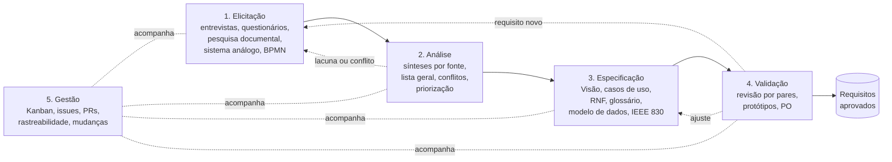
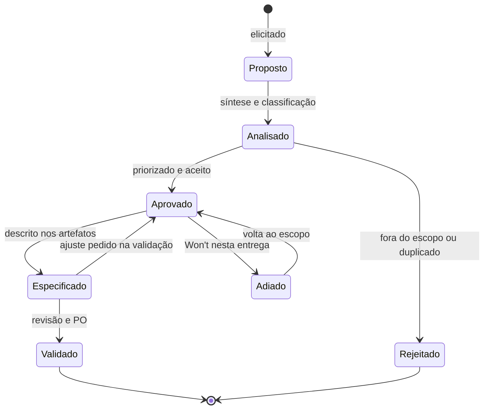
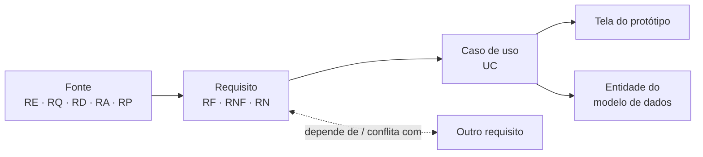

# Definição do Processo de Requisitos

**Projeto:** Sistema de Gestão de Competências (módulo de Feedback)
**Disciplina:** Domínios de Software (2026/2) · 1ª Etapa: Levantamento de Requisitos
**Issue:** #31

Este documento define como o grupo faz a engenharia de requisitos: as etapas, as técnicas, quem faz o quê, como os requisitos são identificados e priorizados, e como as mudanças são controladas.

---

## Sumário

1. [Visão geral do processo](#1-visão-geral-do-processo)
2. [Etapas](#2-etapas)
3. [Técnicas de elicitação](#3-técnicas-de-elicitação)
4. [Papéis e responsabilidades](#4-papéis-e-responsabilidades)
5. [Identificação dos requisitos](#5-identificação-dos-requisitos)
6. [Atributos e ciclo de vida de um requisito](#6-atributos-e-ciclo-de-vida-de-um-requisito)
7. [Priorização (MoSCoW)](#7-priorização-moscow)
8. [Rastreabilidade](#8-rastreabilidade)
9. [Gestão de mudanças](#9-gestão-de-mudanças)
10. [Ferramentas](#10-ferramentas)

---

## 1. Visão geral do processo

O processo tem cinco etapas. Ele é iterativo: a análise e a validação podem mostrar lacunas que levam a uma nova rodada de elicitação. A gestão acompanha todas as etapas.

---

## 2. Etapas

### 2.1 Elicitação

| | |
|---|---|
| **Objetivo** | Descobrir as necessidades, regras e restrições do domínio de feedback e gestão de competências |
| **Entradas** | Documento de definição do projeto; lista de sistemas sugeridos pela professora |
| **Atividades** | Preparar roteiro e questionário; realizar e transcrever entrevistas; aplicar questionários; pesquisar leis e normas; analisar o sistema análogo; modelar o processo atual em BPMN |
| **Saídas** | Roteiro, termo de consentimento, transcrições, questionários respondidos, pesquisa documental, descrição do sistema análogo, BPMN AS-IS |
| **Issues** | #33, #34, #35, #36, #37, #38, #39, #40, #44 |

### 2.2 Análise

| | |
|---|---|
| **Objetivo** | Transformar o material elicitado em requisitos candidatos, eliminar repetições e resolver conflitos |
| **Entradas** | Saídas da elicitação |
| **Atividades** | Sintetizar cada fonte separadamente; classificar cada requisito (RF, RNF, RN); juntar requisitos iguais de fontes diferentes; registrar conflitos e dúvidas para a PO; priorizar |
| **Saídas** | Sínteses por fonte, lista geral de requisitos, matriz de rastreabilidade |
| **Issues** | #41, #42, #43, #45, #49 |

### 2.3 Especificação

| | |
|---|---|
| **Objetivo** | Descrever os requisitos aprovados de forma completa e sem ambiguidade |
| **Entradas** | Lista geral de requisitos priorizada |
| **Atividades** | Escrever o Documento Visão; modelar casos de uso; detalhar um caso de uso por integrante; especificar os RNF pela ISO/IEC 25010; montar o glossário e o modelo de dados; consolidar na especificação IEEE 830 |
| **Saídas** | Documento Visão, diagrama e casos de uso completos, especificação suplementar, glossário, modelo ER, especificação de requisitos |
| **Issues** | #46, #47, #48, #51, #52, #53, #54 |

### 2.4 Validação

| | |
|---|---|
| **Objetivo** | Confirmar que os requisitos estão corretos, completos, consistentes e são o que a PO quer |
| **Entradas** | Artefatos especificados |
| **Atividades** | Revisar cada artefato em PR, por pelo menos outro integrante; conferir os requisitos com a lista de verificação abaixo; validar fluxos e telas com protótipos no Figma; levar dúvidas e conflitos à PO |
| **Saídas** | PRs aprovados, protótipos, dúvidas respondidas, artefatos revisados |
| **Issues** | #50, #55, #56 |

**Lista de verificação usada na revisão de um requisito:**

- [ ] Tem identificador único e fonte registrada
- [ ] Descreve uma só necessidade
- [ ] Está escrito de forma clara, sem termos vagos como "rápido", "fácil" ou "adequado" sem medida
- [ ] Pode ser verificado por teste, inspeção ou demonstração
- [ ] Não contradiz outro requisito, nem a LGPD
- [ ] Tem tipo e prioridade definidos
- [ ] Os termos do domínio estão no glossário

### 2.5 Gestão

| | |
|---|---|
| **Objetivo** | Manter os requisitos organizados, versionados e rastreáveis durante todo o trabalho |
| **Atividades** | Acompanhar tarefas no Kanban; versionar artefatos por PR; manter a matriz de rastreabilidade; controlar mudanças (seção 9) |
| **Saídas** | Quadro Kanban atualizado, histórico de PRs, matriz de rastreabilidade |
| **Issues** | #30, #49, #55 |

---

## 3. Técnicas de elicitação

| Técnica | Para que serve neste projeto | Fonte | Artefato | Prefixo dos requisitos candidatos |
|---|---|---|---|---|
| **Entrevista** semiestruturada | Entender o domínio com quem conhece o processo de feedback, ouvir as dores e decisões da PO | PO e profissionais que dão ou recebem feedback | [`docs/elicitacao/entrevistas/`](elicitacao/entrevistas/) | `RE-xx` |
| **Questionário** | Ouvir mais pessoas, de diferentes cargos, sobre como o feedback acontece hoje | Profissionais de empresas diversas | [`docs/elicitacao/questionarios/`](elicitacao/questionarios/) | `RQ-xx` |
| **Pesquisa documental** | Levantar obrigações legais e normas técnicas: LGPD, ISO/IEC 25010, normas trabalhistas, acessibilidade | Leis, regulamentos e normas | [`docs/elicitacao/pesquisa-documental/`](elicitacao/pesquisa-documental/) | `RD-xx` |
| **Análise de sistema análogo** | Ver como uma ferramenta de mercado resolve o problema, o que copiar e o que evitar | 15Five | [`docs/elicitacao/sistema-analogo/`](elicitacao/sistema-analogo/) | `RA-xx` |
| **Modelagem de processo (BPMN)** | Representar o processo atual de avaliação e feedback e marcar onde estão as dores | Entrevistas e questionários | [`docs/elicitacao/bpmn/`](elicitacao/bpmn/) | `RP-xx` |
| **Prototipação** | Validar fluxos e telas com a PO e descobrir requisitos que faltaram | Requisitos especificados | [`docs/prototipacao/`](prototipacao/) | `RT-xx` |

**Cuidados com dados pessoais.** Toda entrevista e questionário com terceiros usa o termo de consentimento. Nome, cargo e contato do participante só entram no repositório com consentimento registrado.

---

## 4. Papéis e responsabilidades

| Papel | Quem | Responsabilidades |
|---|---|---|
| **Product Owner (PO)** | Profa. Adriana Silveira de Souza | Explica o domínio e as necessidades; responde dúvidas; decide conflitos de requisitos; valida o resultado final |
| **Equipe de requisitos** | Ana Luísa, Davi, Isadora, Júlia e Verônica | Executa todas as etapas do processo. Cada integrante especifica pelo menos um caso de uso completo (#48) |
| **Responsável pela issue** | Integrante atribuído na issue | Produz o artefato, abre o PR, responde à revisão e mantém o card do Kanban atualizado |
| **Revisor** | Qualquer integrante que não seja o autor | Revisa o PR com a lista de verificação da seção 2.4 e aprova ou pede ajustes. Todo PR precisa de pelo menos 1 aprovação |
| **Entrevistador** | Integrantes escalados para cada entrevista | Conduz a entrevista pelo roteiro, coleta o consentimento e grava |
| **Transcritor** | Integrante responsável pela issue da entrevista | Transcreve, revisa e organiza a transcrição por temas |
| **Mantenedora do repositório e do Kanban** | Isadora | Mantém a estrutura do repositório, o quadro e os acessos dos integrantes (#30) |
| **Consolidador** | Responsável pela issue #55 | Junta os artefatos, confere consistência de IDs e termos, e prepara a entrega |

**Regra de comunicação com a PO.** Dúvidas e conflitos são anotados no artefato onde surgiram, em uma seção "Pontos a validar". O grupo junta essas dúvidas e leva à PO em uma única conversa, para não perder respostas.

---

## 5. Identificação dos requisitos

### 5.1 Requisitos candidatos (por fonte)

Durante a elicitação e a análise, cada fonte numera seus requisitos de forma independente. O prefixo mostra a origem:

| Prefixo | Origem | Exemplo |
|---|---|---|
| `RE-xx` | Entrevista | `RE-01` |
| `RQ-xx` | Questionário | `RQ-05` |
| `RD-xx` | Pesquisa documental | `RD-14` |
| `RA-xx` | Sistema análogo | `RA-03` |
| `RP-xx` | Processo de negócio em BPMN | `RP-02` |
| `RT-xx` | Protótipo | `RT-01` |

As funcionalidades descritas no sistema análogo usam `FA-xx` e os documentos da pesquisa documental usam `FD-xx`. Esses identificadores apontam para a fonte, não são requisitos.

### 5.2 Requisitos definitivos (lista geral)

Na lista geral (#45), cada requisito recebe um identificador definitivo, de acordo com o tipo:

| Prefixo | Tipo | Definição | Exemplo |
|---|---|---|---|
| `RF-001` | Requisito funcional | O que o sistema deve fazer | `RF-012` O sistema deve permitir registrar os fatos que motivaram um feedback |
| `RNF-001` | Requisito não funcional | Como o sistema deve ser, classificado pela ISO/IEC 25010 | `RNF-004` O resultado de um colaborador só é visível para ele, seu gestor direto e o RH |
| `RN-001` | Regra de negócio | Política ou restrição do domínio, independente do sistema | `RN-002` Um feedback registrado não pode ser excluído |
| `UC-01` | Caso de uso | Interação de um ator com o sistema para atingir um objetivo | `UC-03` Registrar feedback informal |

**Regras de numeração:**

- O número é sequencial dentro de cada tipo, com três dígitos para requisitos e dois para casos de uso.
- Um identificador nunca é reutilizado. Se um requisito for descartado, o número fica marcado como **Rejeitado** e não volta a ser usado.
- Quando vários candidatos viram um só requisito, a lista geral registra todos na coluna "Origem", por exemplo `RQ-05, RD-14, RE-07`.

---

## 6. Atributos e ciclo de vida de um requisito

### 6.1 Atributos

Cada requisito da lista geral tem os seguintes campos:

| Campo | Descrição |
|---|---|
| ID | Identificador definitivo (seção 5.2) |
| Descrição | Uma frase no padrão "O sistema deve..." ou, para regra de negócio, a regra em si |
| Tipo | RF, RNF ou RN. Para RNF, a característica da ISO/IEC 25010 |
| Origem | Identificadores dos candidatos que deram origem ao requisito |
| Prioridade | Must, Should, Could ou Won't (seção 7) |
| Status | Situação atual no ciclo de vida (seção 6.2) |
| Responsável | Integrante que especificou o requisito |
| Observações | Dúvidas, conflitos e decisões da PO |

### 6.2 Ciclo de vida

---

## 7. Priorização (MoSCoW)

| Prioridade | Significado | Critérios para usar |
|---|---|---|
| **Must** (deve ter) | Sem ele o sistema não cumpre o objetivo ou descumpre a lei | Pedido explícito da PO como essencial; obrigação legal (LGPD); núcleo do domínio: emissor, receptor, fatos, tipo de feedback, plano de ação |
| **Should** (deveria ter) | Importante, mas o sistema funciona sem ele na primeira versão | Citado pela PO ou por mais de uma fonte, sem ser essencial; boa prática derivada de lei; ganho claro para gestor ou RH |
| **Could** (poderia ter) | Desejável, se houver tempo | Citado por uma única fonte; melhoria de conforto; ideia vinda só do sistema análogo |
| **Won't** (não terá agora) | Fora do escopo desta versão | A PO disse que não entra, como canal de denúncia; funções da versão móvel futura; integrações externas não pedidas |

**Como decidir.**

1. O responsável pela lista geral propõe uma prioridade usando os critérios acima.
2. Requisitos citados por mais fontes sobem de prioridade, porque a necessidade se confirma.
3. Se houver dúvida, ou se a quantidade de Must ficar muito grande, o grupo leva a decisão à PO.
4. A decisão da PO prevalece e fica registrada na coluna "Observações".

---

## 8. Rastreabilidade

A matriz de rastreabilidade (#49) liga cada requisito à sua origem e aos artefatos onde ele aparece.

- **Rastreabilidade vertical:** segue um requisito entre níveis diferentes. Vai da fonte (entrevista, questionário, lei) ao requisito, depois ao caso de uso, à tela do protótipo e às entidades do modelo de dados.
- **Rastreabilidade horizontal:** liga requisitos do mesmo nível que dependem ou conflitam entre si. Por exemplo, o requisito de registrar feedback e o requisito de visibilidade do feedback.

**Regra:** todo requisito definitivo precisa de pelo menos uma origem. Todo caso de uso precisa estar ligado a pelo menos um RF.

---

## 9. Gestão de mudanças

1. **Pedido.** Quem identificar a mudança abre uma issue com a etiqueta `análise`. A issue descreve o requisito afetado, o motivo e a fonte, por exemplo uma nova resposta da PO.
2. **Análise de impacto.** O responsável consulta a matriz de rastreabilidade e lista os artefatos afetados.
3. **Decisão.** Mudanças pequenas, como redação ou correção de erro, são decididas na revisão do PR. Mudanças de escopo ou prioridade vão para a PO.
4. **Aplicação.** A mudança entra por PR, atualizando ao mesmo tempo a lista geral, a matriz e os artefatos afetados.
5. **Registro.** O histórico fica no Git. O PR referencia a issue e o requisito alterado.

---

## 10. Ferramentas

| Ferramenta | Uso |
|---|---|
| GitHub (repositório) | Versionar todos os artefatos em Markdown |
| GitHub Issues e Projects (Kanban) | Planejar e acompanhar tarefas, com as colunas Backlog, A fazer, Em andamento, Em revisão e Concluído |
| Pull Requests | Revisão por pares e validação interna dos artefatos |
| Mermaid | Diagramas simples dentro do Markdown, como os deste documento |
| Figma | Protótipos das telas |
| Ferramenta de BPMN | Modelagem do processo AS-IS, escolhida pelo responsável da #44 |
| Gravação e transcrição automática | Registro das entrevistas, com revisão manual da transcrição |
