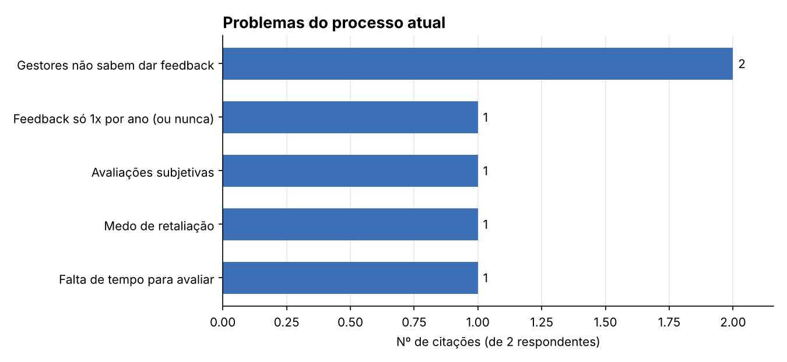
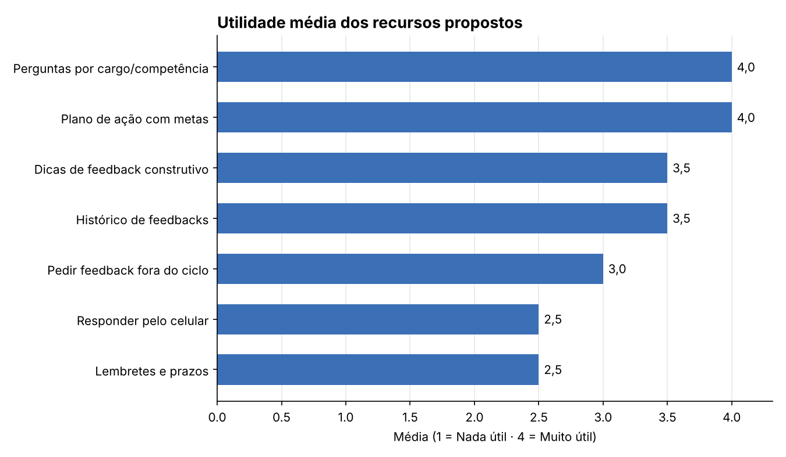

# Síntese dos Requisitos dos Questionários

**Projeto:** Sistema Web de Feedback e Gestão de Competências
**Técnica de elicitação:** Questionário (Google Forms)
**Issue:** #42 – Síntese dos requisitos dos questionários
**Milestone:** 1ª Entrega – Levantamento de Requisitos
**Fontes analisadas:**

| Código | Respondente | Cargo | Papel na avaliação | Porte da empresa | Data da resposta |
|---|---|---|---|---|---|
| Q01 | Isabella Beatriz da Silva | Product Manager | Colaborador sem cargo de liderança | 100 a 499 | 08/11/2026 |
| Q02 | Vaneide Neves | Assessoria ao Presidente (CEO) | Gestor ou líder de equipe | 100 a 499 | 09/11/2026 |

> Os telefones dos respondentes foram omitidos desta síntese (minimização de dados – LGPD). Ambos deram consentimento para o uso dos dados.

---

## 1. Tabulação das respostas

### 1.1 Indicadores numéricos (escala de 1 a 5)

| Indicador | Q01 | Q02 | Média |
|---|---|---|---|
| Satisfação com o feedback atual | 2 | 3 | **2,5** |
| Daria feedback sincero ao gestor sendo identificado | 2 | 1 | **1,5** |

**Leitura:** a satisfação com o processo atual é baixa e a disposição a ser sincero com o gestor identificado é muito baixa nas duas respostas. Este é o achado mais forte dos questionários.

### 1.2 Frequência com que recebe cada tipo de feedback

| Tipo de feedback | Q01 | Q02 |
|---|---|---|
| Formal (reunião ou ciclo) | Raramente | Às vezes |
| Informal (dia a dia) | Às vezes | Às vezes |
| Positivo (reconhecimento) | Raramente | Frequentemente |
| Construtivo (pontos a melhorar) | Às vezes | Às vezes |

Nenhum tipo de feedback formal ou construtivo aparece como "frequente". O reconhecimento varia bastante entre as duas empresas/contextos.

### 1.3 Tipos de avaliação já vivenciados

| Tipo | Q01 | Q02 |
|---|---|---|
| Gestor avaliando o colaborador | ✔ | |
| Colaborador avaliando o gestor | ✔ | |
| Avaliação 360° | | ✔ |

### 1.4 Maiores problemas do processo atual

| Problema | Q01 | Q02 | Citações |
|---|---|---|---|
| Gestores não sabem dar feedback | ✔ | ✔ | **2** |
| Feedback só uma vez por ano (ou nunca) | ✔ | | 1 |
| Avaliações subjetivas, sem critérios claros | ✔ | | 1 |
| Medo de retaliação ao ser sincero | | ✔ | 1 |
| Falta de tempo para avaliar | | ✔ | 1 |

### 1.5 Utilidade dos recursos propostos

Pontuação usada: Muito útil = 4 · Útil = 3 · Pouco útil = 2 · Nada útil = 1.

| Recurso | Q01 | Q02 | Média | Posição |
|---|---|---|---|---|
| Perguntas adaptadas ao cargo e às competências | Muito útil | Muito útil | **4,0** | 1º |
| Plano de ação com metas a partir do feedback | Muito útil | Muito útil | **4,0** | 1º |
| Dicas para escrever feedback construtivo | Útil | Muito útil | 3,5 | 3º |
| Histórico de todos os feedbacks recebidos | Útil | Muito útil | 3,5 | 3º |
| Pedir feedback a um colega fora do ciclo | Útil | Útil | 3,0 | 5º |
| Responder avaliações pelo celular | Nada útil | Muito útil | 2,5 | 6º |
| Lembretes de avaliações pendentes e prazos | Pouco útil | Útil | 2,5 | 6º |

Os dois recursos com consenso máximo são **perguntas por cargo/competência** e **plano de ação com metas**. Celular e lembretes têm a menor média e também a maior divergência entre as respostas.

### 1.6 Confidencialidade e visibilidade

| Pergunta | Q01 | Q02 |
|---|---|---|
| O que deveria ser anônimo? | Nada precisa ser anônimo | Avaliação do gestor feita pelo colaborador |
| Quem vê o resultado de uma pessoa? | Pessoa avaliada, gestor direto, RH | Pessoa avaliada, gestor direto, RH, **Diretoria** |

| Perfil com acesso ao resultado | Citações |
|---|---|
| A própria pessoa avaliada | 2 |
| Gestor direto | 2 |
| RH | 2 |
| Diretoria | 1 |

### 1.7 Painel de resultados e metas

| Item desejado no painel | Q01 | Q02 | Citações |
|---|---|---|---|
| Pontos fortes e pontos a melhorar | ✔ | ✔ | **2** |
| Evolução ao longo do tempo | ✔ | | 1 |
| Andamento das metas | ✔ | | 1 |
| Autoavaliação comparada à visão dos outros | | ✔ | 1 |
| Comentários recebidos | | ✔ | 1 |

| Pergunta | Q01 | Q02 |
|---|---|---|
| Quem define as metas de desenvolvimento | Colaborador e gestor juntos | Colaborador e gestor juntos |
| Tempo aceitável para avaliar um colega | 10 a 20 minutos | Mais de 20 minutos |

### 1.8 Perguntas exclusivas para gestores / RH (apenas Q02)

| Pergunta | Resposta |
|---|---|
| O que mais precisa acompanhar sobre a equipe | Planos de ação em andamento |
| Tempo para consolidar um ciclo de avaliação | Cerca de 1 semana |

### 1.9 Pergunta aberta – "Se o sistema pudesse resolver UMA coisa"

| Fonte | Resposta |
|---|---|
| Q01 | *Não respondida* |
| Q02 | "Sigilo e descrição, normalmente você fica marcado se expor alguns situação." *(transcrição literal)* |

---

## 2. Principais conclusões

1. **Sigilo é a necessidade central.** Sinceridade média de 1,5/5 com gestor identificado, "medo de retaliação" citado como problema e o único pedido aberto é sobre sigilo. Mesmo Q01, que marcou "nada precisa ser anônimo", deu nota 2 para sinceridade identificada.
2. **O problema mais citado é o preparo dos gestores** (2 de 2 respostas), o que sustenta orientações/dicas para quem dá feedback e critérios objetivos por competência.
3. **Consenso sobre o núcleo funcional:** perguntas por cargo/competência, plano de ação com metas, metas definidas em conjunto e visibilidade restrita do resultado.
4. **Oportunidade de automação:** a consolidação de um ciclo leva cerca de 1 semana hoje (Q02).
5. **Recursos divergentes** (celular, lembretes) têm prioridade menor e devem ser configuráveis.

---

## 3. Requisitos consolidados com fonte identificada

Legenda da coluna **Fonte:** Q01 = questionário de Isabella; Q02 = questionário de Vaneide; § = seção do questionário de origem.
**Prioridade sugerida:** Alta = citado nas duas fontes ou ligado à necessidade central de sigilo/LGPD; Média = uma fonte ou divergência; Baixa = baixa utilidade média.

### 3.1 Requisitos funcionais

| ID | Requisito | Fonte | Evidência | Prioridade |
|---|---|---|---|---|
| RQ-01 | O sistema deve permitir ciclos de feedback periódicos configuráveis, além do ciclo anual. | Q01 §3 | Problema "feedback só uma vez por ano"; feedback formal "raramente" (Q01) e "às vezes" (Q02) | Alta |
| RQ-02 | O sistema deve permitir avaliações com critérios objetivos, com perguntas vinculadas às competências de cada cargo. | Q01 §3, §5; Q02 §5 | "Avaliações subjetivas" (Q01); recurso "Muito útil" nas duas fontes (média 4,0) | Alta |
| RQ-03 | O sistema deve oferecer orientações/dicas para quem emite feedback construtivo. | Q01 §3, §5; Q02 §3, §5 | "Gestores não sabem dar feedback" nas duas fontes; média 3,5 | Alta |
| RQ-04 | A avaliação do gestor feita pelo colaborador (avaliação ascendente) deve ser anônima. | Q01 §4; Q02 §4, §6 | Sinceridade identificada 2/5 (Q01) e 1/5 (Q02); Q02 pede anonimato explicitamente | Alta |
| RQ-06 | O sistema deve permitir solicitar feedback a um colega a qualquer momento, fora do ciclo formal. | Q01 §5; Q02 §5 | "Útil" nas duas fontes (média 3,0) | Média |
| RQ-07 | O sistema deve permitir criar um plano de ação com metas a partir de um feedback recebido. | Q01 §5, §6; Q02 §5 | "Muito útil" nas duas fontes (média 4,0) | Alta |
| RQ-09 | O sistema deve manter o histórico de todos os feedbacks recebidos pelo colaborador. | Q01 §5; Q02 §5 | Média 3,5 | Média |
| RQ-10 | O painel do colaborador deve exibir sua evolução ao longo do tempo, pontos fortes e a melhorar e o andamento das metas. | Q01 §6; Q02 §6 | "Pontos fortes e a melhorar" nas duas fontes; evolução e metas em Q01 | Alta |
| RQ-15 | O sistema deve suportar avaliação 360°, reunindo autoavaliação, gestor, pares e liderados no mesmo ciclo. | Q02 §3 | Experiência prévia com avaliação 360° | Média |
| RQ-16 | O sistema deve consolidar automaticamente os resultados de um ciclo ao seu encerramento. | Q02 §2 | Consolidação manual leva cerca de 1 semana | Média |
| RQ-17 | O gestor deve poder acompanhar o andamento dos planos de ação da sua equipe. | Q02 §2 | Item que a gestora mais precisa acompanhar | Média |
| RQ-18 | O painel do colaborador deve comparar sua autoavaliação com a visão dos demais avaliadores. | Q02 §6 | Item desejado no painel | Média |
| RQ-19 | O painel do colaborador deve exibir os comentários recebidos. | Q02 §6 | Item desejado no painel; complementa RQ-09 e RQ-10 | Média |
| RQ-21 | O sistema deve enviar lembretes de avaliações pendentes e prazos, com opção de desativar. | Q01 §5; Q02 §3, §5 | "Pouco útil" (Q01) × "Útil" (Q02); "falta de tempo para avaliar" (Q02) | Baixa |

### 3.2 Requisitos não funcionais

| ID | Requisito | Tipo | Fonte | Evidência | Prioridade |
|---|---|---|---|---|---|
| RQ-05 | O resultado da avaliação de um colaborador deve ser visível somente para ele, seu gestor direto e o RH (acesso da Diretoria a validar – ver seção 4). | Segurança / LGPD | Q01 §4; Q02 §4 | Pessoa, gestor e RH citados nas duas fontes | Alta |
| RQ-11 | Uma avaliação de colega deve poder ser concluída em até 20 minutos. | Usabilidade | Q01 §6; Q02 §6 | 10–20 min (Q01) e mais de 20 min (Q02): o limite de 20 min atende às duas | Média |
| RQ-12 | O sistema deve registrar o consentimento do participante antes da coleta de dados. | LGPD | Q01 §1; Q02 §1 | Consentimento coletado nas duas respostas | Alta |
| RQ-13 | A identidade do autor de uma avaliação anônima não deve ser exibida a nenhum perfil, nem ao gestor avaliado. | Segurança / Privacidade | Q02 §3, §4, §6 | "Medo de retaliação"; "você fica marcado se expor alguma situação" | Alta |
| RQ-20 | O sistema deve permitir responder avaliações pelo celular (interface responsiva). | Usabilidade / Portabilidade | Q01 §5; Q02 §5 | "Nada útil" (Q01) × "Muito útil" (Q02) | Média |

### 3.3 Regras de negócio

| ID | Regra | Fonte | Evidência | Prioridade |
|---|---|---|---|---|
| RQ-08 | As metas de desenvolvimento devem ser definidas em conjunto pelo colaborador e pelo gestor. | Q01 §6; Q02 §6 | Resposta idêntica nas duas fontes | Alta |
| RQ-14 | Resultados de avaliações anônimas só devem ser exibidos de forma agregada quando houver um número mínimo de respondentes, para impedir a identificação por exclusão. | Q02 §4, §6 (proposta da equipe) | Derivada da necessidade de sigilo; o número mínimo deve ser validado com a cliente | Alta |

### 3.4 Resumo por fonte

| Fonte | Requisitos |
|---|---|
| Q01 e Q02 | RQ-02, RQ-03, RQ-04, RQ-05, RQ-06, RQ-07, RQ-08, RQ-09, RQ-10, RQ-11, RQ-12, RQ-20, RQ-21 |
| Somente Q01 | RQ-01 |
| Somente Q02 | RQ-13, RQ-14, RQ-15, RQ-16, RQ-17, RQ-18, RQ-19 |

**Total:** 21 requisitos (14 funcionais, 5 não funcionais, 2 regras de negócio), sendo 11 de prioridade alta.

---

## 4. Divergências e pendências para validação com a cliente

As pendências abaixo ficaram em aberto ao fim desta síntese. Todas foram tratadas na consolidação da [lista geral](../../Lista_Geral_Requisitos.md) (#45), como mostra a última coluna.

| Tema | Q01 | Q02 | Encaminhamento | Tratamento na lista geral |
|---|---|---|---|---|
| Anonimato | "Nada precisa ser anônimo" (sinceridade 2/5) | Avaliação do gestor deve ser anônima (sinceridade 1/5) | RQ-04 adotado como **obrigatório** na avaliação ascendente (a versão de Q01, "quando configurado", foi substituída) | Ponto P-01: confidencial como padrão na avaliação ascendente, anônimo como opção por ciclo (RN-004, RF-030) |
| Diretoria vê resultados? | Não | Sim | Validar com a cliente; proposta: Diretoria vê apenas dados agregados | Ponto P-02: proposta adotada (RNF-001) |
| Responder pelo celular | Nada útil | Muito útil | Manter RQ-20 com prioridade média | Conflito C-08: interface responsiva como Must (RNF-027); aplicativo nativo na versão futura |
| Lembretes | Pouco útil | Útil | Manter RQ-21 com opção de desativar | Conflito C-09: Should, desativável por usuário (RF-040) |
| Tempo para avaliar | 10 a 20 min | Mais de 20 min | Manter limite de 20 min (RQ-11) | Mantido (RNF-014) |
| Número mínimo de respondentes (RQ-14) | – | – | Definir o valor com a cliente | Ponto P-03: 3, configurável, nunca menor que 3 (RN-005) |
| Consentimento como base legal (RQ-12) | – | – | A pesquisa documental (RD-03) mostra que, na relação de emprego, o consentimento não deve ser a base padrão. Manter RQ-12 só para funcionalidades opcionais (RD-04) | Conflito C-06: proposta adotada (RN-012, RF-055) |
| "Anônimo" × RH vendo o emissor (RQ-04, RQ-13) | – | – | A PO disse que o RH pode ver quem deu o feedback (Entrevista 01 §11). Se o RH puder ver, o modo é "confidencial", não "anônimo" (RD-15, RD-16). Validar com a PO qual dos dois vale para a avaliação ascendente | Ponto P-01 (RN-004) |

---

## 5. Limitações da análise

- A amostra tem **apenas 2 respondentes**, de empresas de mesmo porte (100 a 499 funcionários). As médias servem para indicar tendências, não para conclusões estatísticas.
- Só Q02 respondeu às perguntas de gestor/RH; a visão de RH não está representada.
- A pergunta aberta só foi respondida em Q02.
- Recomenda-se confirmar os requisitos de prioridade alta e as pendências da seção 4 em entrevista ou reunião de validação com a cliente.