# Sistema Análogo – 15Five

**Projeto:** Sistema de Gestão de Competências (módulo de Feedback)
**Técnica de elicitação:** Análise de sistema análogo
**Issue:** #40 · **Data de referência da pesquisa:** 17/11/2026
**Artefatos relacionados:** [Entrevista 01](../entrevistas/Entrevista01_Adriana.md) · [Questionário 01](../questionarios/Questionario01_Isabella.md) · Síntese dos requisitos do sistema análogo (issue #43)

---

## Sumário

1. [Objetivo e método](#1-objetivo-e-método)
2. [Por que o 15Five](#2-por-que-o-15five)
3. [Visão geral do sistema](#3-visão-geral-do-sistema)
4. [Funcionalidades analisadas](#4-funcionalidades-analisadas)
5. [Privacidade, anonimato e controle de acesso](#5-privacidade-anonimato-e-controle-de-acesso)
6. [Versão móvel](#6-versão-móvel)
7. [Pontos fortes e pontos fracos](#7-pontos-fortes-e-pontos-fracos)
8. [Comparação com o que a PO pediu](#8-comparação-com-o-que-a-po-pediu)
9. [Capturas de tela e demonstrações](#9-capturas-de-tela-e-demonstrações)
10. [Limitações desta análise](#10-limitações-desta-análise)
11. [Referências](#11-referências)

---

## 1. Objetivo e método

**Objetivo.** Descrever um sistema de mercado que já resolve o problema de registrar e acompanhar feedbacks, para identificar funcionalidades, boas soluções e falhas que o nosso sistema deve adotar, adaptar ou evitar.

**Método.**

1. Escolha da ferramenta na lista de sugestões da professora, descartando as já escolhidas por outros grupos (Lark e Leapsome).
2. Leitura da central de ajuda oficial do 15Five (success.15five.com), da página de preços e da página de segurança, em novembro de 2026.
3. Leitura de avaliações de usuários em sites independentes (G2 e Capterra) para levantar pontos fortes e fracos percebidos por quem usa a ferramenta.
4. Registro de cada funcionalidade com um identificador `FA-xx` (Funcionalidade Analisada). A issue #43 transforma essas funcionalidades em requisitos candidatos `RA-xx` e decide quais serão adotados, adaptados ou descartados.

O 15Five é pago e a página de preços não oferece teste gratuito, apenas demonstração agendada. Por isso a análise se baseia na documentação oficial, e não em uso direto da ferramenta (ver seção 10).

---

## 2. Por que o 15Five

- **Aderência ao domínio.** O produto nasceu como ferramenta de feedback contínuo entre gestor e colaborador, que é o núcleo do nosso sistema. Não é um módulo escondido dentro de um sistema de RH maior.
- **Cobre as modalidades pedidas pela PO.** Tem feedback informal, reconhecimento positivo, avaliação formal com autoavaliação, gestor, pares e ascendente (360°), metas e plano de desenvolvimento.
- **Documentação pública e detalhada.** A central de ajuda descreve regras de visibilidade e anonimato, o que é essencial para os nossos requisitos de LGPD.
- **Tem aplicativo móvel**, o que ajuda a pensar a versão futura para dispositivos móveis.
- **Descrição da professora:** "ideal para verificações regulares de feedback", o que corresponde aos check-ins de acompanhamento que ela citou na entrevista (Entrevista 01 §5).

---

## 3. Visão geral do sistema

| Item | Descrição |
|---|---|
| **Fabricante** | 15Five, Inc. (Estados Unidos) |
| **Tipo** | Plataforma web (SaaS) de gestão de desempenho, engajamento e desenvolvimento |
| **Público** | Empresas de pequeno a grande porte; perfis de colaborador, gestor, administrador de RH |
| **Plataformas** | Navegador web; aplicativos para iOS e Android com funções reduzidas |
| **Idioma** | Interface em inglês. Não encontramos menção a suporte em português |
| **Integrações** | SSO, SCIM, sistemas de RH (HRIS), API, Slack e Microsoft Teams |
| **Segurança** | Relatório SOC 2 Type II disponível mediante acordo de confidencialidade |

**Planos e preços** (página oficial, atualizada em fevereiro de 2026, cobrança anual):

| Plano | Preço por usuário/mês | O que inclui |
|---|---|---|
| Engage | US$ 4 | Pesquisas de engajamento, planos de ação, mapas de calor, comparação com mercado |
| Perform | US$ 11 | Avaliações de desempenho com apoio de IA, OKRs e metas, feedback 360°, matriz de talentos, trilhas e planos de carreira |
| Total Platform | US$ 16 | Tudo dos anteriores, mais painel de RH e microtreinamentos para gestores |

**Organização.** A empresa é cadastrada como uma conta. Pessoas, gestores e grupos são cadastrados manualmente, por planilha ou por integração com o sistema de RH. A hierarquia (quem é gestor de quem) define boa parte das permissões de visibilidade.

---

## 4. Funcionalidades analisadas

### 4.1 Check-in semanal

O check-in é uma atualização periódica e estruturada que o colaborador envia ao gestor. Cada check-in tem:

- **Pulse:** nota de 1 a 5 sobre como a pessoa se sentiu no trabalho desde o último check-in, com comentário opcional.
- **Prioridades:** a recomendação é definir três prioridades por semana e informar o andamento.
- **Perguntas** definidas pela empresa, pelo grupo ou pelo gestor, como conquistas e dificuldades da semana.
- **Atualização das metas (objetivos)** ligadas à pessoa.

O gestor lê, comenta e pode deixar comentários privados. O histórico de check-ins fica disponível como contexto para a avaliação formal.

### 4.2 High Fives (reconhecimento)

Mensagem curta de reconhecimento enviada a um colega, a partir do check-in ou do mural de High Fives. Quem recebe pode reagir e comentar. O administrador pode cadastrar os valores da empresa, e o emissor marca o valor com uma hashtag. Um painel mostra quais valores aparecem mais.

### 4.3 Feedback contínuo e solicitação de feedback

- **Dar feedback:** o emissor escolhe a visibilidade no envio. A opção "receptor e gestor dele" deixa o feedback visível para o receptor e para o gestor. A opção "somente o gestor" esconde o feedback do receptor.
- **Pedir feedback:** o colaborador solicita feedback a colegas a qualquer momento. Por padrão só ele e quem respondeu veem a resposta. Ele pode marcar no pedido que o gestor também verá.
- A visibilidade é definida no envio e **não pode ser alterada depois**.

### 4.4 1-on-1 (reunião individual)

Pauta compartilhada entre gestor e colaborador para conversas recorrentes sobre prioridades, dificuldades e evolução. Cada participante tem uma área de **notas privadas** que só ele vê. Nenhum outro perfil, nem o administrador, lê o conteúdo de uma 1-on-1 da qual não participa.

### 4.5 Best-Self Review (avaliação formal / 360°)

Ciclos de avaliação formal configurados pelo administrador:

- **Tipos de avaliação:** autoavaliação, avaliação do gestor, avaliação por pares e avaliação ascendente (liderado avalia o gestor). Gestores adicionais também podem avaliar.
- **Configuração do ciclo:** nome, tipos de avaliação, participantes, datas de cada etapa, modelos de perguntas e e-mail de abertura.
- **Pares:** indicados pelo avaliado ou voluntários, com número mínimo e máximo, e aprovação automática ou manual da indicação.
- **Anonimato configurável:** o administrador define se o avaliado vê os comentários dos pares e se vê a identidade deles. O mesmo vale para a avaliação ascendente em relação ao gestor.
- **Moderação:** antes da liberação, um administrador pode ocultar respostas inadequadas. A resposta é ocultada para o avaliado, mas não é apagada.
- **Modelos de perguntas** podem incluir os valores da empresa e perguntas de efetividade do gestor.
- **Calibração:** sessão em que calibradores veem a distribuição das notas por gestor e ajustam as notas antes de liberar os resultados.
- A avaliação usa como evidência o histórico de check-ins, High Fives, metas e feedbacks do período.

### 4.6 Objetivos (OKRs)

Cadastro e acompanhamento de metas no formato OKR, da empresa até o indivíduo, com progresso em porcentagem, número ou concluído/não concluído. As metas aparecem e são atualizadas no check-in.

### 4.7 Career Hub e plano de desenvolvimento

- **Competências e trilhas de carreira:** o administrador cadastra competências (conhecimentos, habilidades, comportamentos e atitudes) e associa às funções de cada trilha.
- **Career Hub do colaborador:** quatro abas preenchidas pelo colaborador e compartilhadas com o gestor: clareza do papel, pontos fortes, visão de carreira e plano de crescimento.
- **Plano de crescimento (Growth Plan):** metas de carreira divididas em ações acompanháveis. Fica visível só para o colaborador e o gestor direto. O administrador não abre o plano individual, apenas baixa relatórios.

### 4.8 Pesquisas de engajamento

Pesquisas periódicas para toda a empresa, com resultados por grupo, mapas de calor e plano de ação. As respostas são **confidenciais, não anônimas**: ficam ligadas à conta do colaborador para permitir a segmentação, mas os resultados só aparecem para grupos com pelo menos 5 respondentes. O administrador pode reduzir esse mínimo para 3 ou 4.

### 4.9 Painéis, relatórios e IA

- Painel de Pulse com a evolução do clima ao longo do tempo, filtrável por grupo.
- Painel de indicadores com relatórios de pessoas, desempenho e engajamento.
- Recursos de IA (Kona e Amaya) que resumem reuniões, sugerem pautas e orientam gestores. Alguns são cobrados à parte.

### 4.10 Resumo das funcionalidades

| ID | Funcionalidade | Plano | Seção |
|---|---|---|---|
| FA-01 | Check-in periódico com perguntas configuráveis | Perform | 4.1 |
| FA-02 | Pulse: nota de bem-estar de 1 a 5 em cada check-in | Perform | 4.1 |
| FA-03 | Prioridades semanais acompanhadas no check-in | Perform | 4.1 |
| FA-04 | Comentário privado do gestor no check-in | Perform | 4.1 |
| FA-05 | Reconhecimento público (High Five) com reações e comentários | Perform | 4.2 |
| FA-06 | Valores da empresa marcados por hashtag no reconhecimento | Perform | 4.2 |
| FA-07 | Envio de feedback com visibilidade escolhida pelo emissor | Perform | 4.3 |
| FA-08 | Solicitação de feedback a colegas fora do ciclo formal | Perform | 4.3 |
| FA-09 | Visibilidade do feedback fixada no envio, sem alteração posterior | Perform | 4.3 |
| FA-10 | Pauta compartilhada de 1-on-1 com notas privadas | Perform | 4.4 |
| FA-11 | Ciclo de avaliação formal com datas por etapa | Perform | 4.5 |
| FA-12 | Autoavaliação, gestor, pares e ascendente no mesmo ciclo (360°) | Perform | 4.5 |
| FA-13 | Indicação de pares com limites e aprovação | Perform | 4.5 |
| FA-14 | Anonimato de pares e liderados configurável por ciclo | Perform | 4.5 |
| FA-15 | Moderação: ocultar resposta antes da liberação, sem apagar | Perform | 4.5 |
| FA-16 | Modelos de perguntas reutilizáveis, com valores da empresa | Perform | 4.5 |
| FA-17 | Calibração das notas entre gestores | Perform | 4.5 |
| FA-18 | Histórico do período usado como evidência na avaliação | Perform | 4.5 |
| FA-19 | Metas (OKRs) da empresa ao indivíduo | Perform | 4.6 |
| FA-20 | Competências e trilhas de carreira por função | Perform | 4.7 |
| FA-21 | Plano de crescimento com metas e ações, visível ao colaborador e ao gestor | Perform | 4.7 |
| FA-22 | Pesquisa de engajamento confidencial com mínimo de respondentes | Engage | 4.8 |
| FA-23 | Painel de evolução do clima por grupo | Perform | 4.9 |
| FA-24 | Relatórios e painéis de desempenho | Perform | 4.9 |
| FA-25 | Assistente de IA para gestores | Add-on | 4.9 |
| FA-26 | Aplicativo móvel com check-in, 1-on-1 e metas | Todos | 6 |
| FA-27 | Login único (SSO) e integração com sistema de RH | Todos | 3 |

---

## 5. Privacidade, anonimato e controle de acesso

| Conteúdo | Quem vê por padrão | Configurável? |
|---|---|---|
| Check-in | Colaborador e gestor; administrador vê todos os Pulses | Perguntas e quem revisa |
| Feedback dado | Depende da escolha do emissor: receptor e gestor, ou só o gestor | Só no envio |
| Feedback solicitado | Quem pediu e quem respondeu; gestor se o colaborador marcar | Só no pedido |
| Feedbacks da empresa toda | RH não vê, a menos que o administrador ligue a opção | Sim, desligado por padrão |
| Notas privadas da 1-on-1 | Só o autor | Não |
| Avaliação por pares | Avaliado vê comentários e identidade conforme configuração | Sim, por ciclo |
| Avaliação ascendente | Gestor vê respostas e identidade conforme configuração | Sim, por ciclo |
| Plano de crescimento | Colaborador e gestor direto | Não |
| Pesquisa de engajamento | Resultados agregados, grupo com no mínimo 5 respostas | Mínimo de 3 a 5 |

**Observações relevantes para a LGPD:**

- O 15Five diferencia **confidencial** de **anônimo** de forma explícita. É a mesma distinção proposta na pesquisa documental (RD-15 e RD-16).
- O mínimo de respondentes para mostrar resultado é uma técnica conhecida para evitar a reidentificação em grupos pequenos.
- O princípio de visibilidade mínima por padrão, com ampliação por escolha do usuário, está alinhado com os princípios de necessidade e finalidade da LGPD.
- A empresa é dos Estados Unidos e não encontramos a localização da hospedagem dos dados. Para um cliente brasileiro, isso envolve transferência internacional de dados (ver pesquisa documental, FD-05).

---

## 6. Versão móvel

- Aplicativos gratuitos para iOS (exige iOS 16 ou superior) e Android, que exigem conta ativa.
- Os dois aplicativos **não têm as mesmas funções**. O Android permite preencher e revisar check-ins. O iOS permite também consultar 1-on-1s e metas, e abre o ciclo de avaliação no navegador do celular.
- Funções que não estão no aplicativo são usadas pelo navegador do celular.
- Ditado por voz em qualquer campo de texto.

**Lição para o nosso projeto:** a versão móvel do 15Five cobre as ações frequentes e rápidas (check-in, consulta de metas), enquanto a configuração e a avaliação formal ficam na web. Ter funções diferentes entre iOS e Android é apontado como fragilidade.

---

## 7. Pontos fortes e pontos fracos

### Pontos fortes

- **Facilidade de uso** é o elogio mais citado nas avaliações do G2, seguido de simplicidade e comunicação transparente.
- **Tudo em um lugar:** check-ins, feedback, metas e avaliação ficam ligados, e a avaliação formal aproveita o histórico do período como evidência.
- **Regras de visibilidade claras e documentadas**, com padrão restritivo e escolha explícita do usuário.
- **Anonimato configurável** por tipo de avaliação, e moderação de respostas inadequadas sem apagar o registro.
- **Estímulo ao feedback positivo** com o High Five, ligado aos valores da empresa.
- **Plano de crescimento** com metas e ações, conectado às competências da função.
- **Ritmo semanal** cria o hábito de registrar fatos durante o período, e não só no fim do ciclo.

### Pontos fracos

- **Personalização limitada:** é a reclamação mais frequente no G2, junto com funções ausentes.
- **Relatórios fracos:** usuários relatam dificuldade para consolidar avaliações e painéis pouco práticos.
- **Interface pouco intuitiva para iniciantes** em implantações grandes, segundo parte dos usuários.
- **Repetição no check-in:** usuários contam que acabam repetindo as mesmas respostas toda semana.
- **Progresso das metas não passa de 100%**, segundo uma avaliação no Capterra.
- **Apps móveis desiguais** entre iOS e Android, e com poucas funções.
- **Sem estrutura de feedback:** o feedback é texto livre. Não há campos de fatos, tipo positivo ou construtivo, nem plano de ação nascido do feedback.
- **Idioma e custo:** sem português identificado e cobrado em dólar por usuário, o que pesa para empresas brasileiras.
- **Pesquisa de engajamento não é anônima**, apenas confidencial. A própria empresa avisa que reduzir o mínimo de respondentes aumenta o risco de identificação.

---

## 8. Comparação com o que a PO pediu

| Necessidade levantada | Fonte | Como o 15Five atende | Situação |
|---|---|---|---|
| Feedback baseado em fatos, com campo de fatos obrigatório | Entrevista 01 §1–§2 | Texto livre, sem campo de fatos | Não atende |
| Tipos positivo e construtivo, com estrutura própria | Entrevista 01 §3 | High Five cobre o positivo; construtivo é texto livre | Parcial |
| Feedback formal e informal | Entrevista 01 §3 | Informal por feedback contínuo e High Five; formal pelo ciclo de avaliação | Atende |
| Plano de ação a partir do feedback construtivo, com pontos de monitoramento | Entrevista 01 §4 | Plano de crescimento e metas existem, mas não nascem de um feedback | Parcial |
| Check-ins e indicadores no planejamento do feedback formal | Entrevista 01 §5 | Check-in semanal e metas com progresso | Atende |
| Competências por cargo | Entrevista 01 §9 | Competências e trilhas por função | Atende |
| Perfis de gestor e RH com acessos diferentes | Entrevista 01 §10–§11 | Perfis com visibilidade por hierarquia; RH vê tudo só se ligado | Atende |
| Emissor identificado no feedback do gestor; pares podem ser ocultos | Entrevista 01 §11 | Avaliação do gestor identificada; anonimato de pares configurável | Atende |
| Gestor-colaborador, pares, 360° e autoavaliação | Entrevista 01 §12 | Os quatro tipos no Best-Self Review | Atende |
| Reaproveitar parâmetros e ver evolução no tempo | Entrevista 01 §15 | Modelos de perguntas reutilizáveis; histórico e painéis | Parcial |
| Feedback não pode ser apagado, é registro oficial | Entrevista 01 §20 | Moderação oculta sem apagar; visibilidade não muda após envio | Atende |
| Não é canal de denúncia | Entrevista 01 §32 | Não tem canal de denúncia | Atende |
| Conformidade com a LGPD | Definição do projeto | Boas práticas de privacidade, mas empresa e dados fora do Brasil | Parcial |
| Versão futura para celular | Definição do projeto | Apps com funções reduzidas | Parcial |

---

## 9. Capturas de tela e demonstrações

O grupo não teve acesso a uma conta do 15Five. As imagens abaixo foram obtidas das páginas oficiais de produto do 15Five e da página do aplicativo na App Store, em 17/11/2026. São telas de demonstração do fabricante, com dados fictícios, usadas aqui apenas para análise acadêmica. Os arquivos estão em [`docs/assets/`](../../assets/) com o prefixo `15five-`.

### Figura 1 – Check-in semanal (FA-01, FA-02, FA-03)

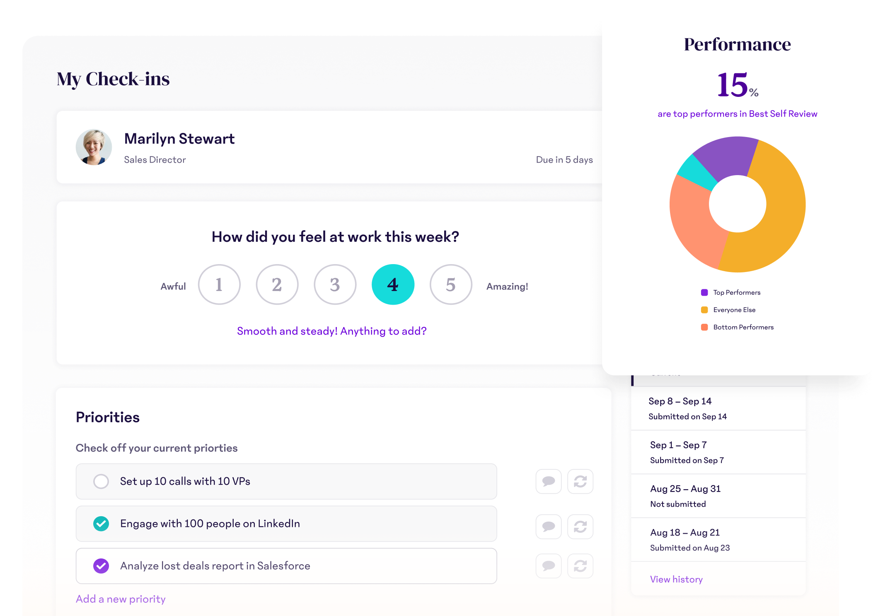

O colaborador responde "Como você se sentiu no trabalho esta semana?" de 1 a 5 e marca as prioridades concluídas. À direita aparece o histórico de check-ins por semana. *Fonte: [15Five – Check-ins](https://www.15five.com/products/perform/check-ins).*

### Figura 2 – High Five (FA-05)

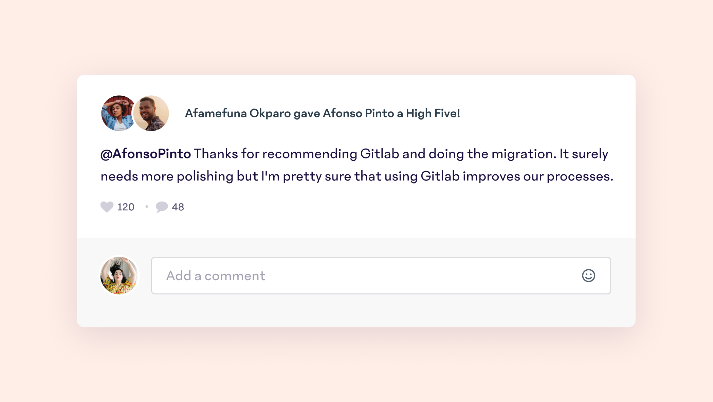

Reconhecimento público entre colegas, com reações e comentários. *Fonte: [15Five – 1-on-1s](https://www.15five.com/products/perform/1-on-1s).*

### Figura 3 – Solicitar feedback (FA-08, FA-09)

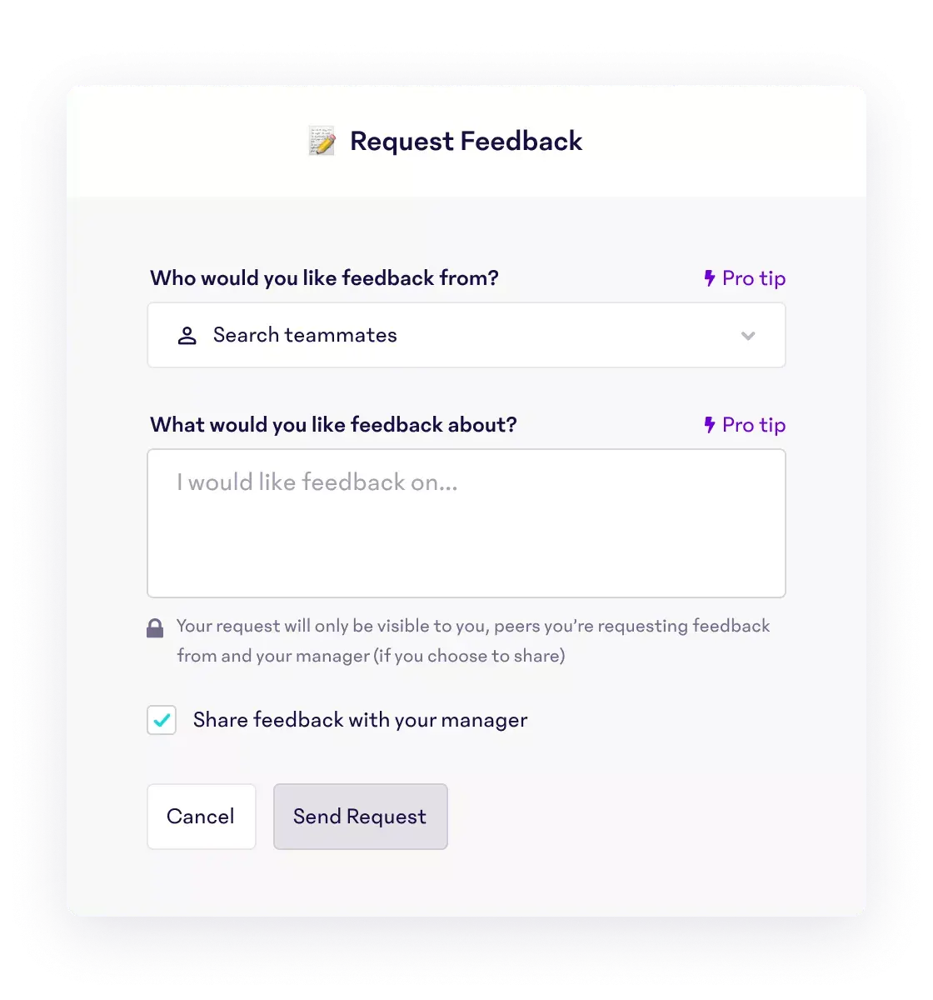

O formulário avisa quem verá o pedido e traz a opção "Compartilhar feedback com seu gestor". É um bom exemplo de transparência sobre visibilidade antes do envio. *Fonte: [15Five – Feedback](https://www.15five.com/products/perform/feedback).*

### Figura 4 – Histórico de feedbacks solicitados (FA-08)

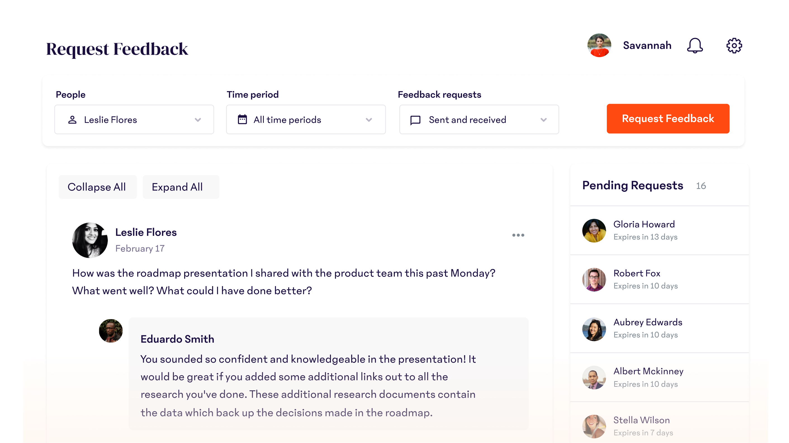

Lista de pedidos enviados e recebidos, com filtros por pessoa e período e com prazo de expiração dos pedidos pendentes. *Fonte: [15Five – Feedback](https://www.15five.com/products/perform/feedback).*

### Figura 5 – Pauta de 1-on-1 (FA-10)

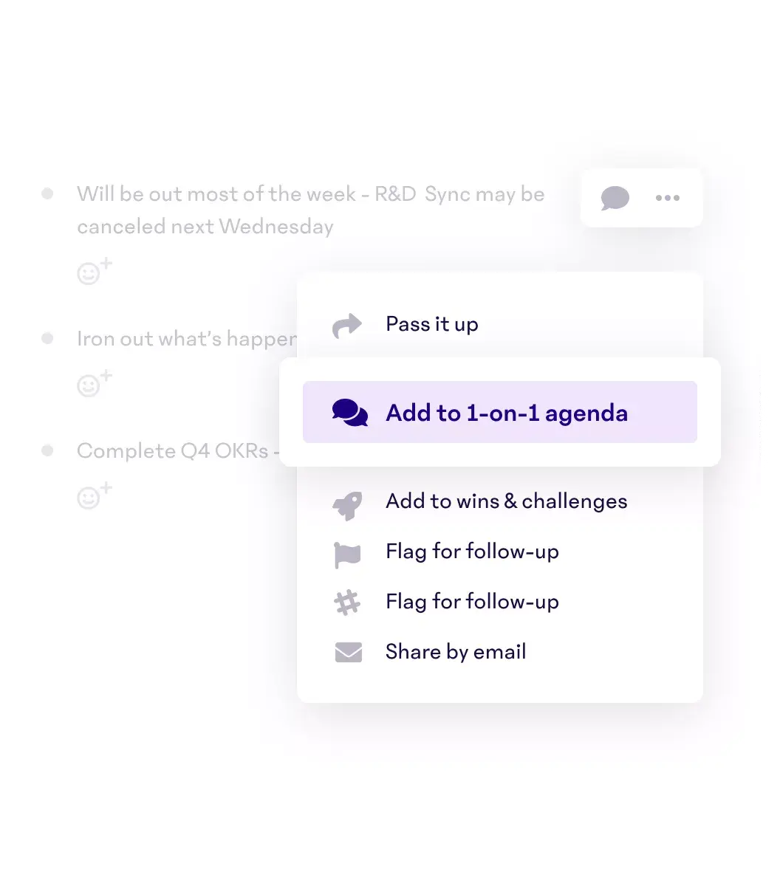

Um item do check-in pode ser levado para a pauta da reunião individual ou marcado para acompanhamento. *Fonte: [15Five – 1-on-1s](https://www.15five.com/products/perform/1-on-1s).*

### Figura 6 – Pergunta de avaliação com escala (FA-12, FA-16)

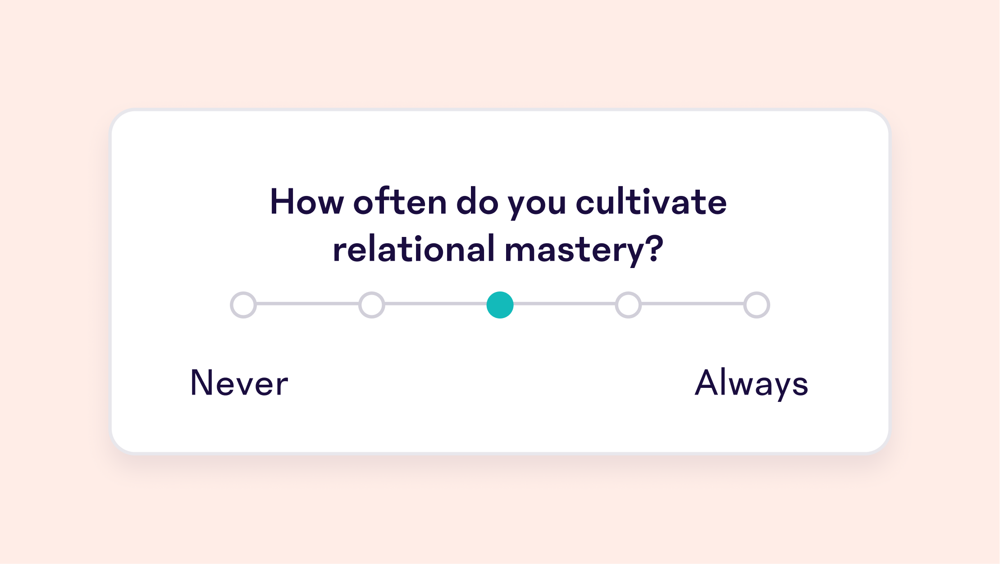

Pergunta de competência respondida em escala de frequência, usada no Best-Self Review. *Fonte: [15Five – Feedback](https://www.15five.com/products/perform/feedback).*

### Figura 7 – Avaliação com assistente de IA (FA-18, FA-25)

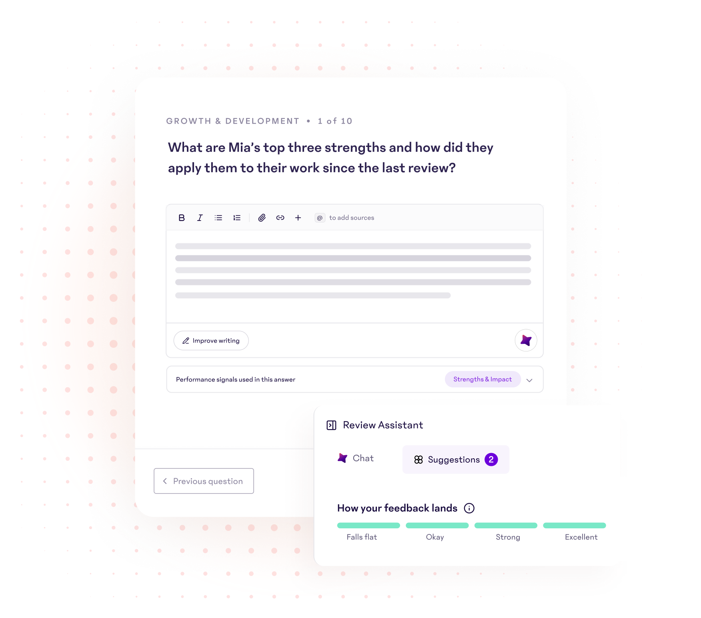

O avaliador escreve a resposta e o assistente sugere melhorias e mostra quais registros do período sustentam a resposta. *Fonte: [15Five – 15Five AI](https://www.15five.com/products/15five-ai).*

### Figura 8 – Objetivos (OKRs) (FA-19)

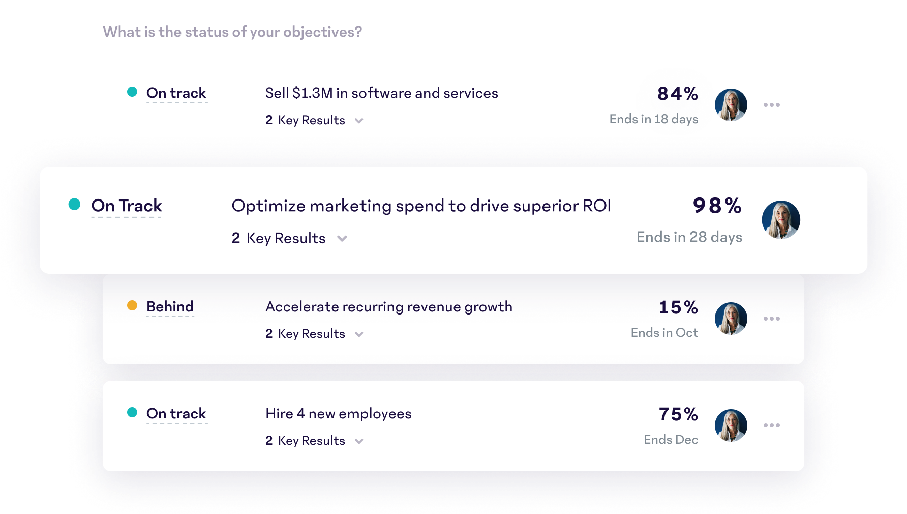

Cada objetivo mostra a situação, os resultados-chave, o progresso e o prazo. *Fonte: [15Five – Perform](https://www.15five.com/products/perform).*

### Figura 9 – Metas de carreira no Career Hub (FA-20, FA-21)

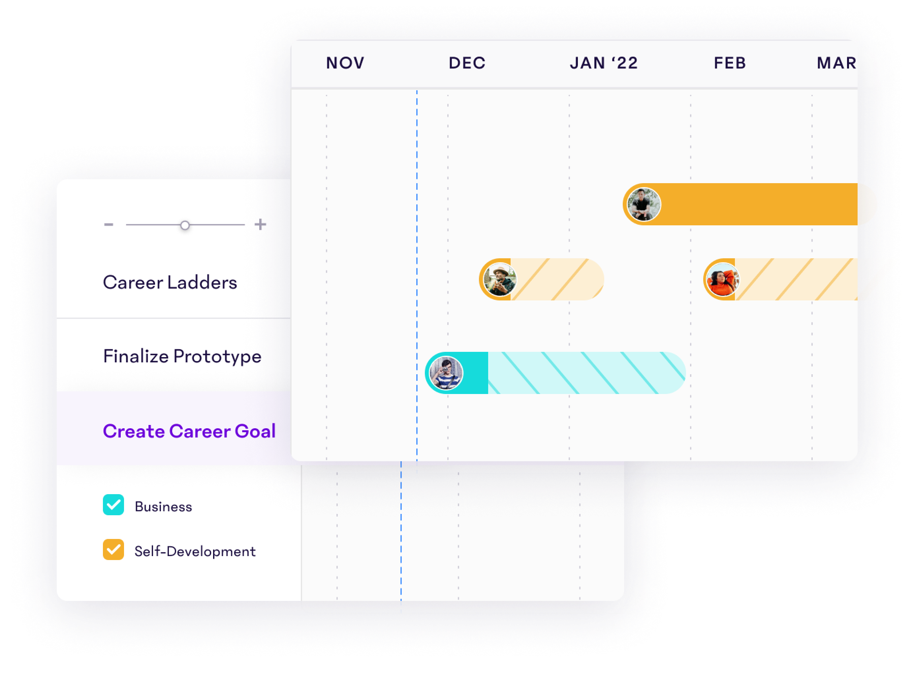

Metas de carreira e de autodesenvolvimento em linha do tempo. *Fonte: [15Five – Perform](https://www.15five.com/products/perform).*

### Figura 10 – Pesquisas de engajamento (FA-22)

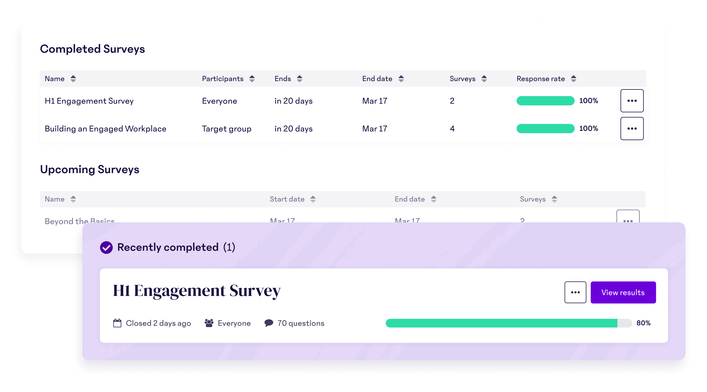

Pesquisas por público, com datas e taxa de resposta. *Fonte: [15Five – Engage](https://www.15five.com/products/engage).*

### Figura 11 e 12 – Aplicativo móvel (FA-26)

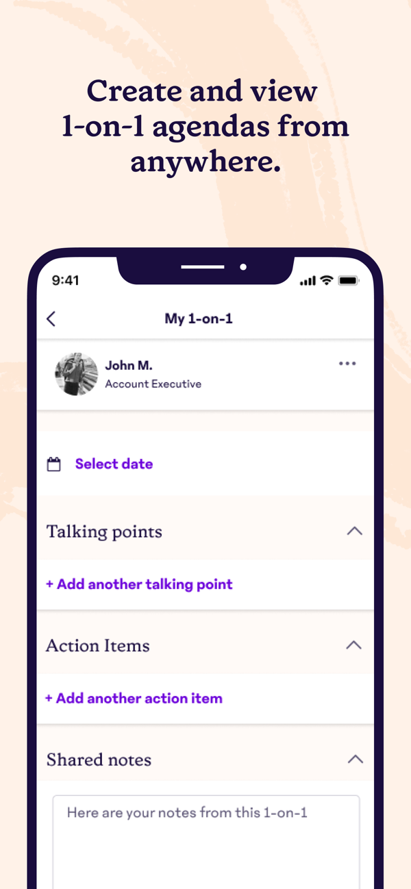
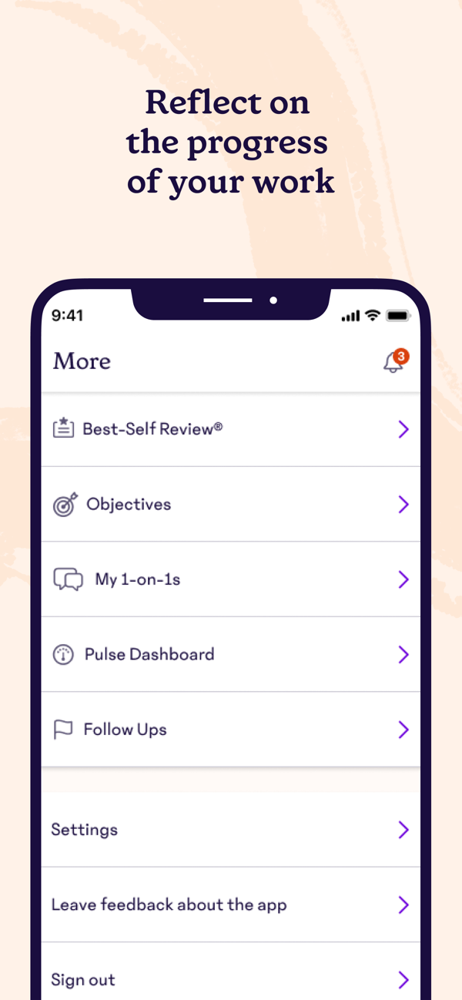

À esquerda, a pauta de 1-on-1 no celular. À direita, o menu com avaliação, objetivos, 1-on-1s, painel de Pulse e acompanhamentos. *Fonte: [15Five na App Store](https://apps.apple.com/us/app/15five/id1020253220).*

---

## 10. Limitações desta análise

- A análise foi feita pela documentação oficial e por avaliações de usuários, sem uso direto da ferramenta. Detalhes de usabilidade não foram observados pelo grupo.
- As figuras da seção 9 são imagens de divulgação do fabricante. Elas podem simplificar ou embelezar a interface real.
- As funções e os preços valem para novembro de 2026 e podem mudar.
- Algumas páginas da central de ajuda divergem entre si, por exemplo sobre quem vê a pauta de 1-on-1 quando a empresa nomeia observadores globais. Nesses casos registramos a regra mais restritiva.
- As avaliações do G2 e do Capterra são opiniões de usuários e não foram verificadas pelo grupo.

---

## 11. Referências

**Documentação oficial do 15Five**

- 15FIVE. [Pricing](https://www.15five.com/pricing). Atualizado em fev. 2026. Acesso em: 17 nov. 2026.
- 15FIVE. [Security](https://www.15five.com/security). Acesso em: 17 nov. 2026.
- 15FIVE. [Pulse – Feature Overview](https://success.15five.com/hc/en-us/articles/50988838569627). Acesso em: 17 nov. 2026.
- 15FIVE. [Use a company value hashtag in a high five](https://success.15five.com/hc/en-us/articles/16767917040539). Acesso em: 17 nov. 2026.
- 15FIVE. [Who can see feedback in 15Five?](https://success.15five.com/hc/en-us/articles/50989064497435). Acesso em: 17 nov. 2026.
- 15FIVE. [Request feedback from a colleague](https://success.15five.com/hc/en-us/articles/50988819903387). Acesso em: 17 nov. 2026.
- 15FIVE. [1-on-1 permissions and visibility](https://success.15five.com/hc/en-us/articles/50988120900507). Acesso em: 17 nov. 2026.
- 15FIVE. [Create a review cycle](https://success.15five.com/hc/en-us/articles/360006582292-Create-a-review-cycle). Acesso em: 17 nov. 2026.
- 15FIVE. [Configure peer and upward review settings (Admin)](https://success.15five.com/hc/en-us/articles/50988326579227-Configure-peer-and-upward-review-settings-Admin). Acesso em: 17 nov. 2026.
- 15FIVE. [Competencies and Paths overview](https://success.15five.com/hc/en-us/articles/14449983728283). Acesso em: 17 nov. 2026.
- 15FIVE. [Create and manage a career goal using growth plans](https://success.15five.com/hc/en-us/articles/29897015755931). Acesso em: 17 nov. 2026.
- 15FIVE. [How does engagement survey confidentiality work in 15Five?](https://success.15five.com/hc/en-us/articles/50988317173275). Acesso em: 17 nov. 2026.
- 15FIVE. [Set a confidentiality threshold for engagement campaigns](https://success.15five.com/hc/en-us/articles/50988900102043). Acesso em: 17 nov. 2026.
- 15FIVE. [Install the 15Five mobile app](https://success.15five.com/hc/en-us/articles/51864481442587-Install-the-15Five-mobile-app). Acesso em: 17 nov. 2026.

**Avaliações de usuários**

- G2. [15Five Reviews](https://www.g2.com/products/15five/reviews). Acesso em: 17 nov. 2026.
- CAPTERRA. [15Five Reviews](https://www.capterra.com/p/140437/15Five/reviews/). Acesso em: 17 nov. 2026.
