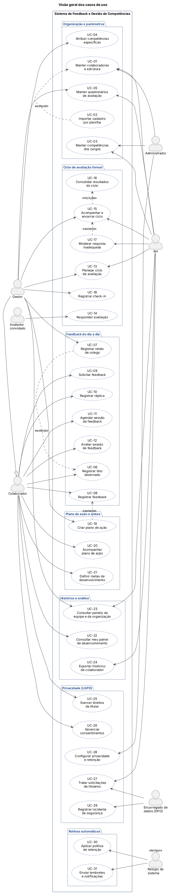
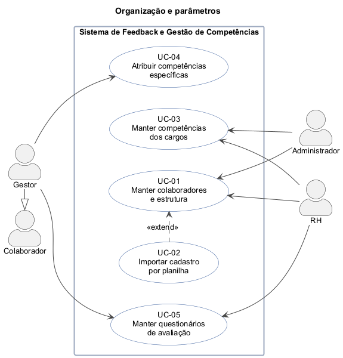
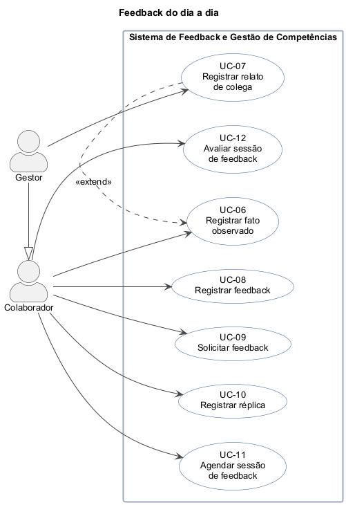
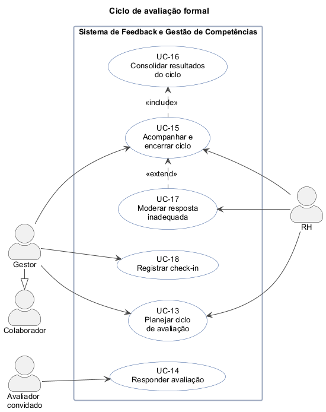
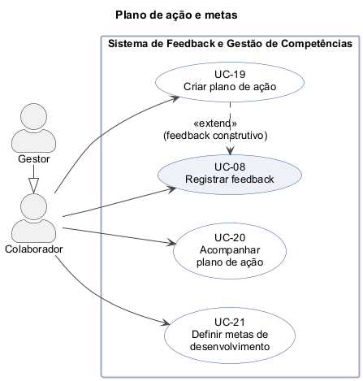
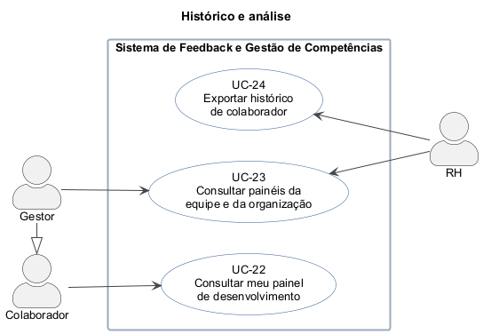
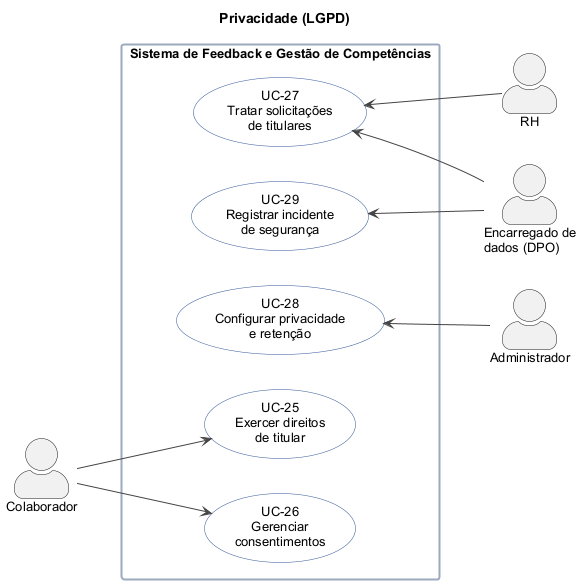
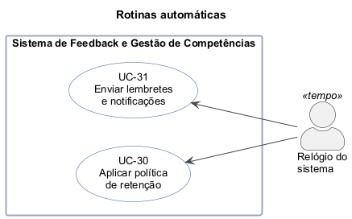

# Diagrama de Casos de Uso

**Projeto:** Sistema Web de Feedback e Gestão de Competências
**Referência:** Larman, *Utilizando UML e Padrões*, cap. 6
**Issue:** #47 · **Data:** 17/11/2026
**Entrada:** [Lista Geral de Requisitos](../../Lista_Geral_Requisitos.md) (#45), versão 1.1
**Fonte dos diagramas:** [Diagrama_Casos_de_Uso.puml](Diagrama_Casos_de_Uso.puml) (PlantUML; gera todas as imagens desta página)

---

## Sumário

1. [Objetivo e método](#1-objetivo-e-método)
2. [Atores](#2-atores)
3. [Fronteira do sistema](#3-fronteira-do-sistema)
4. [Casos de uso](#4-casos-de-uso)
5. [Relacionamentos include e extend](#5-relacionamentos-include-e-extend)
6. [Diagramas](#6-diagramas)
7. [Cobertura dos requisitos funcionais](#7-cobertura-dos-requisitos-funcionais)
8. [O que ficou fora do diagrama](#8-o-que-ficou-fora-do-diagrama)
9. [Ligação com os demais artefatos](#9-ligação-com-os-demais-artefatos)

---

## 1. Objetivo e método

**Objetivo.** Mostrar quem usa o sistema, para atingir quais objetivos, e onde fica a fronteira entre o sistema e o mundo de fora. O diagrama é a base dos casos de uso completos (#48) e da rastreabilidade entre requisitos e casos de uso (#49).

**Método.**

1. Cada requisito funcional da lista geral (RF-001 a RF-065) foi lido e agrupado pelo **objetivo do usuário** que ele atende.
2. Seguindo Larman, cada caso de uso está no **nível de objetivo do usuário**: uma tarefa que uma pessoa realiza em uma sessão e que tem valor para ela, como "Registrar feedback". Ações pequenas, como fazer login ou escolher um campo, não viraram casos de uso.
3. Os nomes usam verbo no infinitivo e objeto, do ponto de vista do ator.
4. `include` e `extend` foram usados só onde há um comportamento reaproveitado ou opcional que vale a pena mostrar (seção 5), como recomenda Larman.
5. A prioridade de cada caso de uso é a mais alta entre os requisitos que ele atende.

Com 31 casos de uso, um diagrama único fica difícil de ler. Por isso há uma **visão geral** e uma **visão por área** (seção 6), todas geradas do mesmo arquivo PlantUML.

---

## 2. Atores

| Ator | Tipo | Quem é | Objetivos principais |
|---|---|---|---|
| **Colaborador** | Principal | Qualquer pessoa da organização com acesso ao sistema | Registrar fatos e feedbacks, pedir feedback, acompanhar seus planos e metas, consultar seu painel, exercer seus direitos de titular |
| **Gestor** | Principal | Colaborador que tem uma equipe sob sua responsabilidade | Planejar ciclos, conduzir sessões, criar planos de ação, acompanhar a equipe. **Herda** tudo o que o Colaborador faz, porque também é avaliado |
| **Avaliador convidado** | Principal | Papel de quem é convidado para responder a uma avaliação de um ciclo: par, membro da equipe, liderado na avaliação ascendente ou o próprio avaliado na autoavaliação | Responder à avaliação dentro do prazo |
| **RH** | Principal | Área de RH da organização. Em organizações sem RH, um usuário recebe este perfil junto com o seu (RF-003, RN-004) | Manter cadastros e questionários padrão, acompanhar ciclos, consultar painéis da organização, exportar histórico, tratar solicitações de titulares |
| **Administrador** | Principal | Responsável pela configuração do sistema na organização | Manter cadastros e configurar privacidade e retenção |
| **Encarregado de dados (DPO)** | Principal | Encarregado pelo tratamento de dados pessoais da organização (LGPD, art. 41) | Tratar solicitações de titulares e registrar incidentes de segurança |
| **Relógio do sistema** | Principal (`<<tempo>>`) | O tempo, que dispara tarefas automáticas | Enviar lembretes e aplicar a política de retenção nas datas certas |

**Decisões de modelagem.**

- **Par.** A issue lista "Par" como ator. Como qualquer colaborador pode ser par de outro, o par não é um tipo de usuário, e sim um **papel** assumido ao ser convidado para uma avaliação. Por isso o ator se chama **Avaliador convidado** e cobre também a equipe, a avaliação ascendente e a autoavaliação (RF-024, RF-027).
- **RH e Administrador** ficaram separados, porque a lista geral define perfis diferentes (RF-003): o administrador cuida da configuração, o RH cuida do processo e vê os feedbacks. Os dois podem manter os cadastros (RF-001, RF-005).
- **Uma pessoa pode ter vários papéis.** Um gestor também é avaliado pelo seu superior, e um usuário pode acumular o perfil RH (RF-003). No diagrama, isso aparece na generalização Gestor → Colaborador.
- **Diretoria.** O RF-003 prevê o perfil da diretoria, com acesso restrito a indicadores agregados da organização (RNF-001, RN-005). A diretoria não tem objetivo próprio no sistema além dessa consulta, que é a visão da organização do UC-23 limitada a dados agregados. Por isso não foi desenhada como ator separado.
- **Relógio do sistema.** Lembretes e eliminação de dados vencidos não são iniciados por uma pessoa. Representar o tempo como ator deixa claro quem dispara esses casos de uso.

---

## 3. Fronteira do sistema

Dentro da fronteira está o **Sistema Web de Feedback e Gestão de Competências** (nas imagens, "Sistema de Feedback e Gestão de Competências"), uma aplicação web (RNF-030) usada por uma única organização (RN-010). Fora dela ficam:

- as **pessoas** da organização, representadas pelos atores da seção 2;
- a **sessão de feedback presencial ou remota**, que acontece entre as pessoas. O sistema agenda, registra e acompanha, mas não conduz a conversa;
- o **treinamento** de quem dá e recebe feedback, a **decisão** sobre promoção, salário ou desligamento e o **canal de denúncias** da organização (seção 10 da lista geral);
- **sistemas externos** de RH e de login único, que ficaram como Won't nesta versão (RF-004, RNF-025). O cadastro entra manualmente ou por planilha (UC-01, UC-02).

---

## 4. Casos de uso

Formato resumido de Larman: um parágrafo com o cenário principal. A descrição completa de cinco deles, um por integrante, está em [Casos de Uso Completos](Casos_de_Uso_Completos.md) (#48).

### 4.1 Organização e parâmetros

| ID | Caso de uso | Ator principal | Descrição resumida | Requisitos | Prioridade |
|---|---|---|---|---|---|
| UC-01 | Manter colaboradores e estrutura | RH, Administrador | Cadastra, altera e desativa colaboradores, cargos e equipes, define quem é gestor de quem e atribui os perfis de acesso | RF-001, RF-003; RN-013, RN-016 | Must |
| UC-02 | Importar cadastro por planilha | RH, Administrador (pelo UC-01) | Estende UC-01: carrega colaboradores, cargos, equipes e hierarquia de um arquivo CSV, mostrando os erros encontrados antes de gravar | RF-002 | Should |
| UC-03 | Manter competências dos cargos | RH, Administrador | Cadastra competências e as associa aos cargos, formando o conjunto fixo de cada cargo | RF-005; RN-014 | Must |
| UC-04 | Atribuir competências específicas | Gestor | Escolhe um colaborador ou grupo da sua equipe e acrescenta competências além das fixas do cargo | RF-006 | Must |
| UC-05 | Manter questionários de avaliação | RH, Gestor | O RH cria questionários e o padrão da organização, com perguntas ligadas a competências e o tipo de resposta de cada uma; o gestor acrescenta perguntas para um colaborador | RF-007, RF-008, RF-009; RN-001, RN-014 | Must |

### 4.2 Feedback do dia a dia

| ID | Caso de uso | Ator principal | Descrição resumida | Requisitos | Prioridade |
|---|---|---|---|---|---|
| UC-06 | Registrar fato observado | Colaborador (emissor) | Registra um fato ou comportamento observado, com data e descrição. O fato fica visível só para quem registrou até ser vinculado a um feedback | RF-011, RF-018; RN-001 | Must |
| UC-07 | Registrar relato de colega | Gestor | Estende UC-06: o fato vem do relato de outro colaborador, fica marcado como "relato" e só embasa um feedback depois de confirmado pelo gestor | RF-012 | Could |
| UC-08 | Registrar feedback | Colaborador (emissor) | Escolhe o receptor, o tipo e a modalidade, preenche a estrutura do tipo escolhido, vincula fatos e competências, vê quem poderá ler o conteúdo e envia. Inclui o formulário curto de reconhecimento e a edição com versões | RF-013 a RF-019, RF-021; RN-001 a RN-004 | Must |
| UC-09 | Solicitar feedback | Colaborador | Pede feedback a um ou mais colegas, fora do ciclo formal, com tema e prazo. Os colegas respondem por UC-08 | RF-031 | Should |
| UC-10 | Registrar réplica | Colaborador (receptor) | Registra uma manifestação sobre um feedback recebido, sem alterar o texto do emissor | RF-020 | Should |
| UC-11 | Agendar sessão de feedback | Colaborador (emissor) | Agenda a sessão com data, hora, participantes, assunto e pauta; o sistema pode sugerir horários livres e envia o comunicado | RF-037, RF-038, RF-039 | Should |
| UC-12 | Avaliar sessão de feedback | Colaborador | Após a sessão, o emissor avalia a postura do receptor e o receptor avalia se o feedback agregou valor | RF-034 | Should |

### 4.3 Ciclo de avaliação formal

| ID | Caso de uso | Ator principal | Descrição resumida | Requisitos | Prioridade |
|---|---|---|---|---|---|
| UC-13 | Planejar ciclo de avaliação | Gestor, RH | Define período, avaliados, objetivos, competências, indicadores, questionário, modalidades, participantes, modo de identificação e datas dos check-ins. Ao abrir o ciclo, o sistema notifica os avaliados e os avaliadores | RF-010, RF-022 a RF-026, RF-030; RN-004 | Must |
| UC-14 | Responder avaliação | Avaliador convidado | Responde ao questionário da sua modalidade dentro do prazo, podendo consultar os fatos e feedbacks do período, e vê antes do envio quem poderá ver suas respostas | RF-019, RF-027, RF-028; RN-001, RN-004 | Must |
| UC-15 | Acompanhar e encerrar ciclo | Gestor, RH | Acompanha quem já respondeu e quem não respondeu, e encerra o ciclo, o que dispara a consolidação dos resultados (UC-16) | RF-029 | Should |
| UC-16 | Consolidar resultados do ciclo | (incluído em UC-15) | Calcula os resultados por competência, indicador e modalidade, compara autoavaliação e avaliação dos outros e aplica o mínimo de respondentes | RF-010, RF-032, RF-033; RN-005, RN-008 | Should |
| UC-17 | Moderar resposta inadequada | RH | Estende UC-15: antes de liberar os resultados, oculta do avaliado uma resposta inadequada, sem apagá-la, registrando a ação e avisando o emissor | RF-035; RN-003 | Could |
| UC-18 | Registrar check-in | Gestor | Registra um check-in com o colaborador: valores observados dos indicadores do ciclo ou check-in periódico ligado a metas e planos | RF-023, RF-036, RF-041 | Must |

### 4.4 Plano de ação e metas

| ID | Caso de uso | Ator principal | Descrição resumida | Requisitos | Prioridade |
|---|---|---|---|---|---|
| UC-19 | Criar plano de ação | Gestor (emissor) | Estende UC-08 quando o feedback é construtivo: emissor e receptor definem juntos ações, responsáveis, metas, pontos de monitoramento e data final | RF-042; RN-006 | Must |
| UC-20 | Acompanhar plano de ação | Colaborador, Gestor | Registra o resultado de cada ponto de monitoramento, ajusta as ações e, na data final, registra se houve melhora ou se é preciso um novo feedback | RF-043 | Must |
| UC-21 | Definir metas de desenvolvimento | Colaborador, Gestor | Cadastra metas individuais ou da equipe, com competência, indicador, valor esperado e prazo, e atualiza o progresso | RF-046, RF-047; RN-006 | Must |

### 4.5 Histórico e análise

| ID | Caso de uso | Ator principal | Descrição resumida | Requisitos | Prioridade |
|---|---|---|---|---|---|
| UC-22 | Consultar meu painel de desenvolvimento | Colaborador | Vê seu histórico em ordem cronológica e a evolução de indicadores e competências em gráficos, com pontos fortes, pontos a melhorar, metas, planos e comentários | RF-048, RF-049; RN-008 | Must |
| UC-23 | Consultar painéis da equipe e da organização | Gestor, RH | Vê indicadores consolidados, tendências e a situação de planos e metas da equipe (gestor) ou da organização (RH), incluindo quais feedbacks geraram melhora e problemas recorrentes por cargo | RF-044, RF-045, RF-050, RF-052; RN-005, RN-007 | Should |
| UC-24 | Exportar histórico de colaborador | RH | Gera um relatório com o histórico completo de um colaborador | RF-051 | Should |

### 4.6 Privacidade (LGPD)

| ID | Caso de uso | Ator principal | Descrição resumida | Requisitos | Prioridade |
|---|---|---|---|---|---|
| UC-25 | Exercer direitos de titular | Colaborador | Consulta o aviso de privacidade e pede acesso, correção, exportação, anonimização ou eliminação dos seus dados, ou a lista de com quem foram compartilhados | RF-053, RF-056 a RF-060 | Must |
| UC-26 | Gerenciar consentimentos | Colaborador | Dá ou revoga o consentimento para funções opcionais; recusar não bloqueia o uso do sistema | RF-055; RN-012 | Must |
| UC-27 | Tratar solicitações de titulares | Encarregado (DPO), RH | Acompanha a fila de pedidos dos titulares, com prazo, responsável e histórico, e registra a resposta | RF-061 | Should |
| UC-28 | Configurar privacidade e retenção | Administrador | Cadastra a finalidade e a base legal de cada categoria de dado e define os prazos de retenção | RF-054, RF-062; RN-011 | Must |
| UC-29 | Registrar incidente de segurança | Encarregado (DPO) | Registra um incidente, os dados e titulares afetados e as medidas adotadas, e gera a lista de titulares a comunicar | RF-063 | Should |

### 4.7 Rotinas automáticas

| ID | Caso de uso | Ator principal | Descrição resumida | Requisitos | Prioridade |
|---|---|---|---|---|---|
| UC-30 | Aplicar política de retenção | Relógio do sistema | Ao fim do prazo, elimina ou anonimiza os dados vencidos, exceto os bloqueados por processo judicial | RF-062; RN-011 | Must |
| UC-31 | Enviar lembretes e notificações | Relógio do sistema | Envia lembretes de sessões, avaliações pendentes, check-ins e prazos de planos, respeitando quem desativou os lembretes | RF-026, RF-037, RF-040 | Should |

**Total:** 31 casos de uso (17 Must, 12 Should e 2 Could).

---

## 5. Relacionamentos include e extend

| Relacionamento | Tipo | Por quê |
|---|---|---|
| UC-02 → UC-01 | `<<extend>>` | Importar a planilha é uma forma opcional de fazer o cadastro. O cadastro manual funciona sem ela (E01 §30) |
| UC-07 → UC-06 | `<<extend>>` | O relato de colega é uma variação opcional do registro de fato, só para o gestor e com a regra de confirmação (RF-012) |
| UC-19 → UC-08 | `<<extend>>` | O plano de ação só acontece quando o feedback é **construtivo**. Ponto de extensão: depois de registrar um feedback construtivo |
| UC-17 → UC-15 | `<<extend>>` | A moderação é opcional e só acontece quando há resposta inadequada, antes da liberação dos resultados |
| UC-15 → UC-16 | `<<include>>` | Todo encerramento de ciclo consolida os resultados. Separar a consolidação deixa claras as regras de RN-005 e RN-008 |

Outras ligações entre casos de uso existem, mas não são `include` nem `extend`, porque acontecem em momentos diferentes e por atores diferentes:

- o pedido de UC-09 é respondido pelos colegas em UC-08;
- o pedido feito em UC-25 é tratado pelo encarregado em UC-27;
- os planos criados em UC-19 são acompanhados em UC-20.

---

## 6. Diagramas

As imagens são geradas pelo arquivo [Diagrama_Casos_de_Uso.puml](Diagrama_Casos_de_Uso.puml). Para alterar um diagrama, edite esse arquivo e gere as imagens de novo:

```bash
java -jar plantuml.jar -charset UTF-8 -tpng Diagrama_Casos_de_Uso.puml
```

### 6.1 Visão geral

Todos os atores e casos de uso em um único diagrama. A versão em [SVG](UC_00_Visao_Geral.svg) pode ser ampliada sem perder qualidade.



### 6.2 Organização e parâmetros



### 6.3 Feedback do dia a dia



### 6.4 Ciclo de avaliação formal



### 6.5 Plano de ação e metas

UC-08, em destaque, aparece apenas para mostrar o ponto de extensão do plano de ação.



### 6.6 Histórico e análise



### 6.7 Privacidade (LGPD)



### 6.8 Rotinas automáticas



---

## 7. Cobertura dos requisitos funcionais

Todos os 65 requisitos funcionais da lista geral foram conferidos. 62 são atendidos por algum caso de uso, e os outros 3 estão justificados na seção 8. Esta tabela é a base da ligação RF ↔ UC na matriz de rastreabilidade (#49).

| Requisito | Caso de uso | Requisito | Caso de uso | Requisito | Caso de uso |
|---|---|---|---|---|---|
| RF-001 | UC-01 | RF-023 | UC-13, UC-18 | RF-045 | UC-23 |
| RF-002 | UC-02 | RF-024 | UC-13 | RF-046 | UC-21 |
| RF-003 | UC-01 | RF-025 | UC-13 | RF-047 | UC-21 |
| RF-004 | — (Won't) | RF-026 | UC-13, UC-31 | RF-048 | UC-22 |
| RF-005 | UC-03 | RF-027 | UC-14 | RF-049 | UC-22 |
| RF-006 | UC-04 | RF-028 | UC-14 | RF-050 | UC-23 |
| RF-007 | UC-05 | RF-029 | UC-15 | RF-051 | UC-24 |
| RF-008 | UC-05 | RF-030 | UC-13 | RF-052 | UC-23 |
| RF-009 | UC-05 | RF-031 | UC-09 | RF-053 | UC-25 |
| RF-010 | UC-13, UC-16 | RF-032 | UC-16 | RF-054 | UC-28 |
| RF-011 | UC-06 | RF-033 | UC-16 | RF-055 | UC-26 |
| RF-012 | UC-07 | RF-034 | UC-12 | RF-056 | UC-25 |
| RF-013 | UC-08 | RF-035 | UC-17 | RF-057 | UC-25 |
| RF-014 | UC-08 | RF-036 | UC-18 | RF-058 | UC-25 |
| RF-015 | UC-08 | RF-037 | UC-11, UC-31 | RF-059 | UC-25 |
| RF-016 | UC-08 | RF-038 | UC-11 | RF-060 | UC-25 |
| RF-017 | UC-08 | RF-039 | UC-11 | RF-061 | UC-27 |
| RF-018 | UC-06, UC-08 | RF-040 | UC-31 | RF-062 | UC-28, UC-30 |
| RF-019 | UC-08, UC-14 | RF-041 | UC-18 | RF-063 | UC-29 |
| RF-020 | UC-10 | RF-042 | UC-19 | RF-064 | — (interface) |
| RF-021 | UC-08 | RF-043 | UC-20 | RF-065 | — (interface) |
| RF-022 | UC-13 | RF-044 | UC-23 | | |

---

## 8. O que ficou fora do diagrama

| Item | Motivo |
|---|---|
| Autenticação (parte de RF-003) | Fazer login não é um objetivo do usuário, e sim um passo para chegar a ele. Larman recomenda não modelar o login como caso de uso. Ele entra como **pré-condição** de todos os casos de uso. A atribuição de perfis está em UC-01 |
| RF-004 – Login único (SSO) | Won't nesta versão: integração externa não pedida pela PO |
| RF-064 – Atalho para o canal de denúncias | É um elemento fixo da interface, não uma tarefa do usuário. O canal de denúncias fica fora da fronteira (RN-009) |
| RF-065 – Símbolo e declaração de acessibilidade | Elemento fixo da interface. Será tratado na especificação suplementar (#51) junto com os demais RNF de acessibilidade |
| Requisitos não funcionais | Valem para vários casos de uso ao mesmo tempo e são tratados na [especificação suplementar](../../Especificacao_Suplementar.md) (#51) |

---

## 9. Ligação com os demais artefatos

**Casos de uso completos (#48).** Os cinco casos sugeridos para o formato completo de Larman, um por integrante, estão descritos em [Casos de Uso Completos](Casos_de_Uso_Completos.md):

| Caso de uso | Por que foi descrito no formato completo |
|---|---|
| UC-08 Registrar feedback | Núcleo do domínio: emissor, receptor, fatos, tipo e regras de visibilidade |
| UC-13 Planejar ciclo de avaliação | Concentra o feedback formal: objetivos, indicadores, modalidades e modos de identificação |
| UC-14 Responder avaliação | Mostra o fluxo do avaliador e as regras de confidencialidade e anonimato |
| UC-19 Criar plano de ação | Liga o feedback construtivo ao acompanhamento da melhora, que é a principal dor do processo atual |
| UC-25 Exercer direitos de titular | Cobre a LGPD, que é restrição do enunciado |

Os IDs e os nomes desta página são os usados em todos os artefatos. Se um caso de uso mudar de nome ou for dividido, o arquivo `.puml` e as imagens precisam ser atualizados.

**Matriz de rastreabilidade (#49).** A tabela da seção 7 e a coluna Requisitos da seção 4 trazem a ligação RF ↔ UC, usada na [matriz](../../Matriz_Rastreabilidade.md).

**Pontos decididos na consolidação da lista geral.** Os casos de uso abaixo seguem as decisões da seção 9 da lista geral. Se alguma delas mudar, pela gestão de mudanças do processo, estes são os casos afetados:

| Ponto | Casos de uso afetados |
|---|---|
| P-01 | UC-13, UC-14 |
| P-04 | UC-08 |
| P-05 | UC-28, UC-30 |
| P-06 | UC-07 |
| P-07 | UC-17 |
| P-08 | UC-23 |
| P-09 | UC-18 |
