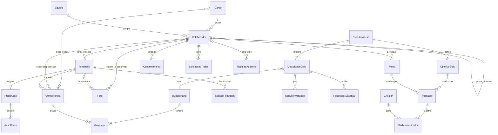
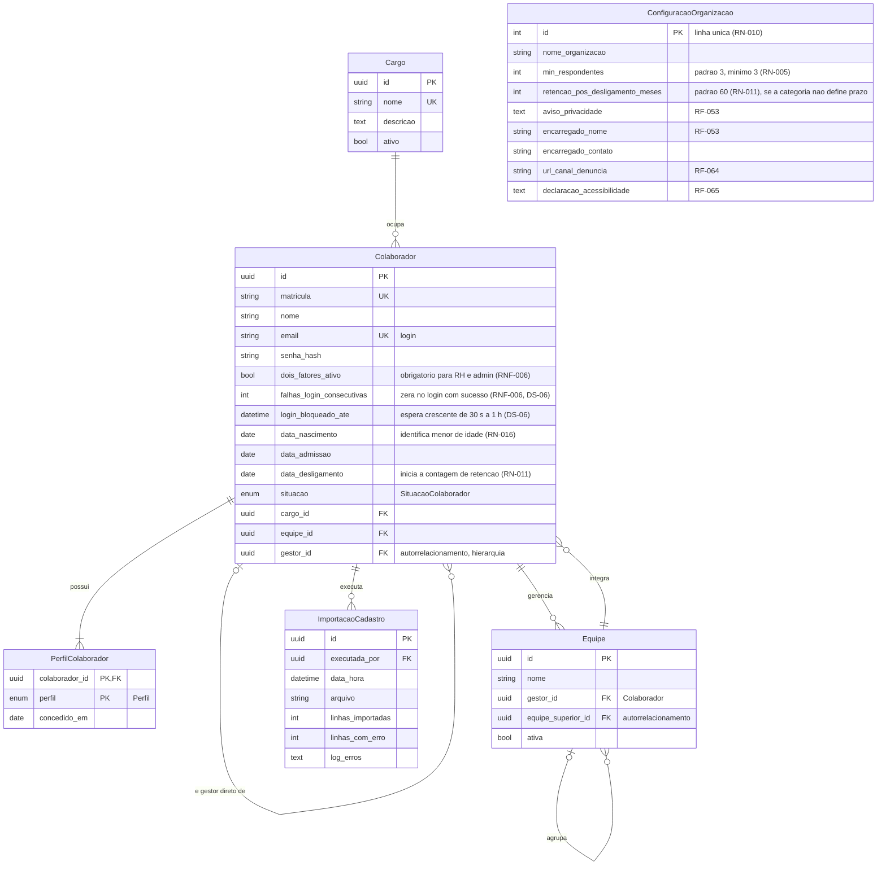
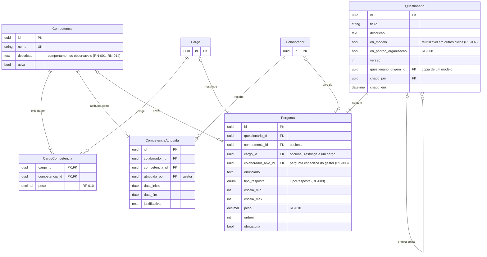
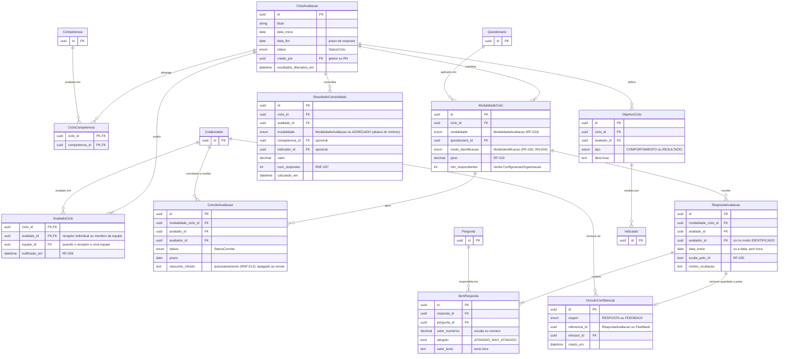
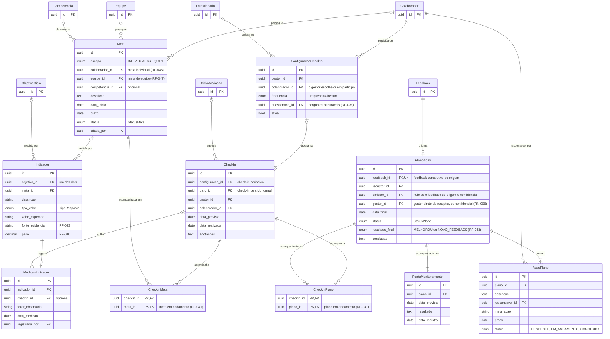

# Modelo de Domínio e Entidade-Relacionamento (Issue #52)

Projeto: Sistema Web de Feedback e Gestão de Competências · Disciplina Domínios de Software (INF0296, 2026/2)

**Entrada:** [Lista Geral de Requisitos](../../Lista_Geral_Requisitos.md) (#45), versão 1.1 · **Versão deste modelo:** 1.2
**Notação:** diagramas `erDiagram` em [Mermaid](https://mermaid.js.org/syntax/entityRelationshipDiagram.html), renderizados direto pelo GitHub. Os diagramas Mermaid desta página são a fonte do modelo. As imagens em [`img/`](img/), em PNG e SVG, foram geradas desses diagramas com o Mermaid CLI na versão 1.2 do modelo (18/11/2026), uma por seção: `00` é a visão geral (seção 3) e `01` a `06` são as seções 4 a 9.

---

## Sumário

1. [Objetivo e escopo](#1-objetivo-e-escopo)
2. [Convenções](#2-convenções)
3. [Visão geral do domínio](#3-visão-geral-do-domínio)
4. [Organização, usuários e acesso](#4-organização-usuários-e-acesso)
5. [Competências e questionários](#5-competências-e-questionários)
6. [Fatos, feedbacks e sessões](#6-fatos-feedbacks-e-sessões)
7. [Ciclos de avaliação, respostas e anonimato](#7-ciclos-de-avaliação-respostas-e-anonimato)
8. [Metas, indicadores, check-ins e planos de ação](#8-metas-indicadores-check-ins-e-planos-de-ação)
9. [LGPD, auditoria e notificações](#9-lgpd-auditoria-e-notificações)
10. [Tratamento do anonimato no modelo](#10-tratamento-do-anonimato-no-modelo)
11. [Dicionário de enumerações](#11-dicionário-de-enumerações)
12. [Rastreabilidade entidade × requisito](#12-rastreabilidade-entidade--requisito)
13. [Decisões de modelagem](#13-decisões-de-modelagem)
14. [Referências](#14-referências)
15. [Histórico de revisões](#15-histórico-de-revisões)

---

## 1. Objetivo e escopo

Representar as entidades do domínio, seus atributos, relacionamentos e cardinalidades, de forma que todo requisito funcional e toda regra de negócio da lista geral que guarde dados tenha onde ser armazenado. O modelo é **conceitual/lógico**: não define SGBD, índices nem tipos físicos. Ele serve de entrada para o glossário, para os casos de uso e para a matriz de rastreabilidade (#49).

Requisitos que não geram dados próprios (desempenho, acessibilidade, idioma, responsividade) ficam fora do modelo. A trilha de auditoria (RNF-005) e o armazenamento separado do vínculo confidencial (RNF-003) entram, porque mudam a estrutura dos dados.

## 2. Convenções

- Nomes de entidades e atributos sem acento, em `PascalCase` e `snake_case`, para não depender do suporte a Unicode do renderizador.
- `PK` = chave primária, `FK` = chave estrangeira, `UK` = valor único.
- Cardinalidade em pé de galinha: `||` exatamente um, `o|` zero ou um, `|{` um ou mais, `o{` zero ou mais.
- Tipos genéricos: `uuid`, `string`, `text`, `int`, `decimal`, `bool`, `date`, `datetime`, `enum` (valores na [seção 11](#11-dicionário-de-enumerações)).
- Cada diagrama mostra os atributos completos das entidades da sua área. Entidades de outras áreas aparecem só com a chave, para indicar a ligação.
- Cada instalação atende a uma única organização (RN-010), por isso não há entidade `Organizacao` em todas as tabelas: as configurações gerais ficam em `ConfiguracaoOrganizacao`, com uma única linha.

## 3. Visão geral do domínio

Entidades principais e como se relacionam, sem atributos. As seções seguintes detalham cada área.

## 4. Organização, usuários e acesso

Cadastro da estrutura organizacional (RF-001, RF-002) e dos perfis de acesso (RF-003). A hierarquia tem quantos níveis forem necessários, com um autorrelacionamento em `Colaborador` (gestor direto). O mesmo colaborador pode acumular perfis, por isso o perfil fica em uma entidade associativa.

**Notas**

- Todo colaborador tem ao menos o perfil `COLABORADOR`. O gestor que também é avaliado pelo seu superior tem `COLABORADOR` e `GESTOR` (RF-003).
- Os perfis `DIRETORIA` e `ENCARREGADO` têm acesso restrito à sua função (RF-003): a diretoria vê só `ResultadoConsolidado` agregado da organização (RNF-001, RN-005), e o encarregado acessa `SolicitacaoTitular` e `IncidenteSeguranca` (RF-061, RF-063).
- `falhas_login_consecutivas` e `login_bloqueado_ate` guardam a espera crescente após falhas de login e a desativação do autenticador em 100 falhas consecutivas (RNF-006, decisão DS-06 da especificação suplementar).
- `gestor_id` nulo indica o topo da hierarquia. O gestor direto é a base da regra de visibilidade de RNF-001.
- Não há campos para dados sensíveis (RN-013). A data de nascimento é coletada para identificar menores (RN-016). A condição de menor de idade é calculada a partir dela, sem atributo próprio, e muda sozinha quando o colaborador faz 18 anos (decisão M-07).

## 5. Competências e questionários

Competências fixas por cargo (RF-005) e específicas por colaborador (RF-006), questionários reutilizáveis (RF-007), questionário padrão com perguntas acrescentadas pelo gestor (RF-008) e tipos de resposta (RF-009).

**Notas**

- Atribuir competências "a um grupo" (RF-006) gera uma linha de `CompetenciaAtribuida` por membro, o que mantém o histórico individual.
- Perguntas sobre personalidade, vida privada ou critérios discriminatórios são proibidas (RN-001, RN-014). Isso é controlado na revisão do questionário, não pelo esquema.

## 6. Fatos, feedbacks e sessões

Registro de fatos (RF-011, RF-012), feedback com versões (RF-013, RF-016, RN-002, RN-003), réplica (RF-020), competências do feedback (RF-021), avaliação da sessão (RF-034), solicitação de feedback (RF-031) e sessão agendada (RF-037 a RF-039).

```mermaid
erDiagram
    Fato {
        uuid id PK
        uuid autor_id FK "quem registrou"
        uuid observado_id FK "colaborador observado"
        uuid observado_equipe_id FK "equipe observada como um todo (UC08-D02)"
        date data_ocorrencia
        text descricao
        bool eh_relato "RF-012"
        uuid relator_id FK "oculto para o receptor"
        bool confirmado_pelo_autor "relato so embasa feedback se confirmado"
        datetime registrado_em
    }
    Feedback {
        uuid id PK
        uuid emissor_id FK "nulo apos o envio se confidencial"
        decimal peso "peso no periodo (RF-010)"
        uuid receptor_colaborador_id FK "um dos dois receptores"
        uuid receptor_equipe_id FK
        enum tipo "TipoFeedback"
        enum modalidade "FORMAL ou INFORMAL"
        enum direcao "DirecaoFeedback"
        enum modo_identificacao "ModoIdentificacao (RN-004)"
        enum visibilidade "Visibilidade (RNF-002)"
        uuid ciclo_id FK "so feedback formal"
        uuid solicitacao_id FK "quando atende a uma solicitacao"
        date data_feedback
        enum postura_receptor "avaliada pelo emissor (RF-034)"
        bool agregou_valor "avaliado pelo receptor (RF-034)"
        enum status "RASCUNHO, ENVIADO"
        datetime enviado_em
    }
    VersaoFeedback {
        uuid id PK
        uuid feedback_id FK
        int numero "1, 2, 3... (RN-003)"
        text descricao
        text acao_comportamento "positivo"
        text resultados "positivo"
        text repercussao "positivo e construtivo"
        text aspecto_positivo "construtivo"
        text problema "construtivo"
        text reflexao "construtivo"
        datetime criada_em
        uuid criada_por FK "nulo se o feedback e confidencial"
    }
    FeedbackFato {
        uuid feedback_id PK, FK
        uuid fato_id PK, FK
    }
    FeedbackCompetencia {
        uuid feedback_id PK, FK
        uuid competencia_id PK, FK
    }
    MembroFeedbackEquipe {
        uuid feedback_id PK, FK "feedback com receptor equipe"
        uuid colaborador_id PK, FK "membro na data do feedback"
    }
    DestinatarioVisibilidade {
        uuid feedback_id PK, FK "visibilidade AMPLIADA"
        uuid colaborador_id PK, FK "pessoa incluida pelo emissor (RNF-002)"
        datetime ampliada_em
    }
    DisponibilidadeAgenda {
        uuid id PK
        uuid colaborador_id FK
        datetime inicio "horario livre (RF-038)"
        datetime fim
    }
    TermoOfensivo {
        uuid id PK
        string termo UK "lista do administrador (RNF-024, DS-13)"
        bool ativo
        uuid cadastrado_por FK
    }
    Replica {
        uuid id PK
        uuid feedback_id FK
        uuid autor_id FK "receptor"
        text texto
        datetime registrada_em
    }
    SolicitacaoFeedback {
        uuid id PK
        uuid solicitante_id FK
        string tema
        date prazo
        datetime criada_em
    }
    DestinatarioSolicitacao {
        uuid solicitacao_id PK, FK
        uuid destinatario_id PK, FK
        enum status "PENDENTE, ATENDIDA, RECUSADA"
    }
    SessaoFeedback {
        uuid id PK
        uuid feedback_id FK "opcional"
        uuid organizador_id FK
        datetime data_hora
        string assunto
        text pauta_compartilhada "RF-039"
        enum status "AGENDADA, REALIZADA, CANCELADA"
    }
    ParticipanteSessao {
        uuid sessao_id PK, FK
        uuid colaborador_id PK, FK
        text anotacao_privada "visivel so ao proprio (RF-039)"
    }
    Colaborador { uuid id PK }
    Equipe { uuid id PK }
    Competencia { uuid id PK }
    CicloAvaliacao { uuid id PK }

    Colaborador ||--o{ Fato : registra
    Colaborador |o--o{ Fato : "e observado em"
    Equipe |o--o{ Fato : "e observada em"
    Colaborador |o--o{ Fato : "relata"
    Colaborador |o--o{ Feedback : emite
    Colaborador |o--o{ Feedback : recebe
    Equipe |o--o{ Feedback : recebe
    Feedback ||--o{ MembroFeedbackEquipe : "entregue a"
    Colaborador ||--o{ MembroFeedbackEquipe : "recebe em grupo"
    Feedback ||--o{ DestinatarioVisibilidade : "ampliado a"
    Colaborador ||--o{ DestinatarioVisibilidade : "ve por ampliacao"
    Colaborador ||--o{ DisponibilidadeAgenda : informa
    Colaborador ||--o{ TermoOfensivo : cadastra
    Feedback ||--|{ VersaoFeedback : "tem versoes"
    Feedback ||--|{ FeedbackFato : "baseado em"
    Fato ||--o{ FeedbackFato : embasa
    Feedback ||--o{ FeedbackCompetencia : "trata de"
    Competencia ||--o{ FeedbackCompetencia : "tratada em"
    Feedback ||--o{ Replica : recebe
    CicloAvaliacao |o--o{ Feedback : contem
    Colaborador ||--o{ SolicitacaoFeedback : solicita
    SolicitacaoFeedback ||--|{ DestinatarioSolicitacao : "enviada a"
    SolicitacaoFeedback |o--o{ Feedback : "atendida por"
    Feedback |o--o{ SessaoFeedback : "discutido em"
    SessaoFeedback ||--|{ ParticipanteSessao : reune
    Colaborador ||--o{ ParticipanteSessao : participa
```

**Notas**

- **Campos obrigatórios (RN-002):** emissor, receptor, data, tipo, modalidade e ao menos um fato. Por isso `Feedback ||--|{ FeedbackFato` (um ou mais). No modo confidencial, o emissor existe e fica em `VinculoConfidencial` (seção 10), e não em `emissor_id`. Um feedback nunca é anônimo: o anonimato só existe nas respostas de avaliação de um ciclo (ERS-D03).
- **Rascunho e autor das versões no modo confidencial:** enquanto o feedback é rascunho, `emissor_id` fica preenchido e só o autor vê o rascunho (RNF-012). No envio, o emissor passa para `VinculoConfidencial` e `emissor_id` fica nulo. `VersaoFeedback.criada_por` também fica nulo, porque só o emissor edita o feedback (RN-003) e o autor de cada versão é o do vínculo (RNF-003).
- **Fato observado:** exatamente um entre `observado_id` e `observado_equipe_id` deve estar preenchido. O fato sobre a equipe como um todo só embasa feedback para a equipe (RN-001, decisão UC08-D02).
- **Visibilidade ampliada (RNF-002):** quando o emissor amplia a visibilidade, cada pessoa incluída fica em `DestinatarioVisibilidade`.
- **Peso (RF-010):** `Feedback.peso` e `Indicador.peso` são os pesos pedidos pelo RF-010. Os pesos de `CargoCompetencia`, `Pergunta` e `ModalidadeCiclo` são escolha de projeto, e todo peso usado no cálculo é exibido junto com o resultado (RN-008).
- **Apoio a outras funções:** `DisponibilidadeAgenda` guarda os horários livres usados para sugerir horários da sessão (RF-038), e `TermoOfensivo`, a lista de termos que o sistema sinaliza ao emissor (RNF-024, DS-13).
- **Receptor:** exatamente um entre `receptor_colaborador_id` e `receptor_equipe_id` deve estar preenchido (restrição de verificação).
- **Feedback para equipe no perfil individual (M-09):** ao enviar um feedback para uma equipe, o sistema grava em `MembroFeedbackEquipe` quem era membro naquela data. O feedback aparece no histórico e no perfil de cada um desses membros (RF-048), sinalizado como "feedback em grupo". O conteúdo continua em um único `Feedback`, e quem entrar na equipe depois não o recebe.
- **Não exclusão e versões (RN-003):** não há exclusão de `Feedback`. Toda edição cria uma nova `VersaoFeedback`; a versão vigente é a de maior `numero`.
- **Fato privado até o vínculo (RF-011):** enquanto não houver linha em `FeedbackFato`, só o `autor_id` vê o fato.
- **Relato (RF-012):** `relator_id` nunca é exibido ao receptor. Um fato com `eh_relato = true` só pode ser vinculado a um feedback se `confirmado_pelo_autor = true`.

## 7. Ciclos de avaliação, respostas e anonimato

Planejamento do ciclo formal (RF-022, RF-023), combinação de modalidades (RF-024, RF-025), modo de identificação por modalidade (RF-030), convites e não respondentes (RF-027, RF-029), consolidação (RF-032, RF-033) e ocultação de resposta inadequada (RF-035).

**Notas**

- **Não há relacionamento entre `ConviteAvaliacao` e `RespostaAvaliacao`.** O convite sabe quem foi convidado e se respondeu (RF-029); a resposta sabe o que foi respondido. Essa separação é o centro do tratamento do anonimato (seção 10).
- **Autoavaliação e gestor → colaborador** são identificados (RN-004), por isso a resposta guarda `avaliador_id`. A comparação da autoavaliação com os demais avaliadores (RF-033) usa a modalidade `AUTOAVALIACAO` contra o `ResultadoConsolidado` das outras.
- **360° (RF-025):** os convites só podem ser feitos a membros da equipe do gestor que abriu o ciclo. É uma regra de aplicação, verificada pela hierarquia de `Colaborador`.
- **Ocultação (RF-035):** a resposta não é apagada; `oculta_pelo_rh` a retira da visão do avaliado e a ação vai para `RegistroAuditoria`.

## 8. Metas, indicadores, check-ins e planos de ação

Indicadores de objetivos de ciclo e de metas (RF-023, RF-046, RF-047), check-ins periódicos (RF-041, RF-036), plano de ação a partir de feedback construtivo (RF-042 a RF-045).

**Notas**

- `Indicador` pertence a um objetivo de ciclo **ou** a uma meta (exatamente um dos dois FKs preenchido). Assim, a evolução de qualquer indicador no painel (RF-049) vem sempre de `MedicaoIndicador`.
- O plano de ação só pode nascer de um feedback de tipo `CONSTRUTIVO` (RF-042) e é definido em conjunto pelo receptor e pelo emissor (RN-006), por isso guarda os dois. Se o feedback de origem for confidencial, o plano é definido pelo receptor e pelo seu gestor direto: `emissor_id` fica nulo e `gestor_id` é preenchido, para não revelar o emissor (RN-004, RN-006, ERS-D05).
- O plano registrado pelo emissor fica com o status `AGUARDANDO_CONFIRMACAO` até o receptor confirmar, o que registra a definição conjunta (RN-006, decisão UC19-D01).
- O resultado da meta fica só em `Meta.status` (`ATINGIDA` ou `NAO_ATINGIDA`), sem atributo repetido (RF-047).
- O check-in periódico fica ligado às metas e aos planos em andamento por `CheckInMeta` e `CheckInPlano` (RF-041).
- "Quais feedbacks e planos resultaram em melhora" (RF-045) é uma consulta sobre `PlanoAcao.resultado_final`.

## 9. LGPD, auditoria e notificações

Inventário de dados e retenção (RF-054, RF-062, RN-011), consentimento (RF-055, RN-012), direitos do titular (RF-056 a RF-061), incidentes (RF-063), trilha de auditoria (RNF-005) e lembretes (RF-037, RF-040).

```mermaid
erDiagram
    CategoriaDado {
        uuid id PK
        string nome UK "cadastro, feedbacks, planos, acessos..."
        text finalidade "RF-054"
        enum base_legal "BaseLegal"
        int prazo_retencao_meses "RF-062"
        enum acao_fim_prazo "ELIMINAR ou ANONIMIZAR"
    }
    CompartilhamentoDados {
        uuid id PK
        uuid categoria_id FK
        string entidade_destino "RF-060"
        enum tipo_entidade "PUBLICA ou PRIVADA"
        text finalidade
        bool inclui_menores "falso por padrao (RN-016)"
        text justificativa_menores "obrigatoria se inclui_menores"
        date data_inicio
        date data_fim
    }
    BloqueioLegal {
        uuid id PK
        uuid colaborador_id FK
        string numero_processo "suspende a eliminacao (RF-062)"
        date data_inicio
        date data_fim
    }
    TermoConsentimento {
        uuid id PK
        text finalidade "so funcionalidade opcional (RN-012)"
        string versao
        text texto
        date vigente_desde
    }
    Consentimento {
        uuid id PK
        uuid colaborador_id FK
        uuid termo_id FK
        datetime concedido_em
        datetime revogado_em
    }
    SolicitacaoTitular {
        uuid id PK
        uuid titular_id FK
        enum tipo "TipoSolicitacaoTitular"
        datetime aberta_em
        date prazo "15 dias para declaracao completa (RF-056)"
        enum status "ABERTA, EM_ANALISE, ATENDIDA, NEGADA"
        uuid responsavel_id FK "RH ou encarregado"
        text resposta
        datetime respondida_em
    }
    IncidenteSeguranca {
        uuid id PK
        datetime detectado_em
        text descricao
        text dados_afetados
        text medidas_adotadas
        bool comunicado_anpd
        date guardar_ate "minimo 5 anos (RF-063)"
    }
    TitularAfetado {
        uuid incidente_id PK, FK
        uuid colaborador_id PK, FK
        datetime comunicado_em
    }
    RegistroAuditoria {
        uuid id PK
        uuid ator_id FK "nulo so nas rotinas automaticas (UC-30)"
        datetime data_hora
        enum acao "AcaoAuditoria"
        string entidade
        uuid entidade_id
        string ip_origem
        text detalhes
        string hash_anterior "encadeamento, torna a trilha inalteravel"
    }
    Notificacao {
        uuid id PK
        uuid destinatario_id FK
        enum tipo "TipoNotificacao"
        string entidade
        uuid entidade_id
        datetime agendada_para
        datetime enviada_em
        bool lida
    }
    PreferenciaNotificacao {
        uuid colaborador_id PK, FK
        enum tipo PK "TipoNotificacao"
        bool ativa "RF-040"
    }
    Colaborador { uuid id PK }

    CategoriaDado ||--o{ CompartilhamentoDados : "compartilhada em"
    Colaborador ||--o{ BloqueioLegal : "sujeito a"
    TermoConsentimento ||--o{ Consentimento : "aceito em"
    Colaborador ||--o{ Consentimento : concede
    Colaborador ||--o{ SolicitacaoTitular : abre
    Colaborador |o--o{ SolicitacaoTitular : "responde"
    IncidenteSeguranca ||--o{ TitularAfetado : afeta
    Colaborador ||--o{ TitularAfetado : "afetado por"
    Colaborador |o--o{ RegistroAuditoria : "ator de"
    Colaborador ||--o{ Notificacao : recebe
    Colaborador ||--o{ PreferenciaNotificacao : configura
```

**Notas**

- `RegistroAuditoria` é somente inclusão: não há alteração nem exclusão, e cada registro guarda o hash do anterior. Toda leitura de `VinculoConfidencial` gera um registro com `acao = CONSULTA_IDENTIDADE` (RNF-003, RNF-005).
- Os registros de acesso (RNF-032) são uma `CategoriaDado` com prazo mínimo de 6 meses.
- **Prazo de retenção:** o prazo de cada `CategoriaDado` prevalece. `ConfiguracaoOrganizacao.retencao_pos_desligamento_meses` é o padrão de feedbacks, avaliações e planos de ação (RN-011) e vale quando a categoria não define prazo próprio (RF-062).
- **Menores de 18 anos (RN-016):** um compartilhamento só abrange dados de menores se `inclui_menores` for verdadeiro, com justificativa registrada.
- A exportação dos dados do titular (RF-058) e o relatório do histórico (RF-051) são consultas sobre as entidades das seções 6 a 8, sem tabela própria.

## 10. Tratamento do anonimato no modelo

O requisito central é desvincular o avaliador da resposta quando a modalidade não é identificada (RN-004, RN-005, RNF-003). O modelo trata os três modos assim:

| Modo | Onde fica a identidade do emissor | Quem consegue ligar emissor e resposta |
|---|---|---|
| `IDENTIFICADO` | `RespostaAvaliacao.avaliador_id` ou `Feedback.emissor_id` | Receptor, gestor direto e RH (RNF-001) |
| `CONFIDENCIAL` | Só em `VinculoConfidencial`, guardado em esquema separado, com chave de criptografia própria. `avaliador_id` e `emissor_id` ficam nulos | Só o RH, e toda consulta vai para a trilha de auditoria. O RH nunca consulta o vínculo de avaliações em que ele é o avaliado (RN-004) |
| `ANONIMO` | Em lugar nenhum. Não se cria `VinculoConfidencial` | Ninguém, nem RH nem administrador |

Mecanismos que garantem a desvinculação:

1. **Convite e resposta sem chave em comum.** `ConviteAvaliacao` registra quem foi convidado e o `status`; `RespostaAvaliacao` registra o conteúdo, sem FK para o convite. Ao enviar, a aplicação marca o convite como `RESPONDIDO` e grava a resposta em transações separadas.
2. **Sem marca de tempo que permita correlacionar.** A resposta guarda só a data (`data_envio`), e o convite não guarda o momento do envio. Assim não dá para cruzar o horário da resposta com o horário em que o convite mudou de status.
3. **Identificadores aleatórios.** As chaves são `uuid` aleatórios (não sequenciais), para que a ordem de inserção não revele a ordem dos convites.
4. **Rascunho preso ao convite, não à resposta.** O autossalvamento (RNF-012) precisa saber de quem é o rascunho, por isso ele fica cifrado em `ConviteAvaliacao.rascunho_cifrado` e é apagado quando a resposta é enviada.
5. **Exibição só agregada e com mínimo de respondentes (RN-005).** Para modalidades `CONFIDENCIAL` e `ANONIMO`, o avaliado só vê `ResultadoConsolidado`, nunca `ItemResposta`. Se o número de respostas da modalidade for menor que `min_respondentes` (padrão 3), elas são somadas a outra categoria (`AGREGADO`) ou omitidas.
6. **Textos livres.** Comentários de modalidades não identificadas aparecem sem autor e só quando o mínimo de respondentes é atingido. A orientação do RF-018 reduz o risco de o texto identificar quem escreveu.
7. **Relatos (RF-012).** `Fato.relator_id` é dado de acesso restrito ao autor do fato, nunca exposto ao receptor.

Consequência aceita: no modo `ANONIMO` o emissor não pode editar a resposta depois do envio, porque o sistema não sabe mais qual resposta é dele. No modo `CONFIDENCIAL`, a edição é possível por meio do vínculo, com registro na auditoria.

## 11. Dicionário de enumerações

| Enumeração | Valores |
|---|---|
| `Perfil` | `COLABORADOR`, `GESTOR`, `RH`, `ADMINISTRADOR`, `DIRETORIA`, `ENCARREGADO` |
| `SituacaoColaborador` | `ATIVO`, `AFASTADO`, `DESLIGADO`, `ANONIMIZADO` |
| `TipoResposta` | `ESCALA_ORDINAL`, `NUMERICO`, `ATINGIDO_NAO_ATINGIDO`, `TEXTO_LIVRE` |
| `TipoFeedback` | `POSITIVO`, `CONSTRUTIVO` |
| `DirecaoFeedback` | `GESTOR_COLABORADOR`, `ASCENDENTE`, `PARES`, `EQUIPE`, `AUTOAVALIACAO`, `OUTRA_AREA` |
| `ModalidadeAvaliacao` | `GESTOR_COLABORADOR`, `ASCENDENTE`, `PARES`, `EQUIPE`, `AUTOAVALIACAO`, `AVALIACAO_360` |
| `ModoIdentificacao` | `IDENTIFICADO`, `CONFIDENCIAL`, `ANONIMO` |
| `Visibilidade` | `PUBLICO_MINIMO` (padrão, RNF-001), `AMPLIADA` (só por ação do emissor, RNF-002) |
| `PosturaReceptor` | `COLABORATIVA`, `REATIVA` |
| `StatusCiclo` | `PLANEJADO`, `ABERTO`, `ENCERRADO`, `RESULTADOS_LIBERADOS` |
| `StatusConvite` | `PENDENTE`, `RESPONDIDO`, `EXPIRADO` |
| `StatusMeta` | `EM_ANDAMENTO`, `ATINGIDA`, `NAO_ATINGIDA`, `CANCELADA` |
| `StatusPlano` | `AGUARDANDO_CONFIRMACAO`, `ABERTO`, `EM_ACOMPANHAMENTO`, `CONCLUIDO` |
| `FrequenciaCheckIn` | `SEMANAL`, `QUINZENAL`, `MENSAL` |
| `AcaoAuditoria` | `CONSULTA`, `CRIACAO`, `ALTERACAO`, `OCULTACAO`, `CONSULTA_IDENTIDADE`, `EXPORTACAO`, `ANONIMIZACAO`, `ELIMINACAO` |
| `BaseLegal` | `EXECUCAO_CONTRATO`, `LEGITIMO_INTERESSE`, `OBRIGACAO_LEGAL`, `CONSENTIMENTO`, `EXERCICIO_DIREITOS` |
| `TipoSolicitacaoTitular` | `CONFIRMACAO_ACESSO`, `CORRECAO`, `ANONIMIZACAO_BLOQUEIO_ELIMINACAO`, `PORTABILIDADE`, `INFORMACAO_COMPARTILHAMENTO`, `REVOGACAO_CONSENTIMENTO` |
| `TipoNotificacao` | `SESSAO_AGENDADA`, `LEMBRETE_SESSAO`, `AVALIACAO_PENDENTE`, `CHECKIN`, `PRAZO_PLANO`, `CICLO_ABERTO`, `RESPOSTA_OCULTADA`, `FEEDBACK_RECEBIDO`, `PLANO_PARA_CONFIRMAR` |

## 12. Rastreabilidade entidade × requisito

| Entidade | Requisitos atendidos |
|---|---|
| `Colaborador`, `Cargo`, `Equipe` | RF-001, RF-048, RNF-001, RN-013, RN-016 |
| `Colaborador` (controle de falhas de login) | RNF-006 |
| `PerfilColaborador` | RF-003, RNF-001, RNF-006 |
| `ImportacaoCadastro` | RF-002 |
| `ConfiguracaoOrganizacao` | RN-005, RN-010, RN-011, RF-053, RF-064, RF-065 |
| `Competencia`, `CargoCompetencia`, `CompetenciaAtribuida` | RF-005, RF-006, RN-014 |
| `Questionario`, `Pergunta` | RF-007, RF-008, RF-009, RF-010, RNF-026, RN-001 |
| `Fato` | RF-011, RF-012, RN-001 |
| `DestinatarioVisibilidade` | RNF-002 |
| `DisponibilidadeAgenda` | RF-038 |
| `TermoOfensivo` | RNF-024 |
| `Feedback` (peso no período) | RF-010 |
| `Feedback`, `FeedbackFato`, `FeedbackCompetencia` | RF-013, RF-014, RF-015, RF-021, RF-034, RN-002, RN-004, RNF-002 |
| `MembroFeedbackEquipe` | RF-013, RF-048 |
| `VersaoFeedback` | RF-016, RN-003 |
| `Replica` | RF-020 |
| `SolicitacaoFeedback`, `DestinatarioSolicitacao` | RF-031 |
| `SessaoFeedback`, `ParticipanteSessao` | RF-037, RF-038, RF-039 |
| `CicloAvaliacao`, `AvaliadoCiclo`, `CicloCompetencia`, `ObjetivoCiclo` | RF-022, RF-026 |
| `ModalidadeCiclo` | RF-024, RF-025, RF-030, RN-004 |
| `ConviteAvaliacao` | RF-025, RF-027, RF-029, RNF-012 |
| `RespostaAvaliacao`, `ItemResposta` | RF-027, RF-028, RF-035 |
| `VinculoConfidencial` | RNF-003, RN-004 |
| `ResultadoConsolidado` | RF-032, RF-033, RF-049, RF-050, RF-052, RN-005, RN-008, RNF-007 |
| `Indicador`, `MedicaoIndicador` | RF-023, RF-046, RF-049 |
| `Meta` | RF-046, RF-047 |
| `ConfiguracaoCheckIn`, `CheckIn`, `CheckInMeta`, `CheckInPlano` | RF-036, RF-041 |
| `PlanoAcao`, `AcaoPlano`, `PontoMonitoramento` | RF-042, RF-043, RF-044, RF-045, RN-006 |
| `CategoriaDado`, `CompartilhamentoDados` | RF-054, RF-060, RF-062, RNF-032 |
| `CompartilhamentoDados` (dados de menores) | RN-016 |
| `BloqueioLegal` | RF-062 |
| `TermoConsentimento`, `Consentimento` | RF-055, RN-012 |
| `SolicitacaoTitular` | RF-056, RF-057, RF-058, RF-059, RF-061 |
| `IncidenteSeguranca`, `TitularAfetado` | RF-063 |
| `RegistroAuditoria` | RNF-005, RF-035, RF-058, RF-062 |
| `Notificacao`, `PreferenciaNotificacao` | RF-026, RF-037, RF-040 |

## 13. Decisões de modelagem

| # | Decisão de modelagem | Justificativa |
|---|---|---|
| M-01 | Perfil em entidade associativa, não como atributo do colaborador | Um usuário acumula perfis (RF-003) |
| M-02 | Hierarquia por autorrelacionamento `gestor_id` | Número de níveis livre (RF-001) |
| M-03 | Conteúdo do feedback em `VersaoFeedback` | Edição sem perder a versão anterior (RN-003, ponto P-04 da lista geral) |
| M-04 | `ConviteAvaliacao` sem FK para `RespostaAvaliacao` e `VinculoConfidencial` em esquema separado | Desvincular emissor e resposta (RN-004, RNF-003, ponto P-01) |
| M-05 | `Indicador` único para objetivos de ciclo e metas | Uma só fonte para os gráficos de evolução (RF-049) |
| M-06 | Configurações gerais em `ConfiguracaoOrganizacao` de linha única | Uma organização por instalação (RN-010) |
| M-07 | Coletar `data_nascimento` e calcular a condição de menor de idade a partir dela | Decisão da equipe. A data identifica o menor (RN-016) e permite saber quando ele deixa de sê-lo, sem depender de atualização manual de um indicador |
| M-08 | `ResultadoConsolidado` guardado ao encerrar o ciclo (RF-032), não calculado a cada consulta | Decisão da equipe. O resultado liberado ao avaliado não muda depois, mesmo que uma resposta seja ocultada ou um dado seja anonimizado mais tarde, e o histórico (RF-048) e os painéis (RF-049, RF-050) leem valores prontos |
| M-09 | Feedback para equipe aparece no perfil de cada membro, sinalizado como "feedback em grupo", com os membros da data do envio guardados em `MembroFeedbackEquipe` | Decisão da equipe. O colaborador vê no próprio histórico (RF-048) tudo o que recebeu, e a lista de membros fixa na data impede que quem entrou depois veja o feedback e que quem saiu o perca |
| M-10 | Ajustes da revisão final (versão 1.1), listados na seção 14 | Aplicam as inconsistências I-01 e I-04 a I-13 do [dicionário de dados](../../Dicionario_de_Dados.md) (seção 5.2), as decisões UC08-D01, UC08-D02 e UC19-D01 dos casos de uso completos e as decisões ERS-D02, ERS-D05 e ERS-D08 da [especificação IEEE 830](../../Especificacao_Requisitos_IEEE830.md) (Apêndice C), que pediam esses ajustes no modelo |

## 14. Referências

**Uso de inteligência artificial**

- ANTHROPIC. Claude Code (modelo Claude Opus 5.5). Disponível em: https://claude.com/claude-code. Acesso em: 17 nov. 2026. Usado para redigir a versão inicial deste modelo e os diagramas em Mermaid a partir da issue #52 e dos artefatos da 1ª etapa. Questão: Apêndice II, Seção II.1 ([Apêndice II](../../arquitetura/Apendice_II_Prompts_IA.md)).

A lista consolidada do projeto está em [Referências](../../arquitetura/Referencias.md).

---

## 15. Histórico de revisões

| Versão | Data | Descrição |
|---|---|---|
| 1.0 | 17/11/2026 | Versão inicial (#52) |
| 1.1 | 17/11/2026 | Revisão final (#55). Perfis `DIRETORIA` e `ENCARREGADO` (RF-003, I-01). Emissor e autor das versões de feedback confidencial só no vínculo, com o rascunho ligado ao autor até o envio (I-04). `Feedback.peso` e regra de exibição dos pesos (I-06). Prazo da categoria prevalece sobre o padrão da organização (I-07). Removido `Meta.atingida` (I-08). Enumerações `AcaoAuditoria` e `FrequenciaCheckIn` fechadas e domínio de `ResultadoConsolidado.modalidade` explicitado (I-09). `CheckInMeta` e `CheckInPlano` (I-10). `DestinatarioVisibilidade` (I-11). `CompartilhamentoDados.inclui_menores` (I-12). `DisponibilidadeAgenda`, `TermoOfensivo` e controle de falhas de login em `Colaborador` (I-13). `Fato.observado_equipe_id` (UC08-D02). `FEEDBACK_RECEBIDO` e `PLANO_PARA_CONFIRMAR` em `TipoNotificacao` e `AGUARDANDO_CONFIRMACAO` em `StatusPlano` (UC08-D01, UC19-D01). `PlanoAcao.gestor_id` para plano de feedback confidencial (ERS-D05). Piso de 3 em `min_respondentes` (ERS-D08) |
| 1.2 | 18/11/2026 | `RegistroAuditoria.ator_id` opcional (cardinalidade zero ou um com `Colaborador`): as ações das rotinas automáticas do relógio do sistema, como a eliminação da política de retenção (UC-30), não têm usuário, mas precisam ser auditadas (RNF-005, RF-062). Imagens de `img/` geradas de novo a partir dos diagramas desta versão, com o dobro da resolução das anteriores |
| 1.3 | 22/11/2026 | Seção 14, Referências, com o registro do uso de IA na versão inicial (#107) |
